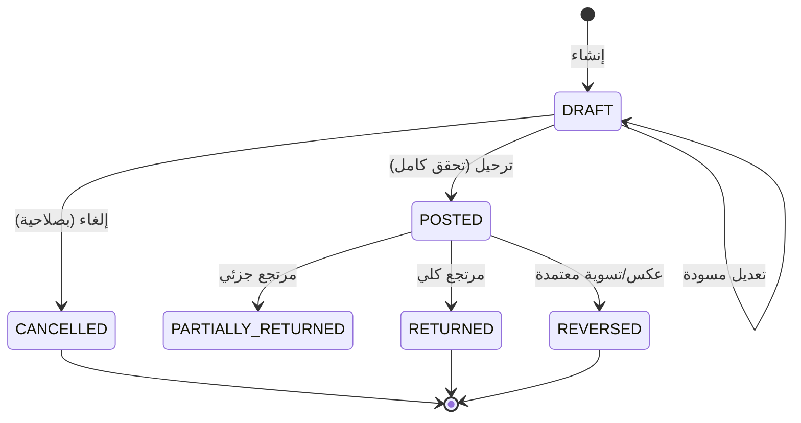
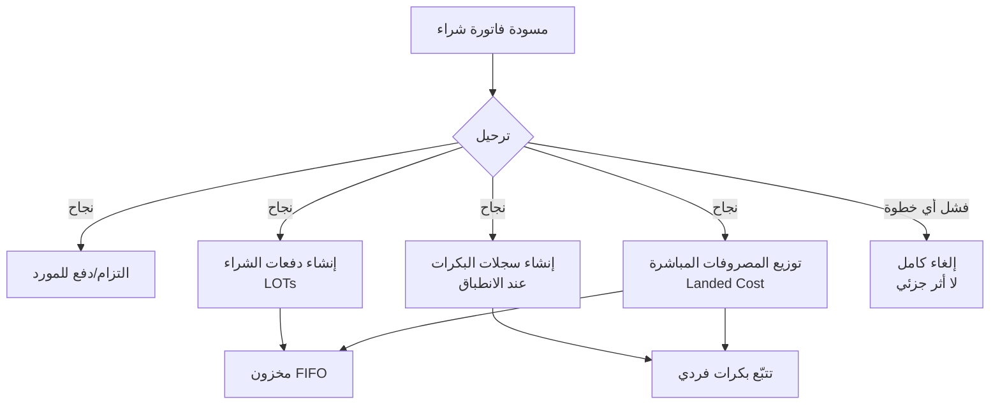
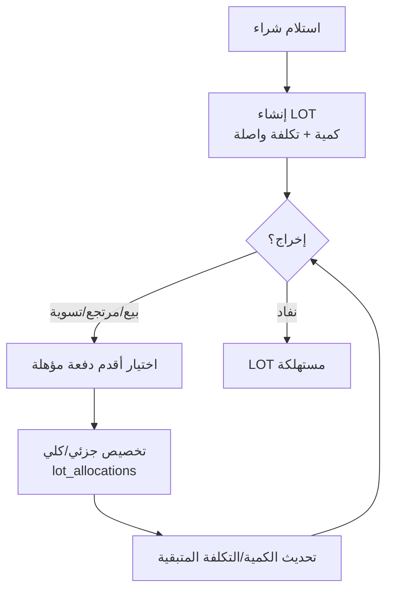

# قواعد العمل — Mizan V1

| البند | القيمة |
|---|---|
| الوثيقة | `02_BUSINESS_RULES.md` |
| الإصدار | 0.3.0 — Batch 1 |
| الحالة | **PROPOSED / بانتظار اعتماد المالك** |
| النطاق | قواعد العمل والسلوك المتوقّع، لا تفاصيل التنفيذ |
| التنفيذ | لم يبدأ |

> هذه الوثيقة تحوّل المتطلبات إلى **قواعد قابلة للتطبيق والاختبار**. كل قاعدة لها معرّف ثابت (`BR-*`). لا يجوز تنفيذ سلوك يخالف قاعدة **CONFIRMED**. القواعد **PROPOSED** و**OPEN** لا تصبح ملزمة قبل اعتمادها.

## 1. اصطلاحات

| المصطلح | المعنى |
|---|---|
| **مسودة (DRAFT)** | مستند قابل للتعديل، بلا أثر مخزني أو محاسبي. |
| **مرحّل (POSTED)** | مستند نهائي أنشأ حركاته المخزنية وقيوده المحاسبية في معاملة واحدة. |
| **ملغى (CANCELLED)** | مسودة أُلغيت؛ لا أثر مخزني/محاسبي، ويُسجَّل الإلغاء في التدقيق. |
| **مرتجع (RETURN)** | مستند جديد يعكس جزئيًا/كليًا أثر مستند أصلي، ولا يعدّله. |
| **عكس (REVERSAL)** | قيد/مستند جديد يعكس قيدًا سابقًا دون حذفه. |
| **دفعة شراء (LOT)** | كمية من منتج دخلت من فاتورة شراء محددة، بتكلفة قابلة للتتبّع. |
| **بكرة (REEL)** | وحدة سلك/كابل فردية لها طول وتكلفة وحالة. |
| **التكلفة الواصلة (LANDED COST)** | سعر المورد + حصة مصروفات الشراء المباشرة الموزعة. |
| **سعر المورد (SUPPLIER INVOICE COST)** | قيمة البند كما وردت في فاتورة المورد، قبل مصروفات الشراء الإضافية. |
| **متاح (AVAILABLE)** | كمية/طول قابل للاستهلاك، غير محجوز لمستند مرحّل آخر، وغير تالف. |

## 2. الثوابت الأساسية (لا تُخترق)

| المعرّف | القاعدة | الحالة |
|---|---|---|
| BR-GEN-001 | لكل عملية مالية أو تجارية مرحّلة مستند مصدر، وحركات مخزنية/مالية، وقيد محاسبي متوازن، في **معاملة ذرية واحدة**. | CONFIRMED |
| BR-GEN-002 | لا يُسمح بترحيل بيع أو شراء أو مرتجع أو قبض أو دفع أو مصروف أو تحويل دون قيوده المحاسبية. | CONFIRMED |
| BR-GEN-003 | المستند المرحّل لا يُعدَّل ولا يُحذف؛ التصحيح بمرتجع أو عكس أو تسوية موثّقة. | CONFIRMED |
| BR-GEN-004 | كل كمية مخزون قابلة للتتبّع إلى دفعة/بكرة ومصدرها. | CONFIRMED |
| BR-GEN-005 | FIFO هو طريقة تكلفة المخزون العادي؛ لا متوسط مرجّح يخفي فروق الدفعات. | CONFIRMED |
| BR-GEN-006 | لا يُسمح بمخزون سالب افتراضيًا، ولا يُرحَّل إخراج يتجاوز المتاح. | CONFIRMED |
| BR-GEN-007 | البكرات المتتبَّعة تُخصَّص عبر سجل تخصيص البكرات فقط، ولا تُخصَّص أيضًا عبر سجل تخصيص الدفعات لنفس الإخراج (`reel_allocations`/`lot_allocations` أسماء مقترحة). | CONFIRMED (المبدأ) / PROPOSED (الأسماء) |
| BR-GEN-008 | الأسعار والتكاليف التاريخية للمستندات المرحّلة لا تتغيّر بتغيّر أسعار اليوم. | CONFIRMED |
| BR-GEN-009 | كل قيد متوازن: مجموع المدين = مجموع الدائن، بالقرش، بلا استثناء. | CONFIRMED |
| BR-GEN-010 | لا تُستخدم أرقام عائمة (`float`/`REAL`) في أي مبلغ أو كمية أو تكلفة. | CONFIRMED |
| BR-GEN-011 | كل قرار غير محسوم يُسجَّل كسؤال مفتوح؛ لا يُفترض سلوك بديل بصمت. | CONFIRMED (حوكمة) |
| BR-GEN-012 | كل عملية حساسة تُسجَّل في سجل تدقيق: المستخدم، الوقت، المستند، القبل/البعد، والسبب حيث يلزم. | PROPOSED |

## 3. قواعد عامة للمستندات

| المعرّف | القاعدة | الحالة |
|---|---|---|
| BR-DOC-001 | لكل مستند نوع، رقم فريد، تاريخ، مستخدم منشئ، وحالة. | CONFIRMED |
| BR-DOC-002 | المسودة لا تؤثر على المخزون أو الحسابات أو أرصدة العملاء/الموردين. | CONFIRMED |
| BR-DOC-003 | الترحيل يتحقق من اكتمال البيانات، والصلاحيات، والتوافر، والفترة المحاسبية (عند اعتمادها)، ثم ينفّذ كل الآثار معًا. | CONFIRMED |
| BR-DOC-004 | إذا فشل أي جزء من الترحيل، تُلغى كل الآثار ولا يبقى مستند نصف مرحّل. | CONFIRMED |
| BR-DOC-005 | رقم المستند لا يُعاد استخدامه. شكل الترقيم وسنة إعادة البدء **غير محددين حتى الآن**. | OPEN (`OQ-DOC-001`) |
| BR-DOC-006 | تُحفظ لقطة بيانات الأطراف والبنود وهوية المتجر في المستند الرسمي عند الإصدار/الترحيل حيث ينطبق. | CONFIRMED |
| BR-DOC-007 | المستند الرسمي المطبوع/المصدَّر A4 لا يُعاد إنشاؤه بمظهر مختلف بعد إصداره؛ تُستخدم النسخة الرسمية المحفوظة. | CONFIRMED |
| BR-DOC-008 | ملفات PDF لا تُخزَّن كـBLOB داخل قاعدة البيانات؛ تُخزَّن في مجلد مُدار مع بيانات وصفية وبصمة. | CONFIRMED |

---

## 4. قواعد المبيعات

### 4.1 دورة حياة فاتورة البيع

الرسم التالي **مفاهيمي**؛ التعداد الدقيق للحالات وأسماء الانتقالات **PROPOSED** في [05_QUOTATIONS_AND_A4_DOCUMENTS.md](05_QUOTATIONS_AND_A4_DOCUMENTS.md).

> الحالات `PARTIALLY_RETURNED` و`RETURNED` و`REVERSED` تعبيرات وصفية؛ طريقة تمثيلها (حالة مستند أم مشتقة من المرتجعات) تحتاج قرارًا تقنيًا في `07_DATA_MODEL_PROPOSAL.md`/`OQ-SAL-001`. الأصل الثابت: **الفاتورة المرحّلة لا تُعدَّل**.

### 4.2 الإنشاء والمسودة

| المعرّف | القاعدة | الحالة |
|---|---|---|
| BR-SAL-001 | يمكن إنشاء فاتورة بيع لعميل نقدي أو آجل، أو لعميل مقاول مرتبط بمشروع. | CONFIRMED |
| BR-SAL-002 | تحدد الفاتورة قائمة الأسعار، ونوع البيع (تجزئة/جملة/مقاول)، وطريقة السداد/شروطها. | CONFIRMED |
| BR-SAL-003 | يمكن حفظ الفاتورة كمسودة دون حجز مخزون أو إنشاء قيد أو تغيير رصيد. | CONFIRMED |
| BR-SAL-004 | يمكن تعديل المسودة وحذف بنودها وإعادة حساب إجمالياتها دون أثر خارجي. | CONFIRMED |
| BR-SAL-005 | لا يُسمح بحذف مسودة مرتبطة بعرض سعر صادر/نشط؛ تُلغى وفق قواعد العروض حفاظًا على التتبّع. | PROPOSED |
| BR-SAL-006 | كل بند يجب أن يحمل منتجًا ووحدة بيع صالحة وكمية موجبة وسعرًا. الكمية صفر أو سالبة مرفوضة. | CONFIRMED |
| BR-SAL-007 | وحدة البيع يجب أن تكون وحدة صالحة للمنتج، والتحويل إلى وحدة الأساس يجب أن يكون دقيقًا. | CONFIRMED |
| BR-SAL-008 | لا يمكن ترحيل مسودة فارغة أو بلا عميل حيث يلزم عميل. | CONFIRMED |
| BR-SAL-009 | يمكن إضافة ملاحظات وشروط طباعة للفاتورة. | CONFIRMED |

### 4.3 التسعير في البيع

| المعرّف | القاعدة | الحالة |
|---|---|---|
| BR-SAL-010 | يُحدَّد سعر البند وفق أولوية التسعير في القسم 7. | CONFIRMED (المبدأ) |
| BR-SAL-011 | يدعم النظام خصمًا على البند وخصمًا على الفاتورة. النوعان (نسبة/مبلغ) مدعومان كتوصية. | CONFIRMED (الوجود) / PROPOSED (النوعان) |
| BR-SAL-012 | الخصم اليدوي على السعر أو الخصم الاستثنائي يتطلب صلاحية منفصلة وسببًا مسجّلًا. | CONFIRMED (المبدأ) / المصفوفة PROPOSED |
| BR-SAL-013 | لا يمكن تطبيق خصم يتجاوز صافي البند/الفاتورة المؤهل؛ القيم السالبة مرفوضة. | CONFIRMED |
| BR-SAL-014 | خصم الفاتورة يُوزَّع على البنود المؤهلة بنسبة صافي كل بند، مع معالجة باقي القروش حتميًا. | CONFIRMED (المبدأ) |
| BR-SAL-015 | إذا كان البيع أقل من تكلفة FIFO الفعلية عند الترحيل، يُطلق ضابط الاعتماد/المنع المحدد. | CONFIRMED (الضابط) / السياسة OPEN (`OQ-PRC-002`) |
| BR-SAL-016 | يُعاد فحص التكلفة/التوافر عند ترحيل الفاتورة؛ انتقال الاعتماد التجاري من العرض غير محسوم. | CONFIRMED (إعادة الفحص) / OPEN (`OQ-PRC-002`) |
| BR-SAL-017 | لا يرى الكاشير تكلفة الشراء أو الربح أو هامش الربح دون صلاحية صريحة. | CONFIRMED |

### 4.4 ترحيل فاتورة البيع

| المعرّف | القاعدة | الحالة |
|---|---|---|
| BR-SAL-020 | الترحيل يتطلب صلاحية `post_sales` (أو ما يعادلها في المصفوفة المعتمدة). | CONFIRMED (المبدأ) |
| BR-SAL-021 | الترحيل يعيد التحقق من صلاحية العميل، وحد الائتمان إن اعتُمد، وتوافر كل بند. | PROPOSED (حد الائتمان OPEN `OQ-SAL-002`) |
| BR-SAL-022 | يتم تخصيص FIFO/البكرات **داخل معاملة الترحيل**، لا عند إنشاء المسودة. | CONFIRMED |
| BR-SAL-023 | إذا تعذّر توفير أي بند، تُرفض الفاتورة بالكامل، وتُعرض قائمة بكل صنف وكميته المطلوبة/المتاحة/الناقصة. | CONFIRMED |
| BR-SAL-024 | لا يُسمح بترحيل جزئي لفاتورة بسبب نقص بعض البنود. | CONFIRMED |
| BR-SAL-025 | تُحفظ تكلفة كل بند من تخصيصاته الفعلية، وتُستخدم في قيد تكلفة المبيعات وتقرير الربح. | CONFIRMED |
| BR-SAL-026 | يُحفظ السعر النهائي ومصدره والخصومات وطريقة توزيعها في لقطة البند. | CONFIRMED |
| BR-SAL-027 | يُنشأ قيد البيع متوازنًا في نفس المعاملة: مدين نقدية/مديونية، دائن إيراد؛ ومدين تكلفة مبيعات، دائن مخزون. | CONFIRMED (المبدأ) |
| BR-SAL-028 | عند نجاح الترحيل، يرتبط المستند بقيده وبحركات المخزون وتخصيصاته. | CONFIRMED |
| BR-SAL-029 | عند فشل أي خطوة، تُلغى حركات المخزون والتخصيصات والقيد ولا يُحفظ نجاح جزئي. | CONFIRMED |
| BR-SAL-030 | تحديث رصيد العميل يتم من القيد/الحركة المالية، لا من رقم محفوظ مستقل غير قابل للتتبّع. | PROPOSED |
| BR-SAL-031 | لا يمكن ترحيل فاتورة بتاريخ يقع في فترة مقفلة، إذا اعتُمدت فترات محاسبية. | OPEN (`OQ-ACC-002`) |
| BR-SAL-032 | لا يمكن ترحيل فاتورة بعملة غير EGP. | CONFIRMED |

### 4.5 الإلغاء والتصحيح

| المعرّف | القاعدة | الحالة |
|---|---|---|
| BR-SAL-040 | إلغاء فاتورة بيع مسموح من حالة DRAFT فقط، وبصلاحية محددة. | PROPOSED (التفصيل) / CONFIRMED (المبدأ) |
| BR-SAL-041 | إلغاء المسودة لا ينشئ قيدًا ولا حركة مخزون، ويُسجَّل في التدقيق مع السبب. | CONFIRMED |
| BR-SAL-042 | الفاتورة المرحّلة تُصحَّح بمرتجع بيع أو قيد عكس/تسوية معتمدة، لا بإلغاء مباشر. | CONFIRMED |
| BR-SAL-043 | لا يُسمح بحذف فاتورة مرحّلة أو تعديل بنودها أو أسعارها. | CONFIRMED |
| BR-SAL-044 | إلغاء مسودة مولّدة من عرض سعر يُعيد حالة العرض السابقة مع مراعاة الانتهاء، ويحرّر منع التكرار. | CONFIRMED |
| BR-SAL-045 | كل إلغاء/عكس له سبب مسجّل ومستخدم ووقت. | CONFIRMED (المبدأ) |

### 4.6 مرتجعات البيع

| المعرّف | القاعدة | الحالة |
|---|---|---|
| BR-SAL-050 | مرتجع البيع يجب أن يشير إلى فاتورة البيع الأصلية، وبند أصلي، وكمية لا تتجاوز المتبقي القابل للإرجاع. | CONFIRMED |
| BR-SAL-051 | يُحسب «المتبقي القابل للإرجاع» = الكمية المبيعة − مجموع المرتجعات السابقة لنفس البند. | CONFIRMED |
| BR-SAL-052 | سعر المرتجع يُشتق من سعر البند الأصلي/صافي البند، ما لم يُعتمد سياسة مختلفة. | PROPOSED (`OQ-SAL-004`) |
| BR-SAL-053 | تكلفة المرتجع تُشتق من تخصيصات التكلفة الأصلية (دفعة/بكرة)، لا من تكلفة اليوم. | CONFIRMED |
| BR-SAL-054 | عند إرجاع كمية تمتد على أكثر من دفعة/تخصيص، تُستخدم تخصيصات الأصل بترتيب حتمي موثّق؛ آلية الاختيار تحتاج قرارًا. | OPEN (`OQ-INV-003`) |
| BR-SAL-055 | يجب تصنيف المرتجع: عودة إلى مخزون قابل للبيع، أو تالف/غير صالح. | CONFIRMED |
| BR-SAL-056 | المرتجع القابل للبيع يعيد الكمية إلى دفعة/بكرة أصلية حيث ينطبق، ويُنشئ حركة مخزون وقيدًا؛ لمرتجع البكرة تُنشأ بكرة/طبقة جديدة مرتبطة بالأصل (`OQ-INV-012`). | CONFIRMED |
| BR-SAL-057 | المرتجع التالف لا يعود مخزونًا قابلًا للبيع؛ يُعالج كخسارة مباشرة بتكلفة الأصل: مدين `5020` / دائن `5010` (`OQ-INV-004` محسوم 2026-11-17). | CONFIRMED |
| BR-SAL-058 | مرتجع البكرة يُنشئ بكرة/طبقة مرتجع جديدة مرتبطة بالبكرة الأصلية وتخصيص البيع، ولا يزيد متبقي الأصلية (`OQ-INV-012` محسوم 2026-11-17). | CONFIRMED |
| BR-SAL-059 | لا يُسمح بمرتجع يتجاوز الكمية/الطول الأصلي أو يكرر إرجاع نفس الكمية. | CONFIRMED |
| BR-SAL-060 | لا يُسمح بمرتجع على مسودة أو فاتورة ملغاة. | CONFIRMED |
| BR-SAL-061 | تسوية المرتجع تُحدَّد صراحةً: تخفيض ذمة، رصيد دائن، رد نقدي/بنكي، أو مختلط. | PROPOSED (`OQ-SAL-007`) |
| BR-SAL-062 | يُخصم المرتجع من الذمة القائمة أولًا؛ لا يصبح رصيد العميل سالبًا. | PROPOSED |
| BR-SAL-063 | إذا كانت الفاتورة مسددة بالكامل، يُسجَّل الفائض رصيدًا دائنًا للعميل أو يُرد نقديًا بصلاحية. | PROPOSED |
| BR-SAL-064 | الرد النقدي/البنكي لا يتجاوز المدفوع فعليًا، ويتطلب مستندًا/صلاحية. | PROPOSED |
| BR-SAL-065 | قيمة المرتجع التجارية منفصلة عن تكلفة المخزون العائدة؛ لكل منهما قيده. | CONFIRMED (المبدأ) |

---

## 5. قواعد المشتريات

### 5.1 دورة حياة فاتورة الشراء

### 5.2 قواعد الشراء

| المعرّف | القاعدة | الحالة |
|---|---|---|
| BR-PUR-001 | يمكن إنشاء فاتورة شراء من مورد، نقدية أو آجلة، مع بنود ووحدات شراء وكميات وأسعار. | CONFIRMED |
| BR-PUR-002 | سعر بند فاتورة المورد يُحفظ كـ`supplier_invoice_cost`، منفصلًا عن أي مصروف شراء إضافي. | CONFIRMED |
| BR-PUR-003 | المصروفات المباشرة (نقل/تحميل/غيرها) تُسجَّل في مستند/سطور منفصلة، ولا تُدمج في سعر المورد. | CONFIRMED |
| BR-PUR-004 | يمكن توزيع المصروفات المباشرة المؤهلة على البنود/الكميات لحساب `landed_cost`. | CONFIRMED (القدرة) / السياسة OPEN (`OQ-INV-001`) |
| BR-PUR-005 | يُحفظ لكل بند/دفعة: التكلفة الأصلية للمورد، وحصة المصروفات، والتكلفة الواصلة النهائية. | CONFIRMED |
| BR-PUR-006 | لا يجوز «تحديث» تكلفة دفعة قديمة بسبب فاتورة/مصروف لاحق دون مستند تسوية موثّق. | CONFIRMED |
| BR-PUR-007 | عند الترحيل تُنشأ دفعة/دفعات مخزون فعلية، لا تُحدَّث كمية مجردة فقط. | CONFIRMED |
| BR-PUR-008 | لكل دفعة: منتج، مخزن، كمية أصلية، كمية متبقية، تكلفة أصلية، تكلفة متبقية، تاريخ، مورد، فاتورة. | CONFIRMED |
| BR-PUR-009 | إذا كان المنتج متتبَّع البكرات، يُنشأ سجل بكرة لكل بكرة مستلمة، بمعرّف وطول وتكلفة. | CONFIRMED |
| BR-PUR-010 | يمكن تسجيل دفعة مورد جزئية أو كاملة وتخصيصها لفاتورة/فواتير. | CONFIRMED |
| BR-PUR-011 | لا يمكن تخصيص دفعة تتجاوز المبلغ المستحق للفاتورة/الرصيد، ولا تُكرَّر نفس الدفعة. | CONFIRMED |
| BR-PUR-012 | الدفعة النقدية للمورد تُنشئ قيدًا: مدين ذمم/التزام المورد، دائن حساب مالي. | CONFIRMED (المبدأ) |
| BR-PUR-013 | الشراء الآجل يُنشئ التزامًا على المورد بقيمة فاتورة المورد (`supplier_invoice_cost`) فقط؛ مصروف الطرف الثالث لا يُضاف إلى رصيد المورد. | CONFIRMED (المبدأ) |
| BR-PUR-014 | لا يُسمح بترحيل شراء دون قيد محاسبي متوازن. | CONFIRMED |
| BR-PUR-015 | فاتورة الشراء المرحّلة لا تُعدَّل؛ التصحيح بمرتجع شراء أو تسوية/عكس. | CONFIRMED |
| BR-PUR-016 | مرتجع الشراء يجب أن يشير للفاتورة الأصلية والدفعة/البكرة حيث ينطبق. | CONFIRMED |
| BR-PUR-017 | مرتجع الشراء يقلّل الكمية والتكلفة من الدفعة/البكرة الأصلية، ولا يستخدم تكلفة اليوم. | CONFIRMED |
| BR-PUR-018 | إذا كان جزء من الدفعة قد استُهلك، لا يُسمح بمرتجع يتجاوز المتبقي إلا بمسار معتمد موثّق. | OPEN (`OQ-PUR-002`) |
| BR-PUR-019 | يمكن عرض كشف مورد يربط الفواتير والمرتجعات والدفعات والأرصدة. | CONFIRMED |
| BR-PUR-020 | يمكن عرض تاريخ أسعار شراء المورد دون تغيير التكاليف التاريخية. | PROPOSED |
| BR-PUR-021 | مصروف شراء مدفوع لطرف ثالث (مثل شركة نقل) له معالجة محاسبية منفصلة؛ لا يُفترض أنه مستحق للمورد. | OPEN (`OQ-PUR-001`) |
| BR-PUR-022 | لا تُضاف ضرائب أو رسوم غير محددة تلقائيًا. | CONFIRMED (عدم الاختراع) |
| BR-PUR-023 | المصروف الذي يصل بعد ترحيل الشراء يُسجَّل بمستند تسوية؛ لا يغيّر تكلفة بيع تاريخية. | PROPOSED (`OQ-INV-011`) |
| BR-PUR-024 | لا يُرسمل مصروف لاحق في مخزون مبيع بالكامل؛ ولا يُخصَّص لدفعة غير محددة بلا أساس. | PROPOSED (`OQ-INV-011`) |

---

## 6. قواعد المخزون والوحدات والبكرات

### 6.1 الوحدات والتحويلات

| المعرّف | القاعدة | الحالة |
|---|---|---|
| BR-INV-001 | لكل منتج **وحدة أساس** واحدة تُخزَّن بها كل الكميات. | CONFIRMED (المبدأ) |
| BR-INV-002 | لكل منتج وحدات شراء/بيع صالحة، مع معامل تحويل صريح إلى وحدة الأساس. | CONFIRMED |
| BR-INV-003 | معامل التحويل يُعبَّر عنه ككسر صحيح (بسط/مقام) أو قيمة عشرية دقيقة، ويُختبر ضد الانقلاب/الاتساق. | CONFIRMED (المبدأ) / التمثيل PROPOSED |
| BR-INV-004 | لا يُستخدم تحويل ضمني أو «تقريبي» ينتج كمية مختلفة عن المعامل المعرّف. | CONFIRMED |
| BR-INV-005 | الكمية المحسوبة بوحدة الأساس يجب أن تكون عددًا صحيحًا بالمقياس المعتمد؛ وإلا يُرفض الإدخال. | PROPOSED (المقياس) |
| BR-INV-006 | 1 كرتونة = 12 قطعة مثال توضيحي؛ لا يُفترض لأي منتج دون تعريفه. | مثال فقط |
| BR-INV-007 | تغيير معامل تحويل منتج لا يغيّر كميات/تكاليف الحركات التاريخية. | CONFIRMED (المبدأ) |

### 6.2 دورة حياة الدفعة وFIFO

| المعرّف | القاعدة | الحالة |
|---|---|---|
| BR-INV-010 | كل دفعة لها كمية أصلية وتكلفة أصلية وكمية/تكلفة متبقية، ولا تُدمج مع دفعة أخرى. | CONFIRMED |
| BR-INV-011 | FIFO يستهلك الدفعات المؤهلة الأقدم أولًا، وفق ترتيب حتمي: تاريخ الاستلام، ثم وقت الإنشاء، ثم المعرّف. | PROPOSED (ترتيب التعادل) |
| BR-INV-012 | إذا لم تكفِ الدفعة، تُقسَّم الكمية على أكثر من دفعة، وتُسجَّل تخصيصات منفصلة. | CONFIRMED |
| BR-INV-013 | إذا لم تكفِ الدفعات المؤهلة، يُرفض الإخراج بالكامل وتُعرض قائمة النقص. | CONFIRMED |
| BR-INV-014 | تكلفة الإخراج = مجموع تكاليف التخصيصات، وتُحفظ في الحركة/البند. | CONFIRMED |
| BR-INV-015 | عند استهلاك دفعة كليًا، تُصفَّر كميتها وتكلفتها المتبقية معًا؛ لا تبقى تكلفة معلّقة. | CONFIRMED |
| BR-INV-016 | عند الاستهلاك الجزئي، تُخصَّص التكلفة نسبيًا وتُحفظ بقية التكلفة في الدفعة؛ لا يُعاد تقييم الدفعة بسعر السوق. | CONFIRMED |
| BR-INV-017 | يمكن فحص الكمية والتكلفة المتبقية لكل دفعة في أي وقت. | CONFIRMED |
| BR-INV-018 | لا يوجد خيار لتقييم المخزون بمتوسط مرجّح في V1. | CONFIRMED |
| BR-INV-019 | لا يُسمح بمخزون سالب. إذا اعتُمد لاحقًا استثناء، يتطلب صلاحية وسببًا وسجلًا؛ لا يُنفَّذ الآن. | CONFIRMED (المنع) / الاستثناء OPEN (`OQ-INV-002`) |

### 6.3 البكرات

| المعرّف | القاعدة | الحالة |
|---|---|---|
| BR-INV-030 | المنتج المتتبَّع بالبكرات يُخزَّن كبكرات فردية، لا ككمية مجهولة مجمّعة. | CONFIRMED |
| BR-INV-031 | كل بكرة لها: `reel_id`، منتج، طول أصلي، طول متبقٍ، دفعة، مورد، فاتورة، تكلفة فعلية، حالة. | CONFIRMED |
| BR-INV-032 | عند استلام بكرة، تُنشأ بحالة `sealed` (أو الحالة الابتدائية المعتمدة) وبطولها وتكلفتها. | PROPOSED (الحالة) |
| BR-INV-033 | أول قطع/بيع جزئي ينقل الحالة إلى `opened`، ويخصم الطول من نفس البكرة. | PROPOSED |
| BR-INV-034 | إذا وصل الطول المتبقي إلى صفر، تصبح الحالة `empty` ولا تُخصَّص مرة أخرى. إعادة فتحها لا تحدث إلا وفق سياسة مرتجع/تسوية معتمدة (`OQ-INV-005`/`OQ-INV-012`). | PROPOSED |
| BR-INV-035 | لا يمكن بيع/قطع طول يتجاوز الطول المتبقي للبكرة. | CONFIRMED |
| BR-INV-036 | تكلفة الطول الصادر تُخصَّص من تكلفة البكرة الأصلية، وتُحفظ مع الحركة. | CONFIRMED |
| BR-INV-037 | يمكن أن يمتد بند بيع واحد على أكثر من بكرة، مع تخصيص منفصل لكل بكرة. | CONFIRMED |
| BR-INV-038 | لا تُستخدم تخصيصات الدفعات لإخراج بكرة متتبَّعة؛ تُستخدم تخصيصات البكرات فقط (`lot_allocations`/`reel_allocations` أسماء مقترحة). | CONFIRMED (المبدأ) / PROPOSED (الأسماء) |
| BR-INV-039 | لا يمكن تخصيص نفس الطول مرتين عبر أي هيكل تخصيص. | CONFIRMED |
| BR-INV-040 | البكرة التالفة لا تُباع؛ تُسجَّل خسارة/تسوية بتكلفتها الأصلية (مدين `5020` / دائن `5010` لمرتجع البيع التالف). | CONFIRMED |
| BR-INV-041 | البكرة المرتجعة تُسجَّل كبكرة/طبقة جديدة مرتبطة بالأصل وتخصيص البيع؛ لا تُدمج تلقائيًا مع الأصل ولا تزيد متبقيه (`OQ-INV-012`). | CONFIRMED |
| BR-INV-042 | انتقالات حالة البكرة تُسجَّل بتاريخ ومستخدم وسبب، ولا تُغيَّر تاريخيًا. | PROPOSED |
| BR-INV-060 | `purchase_lots`/`reels` تحمل الأصل التاريخي وهوية البكرة الفيزيائية؛ وفي LCP المقترح تكون `inventory_cost_layers` هي مصدر الكمية/القيمة المتاحة، والحركات/التخصيصات سجل أدلة، وعروض LOT/REEL مشتقة. لا `lot_balances` قابلة للاستهلاك بالتوازي. | CONFIRMED (المبدأ) / PROPOSED (LCP) |
| BR-INV-061 | مجموع أطوال/تكاليف البكرات الأصلية = كمية/تكلفة الدفعة الأصلية؛ والمتبقي مشتق من الطبقات. | CONFIRMED (المبدأ) |
| BR-INV-062 | لا يمكن أن يظهر نفس الطول كرصيد دفعة وكرصيد بكرة في الوقت نفسه. | CONFIRMED |
| BR-INV-063 | تخصيص التكلفة يستخدم LCP: طبقات موضعية + طبقات مرتجع؛ B القديم غير صالح كما هو. | PROPOSED (`OQ-ACC-003`) |
| BR-INV-064 | استهلاك الطبقة كاملًا يستهلك تكلفتها الأصلية بالضبط؛ والمتبقي لا يصبح سالبًا. | CONFIRMED (المبدأ) |
| BR-INV-065 | كل إصدار من طبقة له تكلفة غير سالبة، حتى بعد مرتجعات تعسفية. | CONFIRMED (المبدأ) / PROPOSED (LCP) |
| BR-INV-066 | التالف ومرتجع المورد والتسويات تُخصم من الطبقات وتظهر في معادلات Q0/C0. | CONFIRMED (المبدأ) / PROPOSED (التفاصيل) |
| BR-INV-067 | المعادلة: `Q0 = remaining + net_sold + damaged + supplier_returned + adjustments_out − adjustments_in`. | PROPOSED |
| BR-INV-068 | المعادلة: `C0 = remaining_cost + net_cogs + damage_cost + supplier_return_cost + adjustments_out_cost − adjustments_in_cost`. | PROPOSED |
| BR-INV-069 | المرتجع القابل للبيع ينشئ طبقة مرتجع، وإعادة إصداره تستهلكها؛ لا تعديل للتاريخ. | PROPOSED |
| BR-INV-070 | تكلفة المرتجع الجزئي تُحسب تراكميًا لكل تخصيص أصلي، وتستقل عن تقسيم المرتجع. | CONFIRMED (المبدأ) / PROPOSED (الصيغة) |
| BR-INV-071 | التالف (جزئي/كلي) يستهلك طبقة متاحة، ويزيد `damaged_qty/cost`، ولا يغيّر COGS تاريخية. | PROPOSED |
| BR-INV-072 | مرتجع المورد يستهلك طبقة متاحة، ويزيد `supplier_returned_qty/cost`، ولا يغيّر COGS تاريخية. | PROPOSED |
| BR-INV-073 | مرتجع البيع التالف ينشئ طبقة مرتجع ثم يستهلكها `DAMAGE` في نفس المعاملة. | PROPOSED |
| BR-INV-074 | أي فشل في ثابت طبقة/حركة/قيد يُلغي الترحيل بالكامل. | CONFIRMED (المبدأ) |

> **توضيح:** «الطول المتبقي» المذكور في `BR-INV-031` هو قيمة مشتقة من الطبقات/الحركات، وليس حقل رصيد مستقلًا قابلًا للتعديل. هذا لا يغيّر مبدأ `BR-INV-031` المعتمد.

### 6.4 الجرد والتسويات

| المعرّف | القاعدة | الحالة |
|---|---|---|
| BR-INV-050 | الجرد والتسويات ليست ميزة مؤكدة في V1؛ وجودها في النطاق **PROPOSED**. | PROPOSED |
| BR-INV-051 | إذا اعتُمدت: الجرد يسجل كمية فعلية، ويحسب الفرق، ويتطلب اعتمادًا قبل الترحيل. | PROPOSED |
| BR-INV-052 | إذا اعتُمدت: تسوية النقص/الزيادة تُنشئ حركة مخزون وقيدًا محاسبيًا، لا تعديلًا صامتًا. | PROPOSED |
| BR-INV-053 | لا تُنفَّذ قواعد الجرد أو حساب فروق التسوية قبل اعتماد السياسة المحاسبية. | OPEN (`OQ-INV-007`) |

---

## 7. قواعد التسعير

### 7.1 أولوية السعر

| المعرّف | القاعدة | الحالة |
|---|---|---|
| BR-PRC-001 | أولوية السعر: **سعر خاص للعميل/المنتج** ← **سعر قائمة الأسعار المختارة** ← **السعر الافتراضي للمنتج**. | CONFIRMED |
| BR-PRC-002 | يمكن أن توجد قوائم أسعار متعددة (تجزئة/جملة/مقاول/مخصصة) وتُختار على الفاتورة. | CONFIRMED |
| BR-PRC-003 | لا تُستخدم قائمة أسعار غير فعالة/غير صالحة للتاريخ دون قرار. | OPEN (`OQ-PRC-003`) |
| BR-PRC-004 | السعر اليدوي (override) يُطبَّق بعد السعر الأساسي، ويتطلب صلاحية وسببًا. | CONFIRMED (المبدأ) |
| BR-PRC-005 | خصم العميل على مستوى النسبة/المبلغ **PROPOSED**، وأولويته مع سعر العميل/القائمة **OPEN**؛ لا يُطبَّق حتى الحسم. | PROPOSED / OPEN (`OQ-PRC-001`) |
| BR-PRC-006 | خصم البند يُطبَّق على سعر البند، ثم خصم الفاتورة على صافي البنود المؤهلة. | CONFIRMED (المبدأ) |
| BR-PRC-007 | لا يتجاوز صافي البند/الفاتورة صفرًا؛ الخصم الزائد مرفوض. | CONFIRMED |
| BR-PRC-008 | يُحفظ السعر النهائي ومصدره وتفاصيل الخصم في لقطة البند. | CONFIRMED |
| BR-PRC-009 | تعديل الأسعار، منح الخصومات، والبيع تحت الحد/التكلفة صلاحيات منفصلة. | CONFIRMED (المبدأ) |
| BR-PRC-010 | لا يُمنح الكاشير وصولًا تلقائيًا لتكاليف الشراء أو الأرباح. | CONFIRMED |
| BR-PRC-011 | عند ترحيل البيع، يُعاد التحقق من التكلفة الفعلية FIFO/البكرة، حتى لو سبق اعتماد السعر. | CONFIRMED |
| BR-PRC-012 | إذا كان السعر أقل من التكلفة الفعلية، يُطلق ضابط المنع/الاعتماد المحدد؛ لا يُرحَّل بصمت. | CONFIRMED (الضابط) / السياسة OPEN (`OQ-PRC-002`) |
| BR-PRC-013 | انتقال اعتماد سعر/خصم العرض إلى فاتورة البيع غير محسوم؛ لا يُفترض الانتقال تلقائيًا، ويظل فحص التكلفة إلزاميًا. | OPEN (`OQ-PRC-002`) |
| BR-PRC-014 | أسعار الفواتير التاريخية لا تتغيّر عند تعديل قوائم الأسعار. | CONFIRMED |
| BR-PRC-015 | «السعر الخاص بالعميل/المنتج» و«خصم العميل» مصطلحان منفصلان: الأول يحدد سعر الوحدة، والثاني خصم مستقل غير مفعّل. | CONFIRMED (الفصل) / PROPOSED (الخصم) |
| BR-PRC-016 | ترتيب الخصومات عند تفعيل خصم العميل: غير معتمد؛ لا يجوز دمجه مع خصم البند/الفاتورة دون `OQ-PRC-001`. | OPEN |

### 7.2 تعارض أولوية خصم العميل

ورد في المصدر بندان مختلفان في الصياغة:

- «سعر خاص للعميل أو خصم يمكنه تجاوز القائمة المختارة».
- «خصم العميل يُطبَّق بعد سعر العميل وقبل قائمة الأسعار».

هذان البندان **لا يحددان ترتيبًا رياضيًا واحدًا** لتطبيق الخصومات. لذلك:

1. الثابت والمعتمد هو أولوية **سعر** العميل على القائمة على السعر الافتراضي.
2. خصم العميل **PROPOSED** وغير مفعّل.
3. ترتيب تطبيقه (بعد سعر العميل؟ قبل القائمة؟ هل يُجمع مع خصم البند؟) مسجّل في `OQ-PRC-001`.
4. لا يجوز للمنفّذ اختيار ترتيب من عنده.

### 7.3 المصطلحات الملزمة

| المصطلح | المعنى | ليس |
|---|---|---|
| سعر خاص للعميل/المنتج (`CUSTOMER_SPECIFIC`) | سعر وحدة محدد لعميل/منتج، له أولوية على القائمة | ليس خصمًا |
| خصم العميل (`CUSTOMER_DISCOUNT`) | خصم مستقل على مستوى العميل (PROPOSED) | ليس سعرًا خاصًا |
| قائمة الأسعار (`PRICE_LIST`) | سعر وحدة من قائمة مختارة | ليس خصمًا |
| السعر الافتراضي (`PRODUCT_DEFAULT`) | سعر وحدة افتراضي للمنتج | ليس خصمًا |
| خصم البند (`ITEM_DISCOUNT`) | خصم على صافي البند بعد السعر | لا يغيّر مصدر السعر |
| خصم الفاتورة (`INVOICE_DISCOUNT`) | خصم يوزَّع على البنود المؤهلة | لا يُطبَّق قبل خصم البند |

- كل الوثائق (01/02/05/07) تستخدم هذه المصطلحات بنفس المعنى.
- لا يُستخدم «خصم العميل» كمرادف لـ«سعر العميل» في أي واجهة/مستند.

---

## 8. قواعد عروض الأسعار

### 8.1 المبدأ: عرض السعر ليس معاملة مالية

| المعرّف | القاعدة | الحالة |
|---|---|---|
| BR-QUO-001 | عرض السعر مستند تجاري، وليس معاملة مرحّلة. | CONFIRMED |
| BR-QUO-002 | عرض السعر لا يحجز مخزونًا، ولا يخصم كمية، ولا يختار بكرة، ولا ينشئ تخصيصًا. | CONFIRMED |
| BR-QUO-003 | عرض السعر لا ينشئ إيرادًا، ولا يغيّر رصيد عميل، ولا ينشئ قبضًا/دفعة. | CONFIRMED |
| BR-QUO-004 | عرض السعر لا ينشئ قيد يومية ولا يؤثر على وردية الكاشير. | CONFIRMED |
| BR-QUO-005 | يمكن إنشاء مسودة وتعديلها قبل الإصدار. | CONFIRMED |
| BR-QUO-006 | يمكن اختيار عميل/مقاول ومشروع، وإضافة أصناف ووحدات وكميات وأسعار وخصومات وملاحظات وشروط. | CONFIRMED |
| BR-QUO-007 | يمكن تحديد تاريخ الإصدار وتاريخ صالحية. | CONFIRMED |
| BR-QUO-008 | يمكن إصدار/قبول/رفض/إلغاء العرض وفق الانتقالات المصرّح بها. | CONFIRMED |
| BR-QUO-009 | كل تغيير حالة يُسجَّل في سجل تاريخي (`quotation_status_history` اسم مقترح) مع المستخدم والوقت والسبب. | CONFIRMED (المبدأ) / PROPOSED (الاسم) |
| BR-QUO-010 | يمكن إنشاء مراجعة جديدة تحتفظ بتاريخ النسخة السابقة. | CONFIRMED |

### 8.2 الحالات والانتهاء

| المعرّف | القاعدة | الحالة |
|---|---|---|
| BR-QUO-020 | الحالات المخزّنة المقترحة: `DRAFT`, `ISSUED`, `ACCEPTED`, `REJECTED`, `CANCELLED`, `SUPERSEDED`, `CONVERTED`. | PROPOSED |
| BR-QUO-021 | `EXPIRED` **ليست حالة مخزّنة**؛ تُحسب من `valid_until` والتاريخ المحلي. | CONFIRMED |
| BR-QUO-022 | يبقى العرض صالحًا خلال كامل يوم `valid_until` بالتوقيت المحلي. | CONFIRMED |
| BR-QUO-023 | العرض المنتهي لا يصبح صالحًا تلقائيًا بسبب إلغاء مسودة بيع مرتبطة. | CONFIRMED |
| BR-QUO-024 | تحويل عرض منتهٍ يتطلب `override_expired_quotation` وسببًا مسجّلًا. | CONFIRMED (الاسم مقترح) |
| BR-QUO-025 | العرض `SUPERSEDED` لا يُحوَّل. | CONFIRMED |
| BR-QUO-026 | التحويل مسموح من `ISSUED` أو `ACCEPTED` بصلاحية `convert_quotation_to_sale`. | CONFIRMED |
| BR-QUO-027 | إنشاء مسودة مراجعة لا يجعل النسخة السابقة `SUPERSEDED`؛ يحدث ذلك فقط عند إصدار المراجعة. | CONFIRMED |
| BR-QUO-028 | لا تُنشأ مراجعة جديدة إذا وُجدت مسودة بيع غير ملغاة مرتبطة بالعرض. | CONFIRMED |
| BR-QUO-029 | ترقيم المراجعات: `Q-0012` ثم `Q-0012-R2` ثم `Q-0012-R3`، مع `root_quotation_id` مشترك وأرقام إصدار فريدة. | CONFIRMED |
| BR-QUO-030 | إنشاء الجذر/النسخة الأولى يتم ذريًا؛ لا جذر بلا نسخة، ولا نسخة بلا جذر. | CONFIRMED (المبدأ) |
| BR-QUO-031 | كل مراجعة تشير إلى `root_quotation_id` نفسه، و`(root_quotation_id, version_no)` فريد؛ تُنشأ الجذور من تسلسل آمن، ولا تُعاد هوية جذر مستخدمة. | CONFIRMED (المبدأ) / PROPOSED (التفاصيل) |

### 8.3 التحويل إلى فاتورة بيع

| المعرّف | القاعدة | الحالة |
|---|---|---|
| BR-QUO-040 | التحويل **كامل فقط**؛ لا تحويل جزئي في V1. | CONFIRMED |
| BR-QUO-041 | القبول الجزئي يُعالج بإنشاء عرض مراجعة يحتوي البنود المقبولة فقط. | CONFIRMED |
| BR-QUO-042 | التحويل ينشئ فاتورة بيع `DRAFT`، ولا يرحّلها تلقائيًا. | CONFIRMED |
| BR-QUO-043 | تستخدم الفاتورة كميات/أسعار/خصومات العرض المحفوظة، دون تحديث صامت من قوائم الأسعار الحالية. | CONFIRMED |
| BR-QUO-044 | عند التحويل يُعرض فحص توافر استرشادي ونقص محتمل، دون حجز مخزون. | CONFIRMED |
| BR-QUO-045 | التخصيص النهائي FIFO/البكرة وفحص التوافر القاطع يحدثان فقط عند ترحيل فاتورة البيع. | CONFIRMED |
| BR-QUO-046 | لا تُختار/تُحجز بكرة أثناء التحويل. | CONFIRMED |
| BR-QUO-047 | الحقول التجارية المشتقة من العرض في المسودة **مقفلة**: العميل، المشروع، البنود، الكميات، الأسعار، الخصومات، التوزيعات. | CONFIRMED |
| BR-QUO-048 | يجوز تعديل حقول المسودة العادية غير التجارية وفق قواعد البيع، مثل شروط السداد وبيانات الدفع والملاحظات وتاريخ الفاتورة حيث يُسمح. | CONFIRMED |
| BR-QUO-049 | لتغيير بنود/أسعار العرض، يجب إنشاء عرض مراجعة، لا تعديل المسودة المولّدة. | CONFIRMED |
| BR-QUO-050 | `sales.source_quotation_id` هو المرجع الوحيد؛ لا `converted_sale_id` مكرر على العرض. | CONFIRMED |
| BR-QUO-051 | لا يوجد أكثر من فاتورة بيع غير ملغاة لنفس العرض. يُفرض بقيد قاعدة بيانات جزئي فريد (SQLite مرشحة)، ويُختبر على مستوى قاعدة البيانات. | CONFIRMED (القيد) / PROPOSED (SQLite) |
| BR-QUO-052 | عند إلغاء مسودة التحويل: تُلغى (لا تُحذف)، ويُسجَّل التدقيق، ويُعاد العرض لحالته السابقة، ويُحرَّر منع التكرار. | CONFIRMED |
| BR-QUO-053 | عند ترحيل فاتورة البيع بنجاح، يُحدَّث العرض إلى `CONVERTED` في نفس المعاملة الذرية. | CONFIRMED |
| BR-QUO-054 | إذا فشل ترحيل فاتورة البيع، يبقى العرض على حالته ولا يصبح `CONVERTED`. | CONFIRMED |
| BR-QUO-055 | لا يمكن تحويل عرض إلى مسودة إذا وُجدت مسودة نشطة أخرى لنفس العرض. | CONFIRMED |

### 8.4 خصم العرض والتقريب

| المعرّف | القاعدة | الحالة |
|---|---|---|
| BR-QUO-060 | خصم العرض يُوزَّع على البنود المؤهلة بنسبة صافي كل بند. | CONFIRMED |
| BR-QUO-061 | تُحسب الحصص بدقة (Decimal/Fraction)، ثم تُحوَّل إلى قروش صحيحة بأخذ floor وتوزيع الباقي، لا بتقريب كل حصة باستقلال. | CONFIRMED (المبدأ) / PROPOSED (الطريقة) |
| BR-QUO-062 | يُوزَّع باقي القروش حتميًا (مثل largest remainder ثم رقم البند)، بحيث يساوي مجموع الحصص الخصم الكلي بالضبط. | PROPOSED |
| BR-QUO-063 | يُعاد استخدام نفس خدمة توزيع الخصم في فواتير البيع حيث ينطبق. | CONFIRMED (المبدأ) |
| BR-QUO-064 | الإجمالي النهائي للعرض/الفاتورة يساوي مجموع البنود بعد التوزيع، بالقرش. | CONFIRMED |

### 8.5 PDF والمستند الرسمي

| المعرّف | القاعدة | الحالة |
|---|---|---|
| BR-QUO-070 | عند الإصدار، يُنشأ PDF A4 رسمي ويُحفظ قبل اعتبار العرض صادرًا. | CONFIRMED (المبدأ) |
| BR-QUO-071 | يُحفظ مع المستند: النوع، المعرّف، نوع التصدير، المسار، hash، إصدار القالب/المحرك، المستخدم، الوقت. | CONFIRMED |
| BR-QUO-072 | إعادة الطباعة/المشاركة تستخدم نفس PDF الرسمي، لا إعادة إنشاء صامتة. | CONFIRMED |
| BR-QUO-073 | تُحفظ لقطات العميل/الهاتف/العنوان/المشروع/هوية المتجر/الشعار، ولقطة كل بند: الاسم/الكود/الوصف/الوحدة/السعر الأصلي/النهائي/مصدر السعر/سبب التعديل/معامل التحويل. | CONFIRMED |
| BR-QUO-074 | الشعار المستخدم في مستند تاريخي غير قابل للتغيير الأثري؛ يُستخدم شعار ثابت/Content-addressed. | CONFIRMED (المبدأ) / PROPOSED (الطريقة) |
| BR-QUO-075 | ملف PDF خارج قاعدة البيانات، مع نسخ احتياطي يشمل الملفات والتحقق من الـhash. | CONFIRMED |
| BR-QUO-076 | انتقال اعتماد سعر/خصم العرض إلى فاتورة البيع غير محسوم؛ لا يُفترض تلقائيًا، ويظل فحص التكلفة إلزاميًا. | OPEN (`OQ-PRC-002`) |

---

## 9. قواعد الحسابات المالية

| المعرّف | القاعدة | الحالة |
|---|---|---|
| BR-FIN-001 | يمكن تعريف حسابات مالية من أنواع: نقدية، بنك، محفظة إلكترونية، أخرى. | CONFIRMED |
| BR-FIN-002 | كل حساب مالي مرتبط بحساب في دليل الحسابات، وله كشف وحركة ورصيد. | CONFIRMED (المبدأ) / الربط PROPOSED |
| BR-FIN-003 | كل قبض/دفع/مصروف/إيداع/سحب/تحويل له مستند مصدر ونوع وقيد متوازن. | CONFIRMED |
| BR-FIN-004 | التحويل بين حسابين ماليين لا يُنشئ إيرادًا أو مصروفًا؛ هو مدين للوجهة ودائن للمصدر. | CONFIRMED |
| BR-FIN-005 | الإيداع/السحب بين النقدية والبنك يُعامل كتحويل، لا كإيراد/مصروف. | CONFIRMED (المبدأ) |
| BR-FIN-006 | تحصيل العميل يُخصَّص لفاتورة/فواتير أو رصيد افتتاحي، ولا يتجاوز المستحق دون معالجة دفعة مقدمة معتمدة. | CONFIRMED (المبدأ) / الدفعة المقدمة OPEN (`OQ-FIN-005`) |
| BR-FIN-007 | دفعة المورد تُخصَّص لفاتورة/فواتير، ولا تتجاوز المستحق دون معالجة معتمدة. | CONFIRMED (المبدأ) |
| BR-FIN-008 | لا يمكن تخصيص نفس المبلغ مرتين، ولا تخصيص دفعة ملغاة. | CONFIRMED |
| BR-FIN-009 | تسوية الحساب المالي تُسجَّل بمستند تسوية، وتعديل الفرق بقيد، لا بتعديل الرصيد مباشرة. | CONFIRMED (المبدأ) |
| BR-FIN-010 | كشف الحساب يعرض الرصيد الافتتاحي والحركات والرصيد الختامي، مع مرجع كل حركة. | CONFIRMED |
| BR-FIN-011 | رصيد الحساب المالي لا يُعدَّل يدويًا؛ يتغيّر فقط بحركة/قيد. | CONFIRMED |
| BR-FIN-012 | السماح برصيد نقدي/بنكي سالب غير محدد؛ لا يُسمح افتراضيًا دون قرار. | OPEN (`OQ-FIN-004`) |
| BR-FIN-013 | الشيكات وتواريخ الاستحقاق غير محددة؛ لا تُنفَّذ قبل قرار. | OPEN (`OQ-FIN-002`) |
| BR-FIN-014 | ورديات الكاشير والنقدية الافتتاحية/الختامية والعجز/الزيادة غير محددة؛ لا تُفترض. | OPEN (`OQ-FIN-003`) |
| BR-FIN-015 | مصروف تشغيلي يُصنَّف ويُربط بحساب مصروف، مع قيد مدين مصروف/دائن حساب مالي أو التزام. | CONFIRMED (المبدأ) / التصنيفات PROPOSED (`OQ-FIN-006`) |
| BR-FIN-016 | كل حركة مالية قابلة للتتبّع إلى مستندها وقيدها، ولا يوجد «رصيد» بلا مصدر. | CONFIRMED |

---

## 10. قواعد المحاسبة والترحيل

### 10.1 المبادئ

| المعرّف | القاعدة | الحالة |
|---|---|---|
| BR-ACC-001 | النظام محاسبي قيد مزدوج؛ لا قيد أحادي الجانب. | CONFIRMED |
| BR-ACC-002 | كل مستند مرحّل يُنشئ قيدًا/قيودًا متوازنة. | CONFIRMED |
| BR-ACC-003 | مجموع المدين = مجموع الدائن في كل قيد، بلا فروق تقريب غير مفسّرة. | CONFIRMED |
| BR-ACC-004 | القيد مرتبط بالمستند المصدر ونوعه ومعرّفه. | CONFIRMED |
| BR-ACC-005 | المستند/القيد المرحّل لا يُعدَّل أو يُحذف. | CONFIRMED |
| BR-ACC-006 | التصحيح بعكس/مرتجع/تسوية، مع مرجع للأصل. | CONFIRMED |
| BR-ACC-007 | الترحيل والقيود وحركات المخزون في معاملة واحدة. | CONFIRMED |
| BR-ACC-008 | لا ترحيل بلا قيود؛ لا قيود بلا مستند مصدر. | CONFIRMED |
| BR-ACC-009 | لا تُنشأ أرصدة/كشوف مستقلة قابلة للانحراف دون مصدر قابل لإعادة البناء. | PROPOSED |
| BR-ACC-010 | الأرصدة الافتتاحية تُسجَّل بمستند افتتاحي وقيد مقابل، لا كأرقام مباشرة. | CONFIRMED |
| BR-ACC-011 | القيد الافتتاحي متوازن، ويشمل العملاء/الموردين/المخزون/النقدية/رأس المال حسب البيانات. | CONFIRMED (المبدأ) |
| BR-ACC-012 | لا تُضاف ضرائب/رسوم/حسابات غير معتمدة تلقائيًا. | CONFIRMED |
| BR-ACC-013 | الفترة المحاسبية/السنة المالية/الإقفال غير محددة؛ لا تُنفَّذ قواعد إقفال قبل قرار. | OPEN (`OQ-ACC-002`) |
| BR-ACC-014 | دليل الحسابات وأرقامه وتصنيفاته **PROPOSED** حتى اعتماد المالك/المحاسب. | PROPOSED (`OQ-ACC-005`) |
| BR-ACC-015 | مصدر الحقيقة المقترح: القيود للمال، وحركات/تخصيصات المخزون للمخزون؛ الكشوف والأرصدة عرض مشتق. | PROPOSED |
| BR-ACC-016 | يجب أن تكون الأرصدة المشتقة قابلة لإعادة الحساب والمطابقة مع المصدر. | PROPOSED |
| BR-ACC-017 | لا يُسمح بترحيل مستند في فترة مقفلة (إذا اعتُمدت الفترات). | OPEN (`OQ-ACC-002`) |
| BR-ACC-025 | مجموع أرصدة العملاء = رصيد حساب الضبط 1100، ومجموع الموردين = 2010؛ الفرق يمنع الإقفال ويعرض للمراجعة. | PROPOSED |
| BR-ACC-026 | كل سطر ذمة يحمل وسم العميل/المورد؛ لا قيد على حساب ضبط بلا طرف. | PROPOSED |

### 10.2 الآثار المحاسبية التمثيلية

> أسماء الحسابات أدناه **توضيحية**. الأرقام والتصنيفات النهائية في [03_ACCOUNTING_DESIGN.md](03_ACCOUNTING_DESIGN.md) وتبقى **PROPOSED** حتى الاعتماد.

| العملية | مدين | دائن | ملاحظة |
|---|---|---|---|
| بيع نقدي | حساب مالي / نقدية | إيرادات المبيعات | بصافي الإيراد بعد الخصم |
| بيع آجل | ذمم العملاء | إيرادات المبيعات | يُنشئ رصيدًا للعميل |
| تكلفة المبيعات | تكلفة المبيعات | المخزون | بتكلفة FIFO/البكرة الفعلية |
| مرتجع بيع قابل للبيع | مرتجعات المبيعات ( contra-revenue) | ذمم/نقدية العميل | يعكس الإيراد |
| مرتجع بيع قابل للبيع (تكلفة) | المخزون | تكلفة المبيعات | بتكلفة الأصل |
| مرتجع بيع تالف | مرتجعات المبيعات | ذمم/نقدية العميل | يعكس الإيراد |
| مرتجع بيع تالف (تكلفة) | خسارة/مخزون تالف | تكلفة المبيعات | لا يعود قابلًا للبيع |
| شراء نقدي (سعر المورد) | المخزون (supplier cost) | حساب مالي | لا يشمل مصروف النقل/التحميل |
| شراء آجل (سعر المورد) | المخزون (supplier cost) | ذمم الموردين | التزام المورد لا يشمل مصروف طرف ثالث |
| مصروف شراء مباشر موزع | المخزون (landed addition) | حساب مالي/التزام طرف ثالث | السياسة OPEN (`OQ-INV-001`, `OQ-PUR-001`) |
| دفعة مورد | ذمم الموردين | حساب مالي | تخصيص لفاتورة |
| مرتجع شراء | ذمم الموردين / حساب مالي | المخزون (بتكلفة الدفعة) | يعكس الكمية والتكلفة الأصلية |
| تلف مخزون | خسارة/تالف | المخزون (بتكلفة الطبقة) | لا يعود للبيع |
| تحصيل عميل | حساب مالي | ذمم العملاء | تخصيص لفاتورة |
| زيادة سداد/رصيد دائن | حساب مالي | أرصدة دائنة للعملاء | بعد استنفاد الذمة |
| رد رصيد دائن لعميل | أرصدة دائنة للعملاء | حساب مالي | بصلاحية/سبب |
| مصروف تشغيلي | مصروف | حساب مالي/التزام | بتصنيف |
| تحويل بين حسابين | الحساب الوجهة | الحساب المصدر | لا أثر في الأرباح |
| تسوية تكلفة واصلة لاحقة | مخزون + تسوية/COGS | حساب مالي/التزام | **OPEN** (`OQ-INV-011`) |
| قيد افتتاحي | أصول/مخزون/ذمم مدينة | التزامات/ذمم دائنة/حقوق ملكية | متوازن |

### 10.3 العكس والمرتجعات

| المعرّف | القاعدة | الحالة |
|---|---|---|
| BR-ACC-020 | العكس ينشئ قيدًا جديدًا بالمدين/الدائن المعكوسين، ويشير للقيد الأصلي. | CONFIRMED |
| BR-ACC-021 | لا يُحذف القيد الأصلي عند العكس. | CONFIRMED |
| BR-ACC-022 | المرتجع مستند جديد، لا فاتورة سالبة تُعدّل الأصل. | CONFIRMED |
| BR-ACC-023 | إذا كان العكس مرتبطًا بمخزون، تُعكس حركة المخزون/التخصيص أيضًا في نفس المعاملة. | CONFIRMED (المبدأ) |
| BR-ACC-024 | لا يُسمح بعكس جزئي يترك القيد الأصلي غير متوازن أو حركة مخزون بلا مقابل. | CONFIRMED (المبدأ) |

---

## 11. المقاولون والمشاريع

| المعرّف | القاعدة | الحالة |
|---|---|---|
| BR-CON-001 | المقاول عميل من نوع/تصنيف مقاول، وليس كيانًا منفصلًا تمامًا عن العميل. | CONFIRMED |
| BR-CON-002 | يمكن ربط عدة مشاريع بمقاول واحد. | CONFIRMED |
| BR-CON-003 | يمكن ربط عرض سعر/فاتورة بيع/تحصيل بمشروع. | CONFIRMED |
| BR-CON-004 | كشف المشروع يعرض المبيعات والتحصيلات والرصيد المستحق، مع مرجع المستندات. | CONFIRMED |
| BR-CON-005 | لا توجد ميزات إدارة مشاريع معقدة (مهام/Gantt/موارد) في V1. | CONFIRMED |
| BR-CON-006 | رصيد المشروع/المقاول مشتق من المستندات المرحّلة، لا رقم يدوي مستقل. | PROPOSED |
| BR-CON-007 | هل كل فاتورة/تحصيل لمقاول يجب أن يرتبط بمشروع؟ **غير محدد**. | OPEN (`OQ-CON-001`) |
| BR-CON-008 | الحقول الإلزامية لبيانات المقاول **غير محددة**. | OPEN (`OQ-CON-001`) |

---

## 12. الصلاحيات والتدقيق

| المعرّف | القاعدة | الحالة |
|---|---|---|
| BR-SEC-001 | الوصول الافتراضي مرفوض؛ كل عملية تتطلب صلاحية صريحة. | PROPOSED (Default Deny) |
| BR-SEC-002 | صلاحية عرض التكلفة منفصلة عن صلاحية تعديل السعر ومنح الخصم والاعتماد والترحيل. | CONFIRMED |
| BR-SEC-003 | الكاشير لا يرى تكلفة الشراء أو الربح أو الهامش دون منح صريح. | CONFIRMED |
| BR-SEC-004 | العمليات الحساسة تتطلب صلاحية + تأكيدًا، مع سجل تدقيق. | CONFIRMED (الصلاحية/التأكيد) / PROPOSED (التدقيق) |
| BR-SEC-005 | فرض الصلاحية يتم في الخدمة/النواة، لا بإخفاء عناصر الواجهة فقط. | PROPOSED (آلية) |
| BR-SEC-006 | سجل التدقيق لا يُعدَّل/يُحذف من واجهة المستخدم العادية. | PROPOSED |
| BR-SEC-007 | مصفوفة الأدوار والصلاحيات النهائية **PROPOSED** وتحتاج اعتمادًا. | PROPOSED (`OQ-SEC-001`) |

---

## 13. المستندات A4

| المعرّف | القاعدة | الحالة |
|---|---|---|
| BR-DOC-A4-001 | A4 هو التنسيق الوحيد المؤكد للطباعة في V1. | CONFIRMED |
| BR-DOC-A4-002 | لا طباعة حرارية 58/80mm ولا ESC/POS. | CONFIRMED |
| BR-DOC-A4-003 | نفس محرك العرض يُستخدم للطباعة وPDF. | CONFIRMED |
| BR-DOC-A4-004 | دعم عربي RTL وتشكيل صحيح، وخط مرخّص، وتنسيق EGP موحّد. | CONFIRMED |
| BR-DOC-A4-005 | رأس جدول متكرر، ترقيم صفحات ثابت، وتجنّب قطع الصفوف. | CONFIRMED |
| BR-DOC-A4-006 | المستند الرسمي ثابت؛ إعادة الطباعة تستخدم النسخة المحفوظة. | CONFIRMED |
| BR-DOC-A4-007 | اختبار استخراج نص/صور ذهبية/أبعاد A4 + اختبار طابعة حقيقية قبل الإصدار. | CONFIRMED |
| BR-DOC-A4-008 | Microsoft Print to PDF لا يُغني عن اختبار طابعة A4 حقيقية. | CONFIRMED |

---

## 14. النسخ الاحتياطي والعمل دون اتصال

| المعرّف | القاعدة | الحالة |
|---|---|---|
| BR-BKP-001 | العمل الأساسي لا يعتمد على إنترنت. | CONFIRMED |
| BR-BKP-002 | النسخ الاحتياطي يستخدم SQLite Online Backup API أو آلية متسقة مكافئة، لا نسخ ملف قاعدة حيّة كافتراضي. | CONFIRMED (لا نسخ حيّ) / PROPOSED (الآلية) |
| BR-BKP-003 | النسخة تشمل قاعدة البيانات وملفات المستندات، وتُتحقق سلامتها وبصماتها. | CONFIRMED |
| BR-BKP-004 | النسخة مشفّرة، ومفتاحها لا يُخزَّن بجانبها. | PROPOSED |
| BR-BKP-005 | نسخة محلية + نسخة خارج الجهاز. | PROPOSED |
| BR-BKP-006 | الاحتفاظ المقترح: 30 يومية / 12 شهرية / نسخة قبل التحديثات الكبرى. | PROPOSED |
| BR-BKP-007 | الاستعادة تُختبر دوريًا وتُوثَّق. | CONFIRMED (المبدأ) |
| BR-BKP-008 | مزوّد النسخة الخارجية/المزامنة وتكرارها **غير محددين**؛ لا يُفترض Google Drive أو غيره. | OPEN (`OQ-BKP-001`) |
| BR-BKP-009 | الواجهة لا تتجمد أثناء النسخ. | PROPOSED |

---

## 15. أمثلة توضيحية

> **كل الأرقام والأسماء التالية افتراضية للشرح فقط**، وليست بيانات متجر أو أسعارًا معتمدة.

### 15.1 مثال بيع FIFO مع خصم فاتورة

**المعطيات التوضيحية:**

- المنتج: كابل نحاس (وحدة الأساس: متر).
- الدفعة A: 100 م بتكلفة واصلة 20.00 EGP/م.
- الدفعة B: 100 م بتكلفة واصلة 22.00 EGP/م.
- بيع 120 م بسعر 30.00 EGP/م.
- خصم فاتورة: 120.00 EGP.

**الحساب:**

| البند | القيمة |
|---|---|
| إجمالي البيع قبل الخصم | 120 × 30.00 = 3,600.00 EGP |
| صافي البيع بعد الخصم | 3,600.00 − 120.00 = 3,480.00 EGP |
| تكلفة FIFO | (100 × 20.00) + (20 × 22.00) = 2,000.00 + 440.00 = 2,440.00 EGP |
| الربح الإجمالي | 3,480.00 − 2,440.00 = 1,040.00 EGP |

**التخصيصات:**

- `lot_allocations`: الدفعة A بمقدار 100 م، تكلفة 2,000.00 EGP.
- `lot_allocations`: الدفعة B بمقدار 20 م، تكلفة 440.00 EGP.
- المتبقي: الدفعة B = 80 م بتكلفة متبقية 1,760.00 EGP.

**القيد التمثيلي (حسابات توضيحية):**

| الحساب | مدين | دائن |
|---|---:|---:|
| نقدية/ذمم عملاء | 3,480.00 | — |
| إيرادات المبيعات | — | 3,480.00 |
| تكلفة المبيعات | 2,440.00 | — |
| المخزون | — | 2,440.00 |

### 15.2 مثال تكلفة واصلة

**المعطيات التوضيحية:**

- 3 كراتين × 100 م = 300 م.
- سعر فاتورة المورد: 9,000.00 EGP.
- نقل وتحميل مباشر: 450.00 EGP.
- لا توجد مصروفات أخرى.

| البند | القيمة |
|---|---|
| تكلفة المورد | 9,000.00 EGP |
| المصروفات المباشرة | 450.00 EGP |
| التكلفة الواصلة | 9,450.00 EGP |
| الكمية بالأساس | 300 م |
| التكلفة الواصلة/م | 31.50 EGP |

**ملاحظة:** إذا كان القسمة لا تنتج عددًا منتهيًا (مثل 100 EGP على 3 م)، **لا** تُقرَّب تكلفة المتر مبكرًا؛ تُحفظ التكلفة الكلية للدفعة، ويُخصَّص الجزء الصادر نسبيًا مع حفظ الباقي، وفق ADR-0003. القيمة المعروضة للمتر للقراءة فقط.

### 15.3 مثال قطع بكرة

**المعطيات التوضيحية:**

- بكرة `R-0007` طولها 100 م، تكلفتها الفعلية 3,000.00 EGP.
- بيع 37.5 م منها.

| البند | القيمة |
|---|---|
| الطول الأصلي | 100 م |
| الطول المبيع | 37.5 م |
| الطول المتبقي | 62.5 م |
| تكلفة الجزء المبيع | (37.5 / 100) × 3,000 = 1,125.00 EGP |
| التكلفة المتبقية | 3,000 − 1,125 = 1,875.00 EGP |

**قواعد مرتبطة:** تُخصَّص البكرة عبر `reel_allocations` فقط، ولا تُنشأ `lot_allocations` لنفس الطول.

### 15.4 مثال مرتجع بيع

**المعطيات التوضيحية:** مرتجع 20 م من بيع سابق استهلك 100 م من الدفعة A و20 م من الدفعة B.

- يجب أن يشير المرتجع إلى بنود/تخصيصات الأصل.
- إذا كانت الـ20 م عائدة إلى الدفعة B (الأحدث تخصيصًا)، فتكلفة المرتجع 20 × 22 = 440 EGP، وتعود الكمية إلى B.
- آلية تحديد التخصيص عند وجود أكثر من دفعة **تحتاج قرارًا** (`OQ-INV-003`)؛ لا يُستخدم سعر اليوم.

### 15.5 مثال تحويل مالي

**المعطيات التوضيحية:** تحويل 5,000.00 EGP من النقدية إلى البنك.

| الحساب | مدين | دائن |
|---|---:|---:|
| البنك | 5,000.00 | — |
| النقدية | — | 5,000.00 |

**ملاحظة:** لا إيراد ولا مصروف؛ صافي الأصول لم يتغيّر.

---

## 16. سجل التعارضات والغموض داخل قواعد العمل

| المعرّف | التعارض/الغموض | كيف عولج | القرار المطلوب |
|---|---|---|---|
| C-001 | أولوية خصم العميل: «يتجاوز القائمة» مقابل «بعد سعر العميل وقبل القائمة» | لم يُختر ترتيب؛ خصم العميل PROPOSED وغير مفعّل، وسعر العميل فقط CONFIRMED | `OQ-PRC-001` |
| C-002 | «يجوز توزيع المصروفات المباشرة» مقابل «يجب الحفاظ على التكلفة الواصلة» | القدرة على التوزيع CONFIRMED، لكن إلزاميتها/أساسها OPEN | `OQ-INV-001` |
| C-003 | دورة حياة البيع DRAFT/POSTED/CANCELLED واردة في نطاق «PROPOSED»، بينما المسودة/الترحيل مؤكدان | اعتُبرت الوظيفة مؤكدة، والتعداد الدقيق PROPOSED | `OQ-SAL-001` |
| C-004 | «تسوية الحسابات» قد تعني مطابقة بنكية أو مطابقة كشف | المبدأ مؤكد، التعريف التفصيلي OPEN | `OQ-FIN-001` |
| C-005 | «مصروف شراء مباشر» قد يُدفع للمورد أو لطرف ثالث | فُصل المستندان؛ معالجة الطرف الثالث OPEN | `OQ-PUR-001` |
| C-006 | مرتجع جزئي من بند استهلك عدة دفعات | مُنع استخدام تكلفة اليوم؛ آلية اختيار التخصيص OPEN | `OQ-INV-003` |
| C-007 | حالة `EXPIRED` محسوبة، واستعادة الحالة السابقة بعد إلغاء مسودة | لا تُخزَّن EXPIRED؛ تُحفظ الحالة السابقة في التاريخ وتُعاد مع إعادة حساب الانتهاء | `OQ-QUO-001` (تفاصيل التنفيذ) |
| C-008 | «سعر خاص أو خصم يتجاوز القائمة» مع «أولوية سعر العميل» | فُصل السعر (CONFIRMED) عن الخصم (PROPOSED) | `OQ-PRC-001` |
| C-009 | حد الائتمان لم يُذكر صراحةً لكنه متوقع تجاريًا | لم يُضف كمتطلب مؤكد؛ سُجّل OPEN | `OQ-SAL-002` |
| C-010 | مرتجع التالف: هل يعكس تكلفة المبيعات أم يُسجل خسارة؟ | المبدأ مؤكد، الحساب PROPOSED | `OQ-INV-004` |
| C-011 | «نقدي» قد يعني دفعًا كاملًا أو طريقة سداد | لم تُفترض قاعدة كاملة؛ طريقة السداد/المتبقي تحتاج قرارًا | `OQ-SAL-003` |
| C-012 | A ينتج فرقًا عند تقسيم الكمية، وB ينتج تكلفة سالبة بعد مرتجعات | وُثّق المثالان (2,333/2,334 و−1)؛ LCP مرشح، A/B غير معتمدين | `OQ-ACC-003` |
| C-013 | الدفعة الأم والبكرة قد تحتسبان الكمية نفسها | اعتماد مصدر واحد: LOT balance أو REEL؛ لا ازدواج | `OQ-INV-012` (تفاصيل المرتجع) |
| C-014 | مصروف شراء يصل بعد بيع جزء | لا إعادة كتابة تاريخية؛ خيارات التسوية موثقة | `OQ-INV-011` |
| C-015 | تسوية مرتجع البيع (نقد/رصيد/ذمة) | لا افتراض واحد؛ خيارات PROPOSED | `OQ-SAL-007` |
| C-016 | إلغاء عرض ISSUED/ACCEPTED | غير محسوم؛ الانتقالات المقترحة موثقة | `OQ-QUO-005` |
| C-017 | B ينتج تكلفة إصدار سالبة بعد إرجاع تخصيصات محددة | LCP يفصل الطبقات؛ لا سالب | `OQ-ACC-003` |
| C-018 | التالف/مرتجع المورد غير ممثلين في `remaining` | معادلات Q0/C0 الكاملة + أدوار DAMAGE/PURCHASE_RETURN | `OQ-INV-004`/`OQ-PUR-002` |

---

## 17. معايير قبول قواعد العمل (أمثلة)

| المعرّف | السيناريو | النتيجة المتوقعة |
|---|---|---|
| AC-BR-001 | ترحيل بيع 120 م من دفعتين 100/100 | تخصيصان: 100 من الأقدم + 20 من التالي، وتكلفة محفوظة. |
| AC-BR-002 | ترحيل بيع 250 م من متاح 200 | رفض كامل، رسالة بالصنف/المطلوب/المتاح/الناقص. |
| AC-BR-003 | محاولة تعديل فاتورة مرحّلة | رفض، وإتاحة مرتجع/عكس. |
| AC-BR-004 | إلغاء مسودة بيع | لا قيد/حركة، سجل تدقيق، ولا تغيير أرصدة. |
| AC-BR-005 | بيع بكرة 30 م من 100 م | خصم 30 من نفس البكرة، تكلفة نسبية، بلا `lot_allocations`. |
| AC-BR-006 | محاولة تخصيص بكرة عبر lot وreel معًا | رفض على مستوى قاعدة البيانات/الخدمة. |
| AC-BR-007 | ترحيل فاتورة شراء مع نقل | دفعة بتكلفة واصلة، وسعر مورد أصلي محفوظ منفصلًا. |
| AC-BR-008 | تحويل عرض إلى بيع مرتين | منع المسودة الثانية بقيد SQLite، وليس فقط بالواجهة. |
| AC-BR-009 | إلغاء مسودة تحويل | العرض يعود لحالته السابقة، مع مراعاة الانتهاء. |
| AC-BR-010 | إصدار عرض | PDF رسمي محفوظ مع hash، وإعادة الطباعة تستخدمه. |
| AC-BR-011 | قيد غير متوازن | رفض الترحيل بالكامل. |
| AC-BR-012 | فشل إنشاء القيد بعد خصم المخزون | rollback كامل؛ لا حركة ولا مستند مرحّل. |
| AC-BR-013 | تحويل 1000 من النقدية للبنك | قيد مدين بنك/دائن نقدية، بلا إيراد/مصروف. |
| AC-BR-014 | مرتجع بيع تالف | لا يعود للمخزون القابل للبيع؛ خسارة/تالف بتكلفة الأصل. |
| AC-BR-015 | فاتورة شراء بلا قيد | مرفوضة تصميميًا؛ لا مسار ترحيل بلا قيد. |
| AC-BR-016 | 90 م / 105,000: 2 م مقابل 1+1 | LCP: 2,333 لكل منهما؛ A: 2,333/2,334 (موثق). |
| AC-BR-020 | 3 وحدات/100: إرجاع الأول والثالث ثم إصدار 0.001 | B: −1 مرفوض؛ LCP: ≥0. |
| AC-BR-021 | تلف 10 من 100/2,000 | متبقٍ 90/1,800، تالف 10/200. |
| AC-BR-022 | مرتجع مورد 10 قبل البيع | متبقٍ 90/1,800، supplier_returned 10/200. |
| AC-BR-023 | مرتجع 0.5+0.5 لتخصيص 2/2,333 | 583+584=1,167. |
| AC-BR-017 | منتج بكرات: محاولة تخصيص lot وreel معًا | رفض DB/Service. |
| AC-BR-018 | مصروف نقل بعد بيع جزء | لا تغيير تاريخي؛ تسوية وفق `OQ-INV-011`. |
| AC-BR-019 | مرتجع على فاتورة مسددة بالكامل | 2020/رد نقدي وفق `OQ-SAL-007`، لا AR سالب. |

---

**الوثائق المرتبطة:** [المتطلبات](01_PRODUCT_REQUIREMENTS_V1.md) · [المحاسبة](03_ACCOUNTING_DESIGN.md) · [المخزون](04_INVENTORY_FIFO_AND_REELS.md) · [العروض](05_QUOTATIONS_AND_A4_DOCUMENTS.md) · [الأسئلة المفتوحة](10_OPEN_QUESTIONS.md) · [دقة المال](adr/ADR-0003-MONEY-AND-QUANTITY-PRECISION.md) · [تقرير المراجعة](BATCH_1_REVIEW_REPORT.md)
