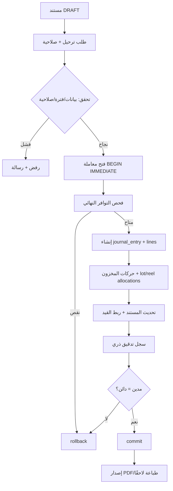

# التصميم المحاسبي — Mizan V1

| البند | القيمة |
|---|---|
| الوثيقة | `03_ACCOUNTING_DESIGN.md` |
| الإصدار | 0.2.0 — Batch 1 |
| الحالة | **PROPOSED / NEEDS APPROVAL** |
| يعتمد عليه | الترحيل، المبيعات، المشتريات، المرتجعات، التقارير المالية |
| لا يعتمد عليه بعد | أرقام دليل الحسابات، المعالجة الضريبية، السنة المالية |

> **تحذير:** أسماء الحسابات وأرقامها وتصنيفاتها في هذه الوثيقة **مقترحة**، وليست دليل حسابات معتمدًا. لا تُستخدم في تنفيذ فعلي قبل اعتماد المالك/المحاسب. البنود الموسومة **OPEN** لا تُنفَّذ.

## 1. المبادئ الحاكمة

| المعرّف | المبدأ | الحالة |
|---|---|---|
| ACC-P-001 | محاسبة قيد مزدوج: كل قيد له مدين ودائن متساويان بالقرش. | CONFIRMED |
| ACC-P-002 | كل مستند تجاري/مالي مرحّل يُنتج قيوده في **نفس المعاملة الذرية** التي تُنشئ حركات المخزون وتحدّث المستند. | CONFIRMED |
| ACC-P-003 | لا ترحيل بيع/شراء/مرتجع/قبض/دفع/مصروف/تحويل بلا قيد. | CONFIRMED |
| ACC-P-004 | المستند/القيد المرحّل غير قابل للتعديل أو الحذف؛ التصحيح بعكس/مرتجع/تسوية. | CONFIRMED |
| ACC-P-005 | المبالغ كلها أعداد صحيحة بالقرش، ولا تُستخدم أرقام عائمة. | CONFIRMED |
| ACC-P-006 | القيود هي السجل المالي المعتمد؛ أرصدة العملاء/الموردين والكشوف **مشتقة**، وليست سجلًا موازيًا. | PROPOSED |
| ACC-P-007 | الأرصدة المشتقة قابلة لإعادة البناء من القيود، ومطابقتها إلزامية. | PROPOSED |
| ACC-P-008 | لا تُضاف ضريبة أو رسم أو حساب غير معتمد تلقائيًا. | CONFIRMED (عدم الاختراع) |
| ACC-P-009 | الترحيل لا يبدأ قبل اعتماد دليل الحسابات وقواعد الترحيل لهذه المرحلة. | PROPOSED (حوكمة) |

## 2. دليل الحسابات المقترح

### 2.1 الهيكل

- حسابات هرمية بأرقام 4 خانات (قابلة للتوسع إلى 6).
- أنواع: `ASSET`, `LIABILITY`, `EQUITY`, `REVENUE`, `EXPENSE`.
- حسابات ضبط (Control Accounts) للعملاء والموردين والمخزون، مع حسابات فرعية من خلال أبعاد الحركة (العميل/المورد/المشروع)، لا حسابات GL منفصلة لكل عميل.
- الحسابات المقترحة أدناه **ليست معتمدة**.

| الرمز | الاسم المقترح | النوع | طبيعة الرصيد | الاستخدام |
|---|---|---|---|---|
| 1010 | Cash on Hand — نقدية بالصندوق | ASSET | مدين | الحساب المالي النقدي |
| 1020 | Bank — بنك | ASSET | مدين | حساب بنكي |
| 1030 | E-Wallets — محافظ إلكترونية | ASSET | مدين | محفظة/حساب إلكتروني |
| 1100 | Accounts Receivable — ذمم العملاء | ASSET | مدين | حساب ضبط العملاء |
| 1200 | Inventory — مخزون قابل للبيع | ASSET | مدين | حساب ضبط المخزون |
| 1210 | Damaged Inventory — مخزون تالف | ASSET | مدين | اختياري لتتبع التالف قبل الإعدام |
| 1300 | Advances to Suppliers — دفعات مقدمة لموردين | ASSET | مدين | OPEN/اختياري |
| 2010 | Accounts Payable — ذمم الموردين | LIABILITY | دائن | حساب ضبط الموردين |
| 2020 | Customer Credits/Advances — أرصدة دائنة للعملاء | LIABILITY | دائن | زيادة سداد/رصيد مرتجع |
| 2030 | Accrued Expenses — مصروفات مستحقة | LIABILITY | دائن | مصروف مستحق غير مدفوع |
| 2040 | Taxes Payable — ضرائب مستحقة | LIABILITY | دائن | **غير مفعّل** حتى قرار الضريبة |
| 3010 | Capital — رأس المال | EQUITY | دائن | رأس المال |
| 3020 | Retained Earnings — أرباح محتجزة | EQUITY | دائن | إقفال/افتتاح |
| 3030 | Opening Balance Equity — رصيد افتتاحي مقابل | EQUITY | دائن | قيد الافتتاح |
| 4010 | Sales Revenue — إيرادات المبيعات | REVENUE | دائن | صافي الإيراد |
| 4020 | Sales Returns — مرتجعات المبيعات | REVENUE (contra) | مدين | عكس الإيراد |
| 4030 | Other Income — إيرادات أخرى | REVENUE | دائن | إن وجدت |
| 5010 | Cost of Goods Sold — تكلفة المبيعات | EXPENSE | مدين | FIFO/البكرة |
| 5020 | Inventory Loss/Damaged — خسارة/تالف | EXPENSE | مدين | تالف/فروق |
| 5030 | Landed Cost Adjustment — تسوية تكلفة واصلة | EXPENSE | مدين | فروق لاحقة/سياسة OPEN |
| 5100 | Operating Expenses — مصروفات تشغيلية | EXPENSE | مدين | حساب أب |
| 5110 | Rent — إيجار | EXPENSE | مدين | تصنيف مقترح |
| 5120 | Utilities — مرافق | EXPENSE | مدين | تصنيف مقترح |
| 5130 | Salaries — رواتب | EXPENSE | مدين | تصنيف مقترح |
| 5190 | Other Operating Expenses — أخرى | EXPENSE | مدين | تصنيف مقترح |

> **حساب 2040 غير مفعّل.** وجوده كحقل مستقبلي لا يعني اعتماد ضريبة. لا يُستخدم حتى قرار `OQ-ACC-001`.

### 2.2 حسابات الضبط والربط

| المفتاح (Account Mapping) | الحساب المقترح | الاستخدام |
|---|---|---|
| `AR_CONTROL` | 1100 | ذمم العملاء |
| `AP_CONTROL` | 2010 | ذمم الموردين |
| `INVENTORY_CONTROL` | 1200 | المخزون القابل للبيع |
| `DAMAGED_INVENTORY` | 1210 | اختياري |
| `COGS` | 5010 | تكلفة المبيعات |
| `SALES_REVENUE` | 4010 | الإيراد |
| `SALES_RETURNS` | 4020 | المرتجعات |
| `CUSTOMER_CREDITS` | 2020 | أرصدة دائنة للعملاء |
| `INVENTORY_LOSS` | 5020 | خسارة/تالف |
| `LANDED_COST_ADJUSTMENT` | 5030 | فروق لاحقة |
| `OPENING_EQUITY` | 3030 | قيد الافتتاح |

- الحسابات المالية (نقدية/بنك/محفظة) مرتبطة بـ`financial_accounts.gl_account_id`.
- لا يُسمح بترحيل إلى حساب أب/غير قابل للترحيل.
- لا يُسمح بترحيل إلى حساب ضبط دون وسم الطرف المناسب (عميل/مورد).

## 3. نموذج القيد اليومي

### 3.1 الكيانات

**`journal_entries`**

| الحقل | النوع/القيد | ملاحظات |
|---|---|---|
| `id` | INTEGER PK | |
| `entry_no` | TEXT UNIQUE | تسلسل مستقل؛ الشكل OPEN |
| `entry_date` | DATE | تاريخ محاسبي محلي |
| `source_type` | TEXT | SALE, PURCHASE, SALES_RETURN, PURCHASE_RETURN, RECEIPT, PAYMENT, EXPENSE, TRANSFER, OPENING, ADJUSTMENT |
| `source_id` | INTEGER | معرف المستند المصدر |
| `description` | TEXT | وصف عربي |
| `status` | TEXT | `POSTED`, `REVERSED` |
| `posted_at` | TIMESTAMP UTC | |
| `posted_by` | FK users | |
| `reversal_of_id` | FK journal_entries NULL | للقيد العكسي |
| `reversed_by_id` | FK journal_entries NULL | للقيد الأصلي |
| `idempotency_key` | TEXT UNIQUE | يمنع الترحيل المزدوج |

**`journal_lines`**

| الحقل | النوع/القيد | ملاحظات |
|---|---|---|
| `id` | INTEGER PK | |
| `journal_entry_id` | FK | |
| `line_no` | INTEGER | تسلسل داخل القيد |
| `account_id` | FK accounts | حساب قابل للترحيل |
| `debit_piastres` | INTEGER >= 0 | أحدهما صفر |
| `credit_piastres` | INTEGER >= 0 | أحدهما صفر |
| `party_type` | TEXT NULL | CUSTOMER/SUPPLIER |
| `party_id` | INTEGER NULL | معرف العميل/المورد |
| `project_id` | FK projects NULL | لتقارير المشروع |
| `description` | TEXT | |
| `source_line_id` | INTEGER NULL | ربط ببند المستند |

### 3.2 قواعد التحقق

1. `debit_piastres` و`credit_piastres` أعداد صحيحة غير سالبة.
2. في كل سطر: أحدهما > 0 والآخر = 0 (لا سطر صفري).
3. مجموع المدين = مجموع الدائن بالقرش.
4. `source_type`/`source_id` يشيران إلى مستند موجود وغير مرحّل مسبقًا.
5. `idempotency_key` فريد.
6. `entry_date` داخل فترة مفتوحة (إذا اعتُمدت الفترات).
7. حساب الضبط `AR_CONTROL` يتطلب `party_type=CUSTOMER` و`party_id`؛ و`AP_CONTROL` يتطلب `SUPPLIER`.
8. لا يُسمح بترحيل قيد إلى حساب غير نشط/أب.
9. القيد لا يُنشأ منفردًا خارج خدمة الترحيل.
10. أي فشل يعيد `rollback` كاملًا.

## 4. دورة الترحيل والحدود الذرية



### 4.1 قواعد الحدود

- **وحدة عمل واحدة** لكل عملية ترحيل؛ لا `commit` داخل المستودعات.
- استخدام `BEGIN IMMEDIATE` (أو ما يعادله) لتقليل تعارض الكتابة.
- قراءة/قفل المخزون والتحقق منه داخل نفس المعاملة.
- إنشاء القيد وحركات المخزون وتحديث المستند وسجل التدقيق داخل المعاملة.
- لا تُنشأ ملفات PDF داخل معاملة قاعدة البيانات؛ تُنشأ بعد `commit` أو بآلية staging/تعويض للعروض (انظر `05_QUOTATIONS_AND_A4_DOCUMENTS.md` §8).
- الترحيل المكرر لنفس المستند يُرفض بـ`idempotency_key`/حالة المستند.

### 4.2 حالات القيد

- `POSTED`: قيد نشط.
- `REVERSED`: القيد الأصلي بعد إنشاء قيد عكسي مرتبط.
- لا `DRAFT` للقيود في V1؛ القيود تُنشأ عند الترحيل فقط. أي مسودة محاسبية يدوية **غير مطلوبة** ولم تُعتمد.

## 5. مصفوفة الترحيل

> الحسابات أدناه من الدليل المقترح. المبالغ بالقرش. كل صف يحتاج تأكيدًا محاسبيًا قبل التنفيذ. الصفوف الموسومة OPEN لا تُنفَّذ.

| # | العملية | مدين | دائن | ملاحظات/شروط |
|---:|---|---|---|---|
| P-01 | بيع نقدي | 1010/1020/1030 (حسب الحساب المالي) | 4010 إيرادات المبيعات | بصافي الإيراد بعد الخصم؛ لا ضريبة |
| P-02 | بيع آجل | 1100 ذمم العملاء | 4010 إيرادات المبيعات | وسم العميل إلزامي |
| P-03 | تكلفة البيع | 5010 تكلفة المبيعات | 1200 المخزون | بتكلفة FIFO/البكرة الفعلية |
| P-04 | بيع نقدي جزئي/مختلط | 1010/1020 + 1100 | 4010 | الجزء غير المدفوع ذمم؛ يحتاج `OQ-SAL-003` |
| P-05 | مرتجع بيع — خفض ذمم | 4020 مرتجعات المبيعات | 1100 ذمم العملاء | بالبند التجاري |
| P-06 | مرتجع بيع — رد نقدي/بنكي | 4020 مرتجعات المبيعات | 1010/1020 | يتطلب صلاحية ودفعة/مستند |
| P-07 | مرتجع بيع — رصيد دائن للعميل | 4020 مرتجعات المبيعات | 2020 أرصدة العملاء | للجزء الذي لا يقابله مستحق |
| P-08 | مرتجع بيع — إعادة مخزون قابل للبيع | 1200 المخزون | 5010 تكلفة المبيعات | بتكلفة الأصل |
| P-09 | مرتجع بيع — تالف | 5020 خسارة/تالف | 5010 تكلفة المبيعات | لا يعود للمخزون القابل للبيع |
| P-10 | شراء نقدي — سعر المورد | 1200 المخزون | 1010/1020 | `supplier_invoice_cost` فقط |
| P-11 | شراء آجل — سعر المورد | 1200 المخزون | 2010 ذمم الموردين | لا يضاف مصروف طرف ثالث إلى المورد |
| P-12 | مصروف شراء مباشر موزّع | 1200 المخزون | 1010/1020 أو 2030/طرف ثالث | `landed_cost`؛ السياسة OPEN |
| P-13 | مصروف شراء غير موزّع (إن اعتمد) | 5030/مصروف | 1010/1020 أو 2030 | يتطلب قرارًا |
| P-14 | دفعة مورد | 2010 ذمم الموردين | 1010/1020 | تخصيص لفاتورة |
| P-15 | تحصيل عميل | 1010/1020 | 1100 ذمم العملاء | تخصيص لفاتورة |
| P-16 | زيادة تحصيل/دفعة مقدمة | 1010/1020 | 2020 أرصدة العملاء | بعد استنفاد الذمة؛ `OQ-FIN-005` |
| P-17 | رد رصيد دائن لعميل | 2020 أرصدة العملاء | 1010/1020 | بصلاحية وسبب |
| P-18 | مصروف تشغيلي | 51xx مصروف | 1010/1020 أو 2030 | تصنيف |
| P-19 | تحويل بين حسابين | الحساب الوجهة | الحساب المصدر | لا إيراد/مصروف |
| P-20 | مرتجع شراء | 2010/1010 | 1200 المخزون | بتكلفة الدفعة/البكرة الأصلية |
| P-21 | قيد افتتاحي | أصول/مخزون/ذمم مدينة | التزامات/ذمم دائنة/3030 | متوازن |
| P-22 | تسوية فروق بنكية | حساب مالي/مصروف/إيراد | حساب مالي/مصروف/إيراد | مستند تسوية معتمد؛ OQ-FIN-001 |
| P-23 | تسوية تكلفة واصلة لاحقة | 1200 + 5030/5010 | 1010/1020 أو 2030 | حسب حالة البيع؛ **OPEN** |
| P-24 | تلف مخزون | 5020 خسارة/تالف | 1200 المخزون | بتكلفة الطبقة المستهلكة |
| P-25 | إعادة إصدار مرتجع | 5010 تكلفة المبيعات | 1200 المخزون | بتكلفة طبقة المرتجع |
| P-26 | تسوية مخزون | 1200 أو حساب تسوية | 1200 أو حساب تسوية | **OPEN** (`OQ-INV-007`) |

### 5.1 ملاحظات على المصفوفة

- **الخصومات:** الإيراد يُسجَّل صافيًا بعد خصم البند والفاتورة. تحليل الخصم يبقى في مستند البيع/التقارير، ولا يُنشأ حساب خصم منفصل في الترحيل الافتراضي. إذا طلب المحاسب إظهار إجمالي البيع وحساب خصم مقابل، يُضاف حساب `Sales Discounts` ويعاد اعتماد المصفوفة. **PROPOSED.**
- **الضريبة:** لا سطر ضريبة. عند اعتمادها تُضاف سطور ضريبة قبل/بعد الإيراد حسب القانون، ويُعاد اعتماد المصفوفة.
- **الخصم على مستوى العميل:** غير مفعّل؛ لا يوجد سطر له حتى `OQ-PRC-001`.
- **المصروف المباشر:** إن دُفع لطرف ثالث، لا يُضاف إلى حساب المورد 2010؛ يُستخدم حساب مالي أو التزام طرف ثالث. الحساب التفصيلي OPEN (`OQ-PUR-001`).
- **المرتجع التالف:** الافتراضي هو تحميل الخسارة مباشرة على 5020. إذا اعتمد المالك تتبع `Damaged Inventory 1210` كأصل ثم إعدام، يُضاف سطر إعدام لاحق.
- **تكلفة لاحقة بعد بيع جزء:** لا تُعاد كتابة البيع. تُعالج الفروق بمستند تسوية؛ الخيارات في `OQ-INV-011`.

## 6. دفتر العملاء والموردين (Subledger)

### 6.1 العلاقة بحسابات الضبط

- `1100 AR_CONTROL` حساب ضبط واحد، وليس حسابًا لكل عميل.
- كل سطر في `journal_lines` يتعلق بالذمم يحمل `party_type='CUSTOMER'` و`party_id`.
- `2010 AP_CONTROL` بالمثل مع `SUPPLIER`.
- رصيد العميل = مجموع حركات 1100 الموسومة به (مدين − دائن) + أي رصيد افتتاحي.
- رصيد المورد = مجموع حركات 2010 الموسومة به (دائن − مدين).
- لا يوجد حقل «رصيد العميل» قابل للتعديل اليدوي.

### 6.2 الأرصدة المشتقة

| العرض | المصدر | إعادة البناء |
|---|---|---|
| `customer_balances` | `journal_lines` على 1100 + party | view/استعلام |
| `supplier_balances` | `journal_lines` على 2010 + party | view/استعلام |
| كشف العميل | القيود + المستندات | إعادة حساب |
| كشف المورد | القيود + المستندات | إعادة حساب |
| أعمار الديون | فواتير/قيود + تواريخ الاستحقاق | إعادة حساب |

- يجب أن يساوي مجموع أرصدة العملاء رصيد 1100، ومجموع أرصدة الموردين رصيد 2010. أي فرق يمنع الإقفال/التقارير ويُعرض كخطأ.
- لا تُنشأ «أرصدة افتتاحية» مباشرة في جدول العملاء؛ تُنشأ بقيد افتتاحي.

## 7. تقييم المخزون وتكلفة المبيعات

| المعرّف | القاعدة | الحالة |
|---|---|---|
| ACC-INV-001 | المخزون القابل للبيع يُقيَّم بتكلفة الدفعات/البكرات المتبقية، لا بسعر السوق. | CONFIRMED |
| ACC-INV-002 | تكلفة البيع تُسحب من تخصيصات FIFO/البكرة، وتُقيَّد 5010/1200. | CONFIRMED |
| ACC-INV-003 | حساب 1200 يجب أن يطابق مجموع التكاليف المتبقية للطبقات القابلة للبيع + البكرات، مع مراعاة التالف/مرتجع المورد/التسويات. | PROPOSED |
| ACC-INV-004 | لا تُستخدم قيمة مخزون إجمالية مستقلة قابلة للتعديل اليدوي. | PROPOSED |
| ACC-INV-005 | نموذج **طبقات التكلفة الموضعية LCP** (ADR-0003) هو المرشح، ويحتاج اعتمادًا (`OQ-ACC-003`). | PROPOSED |
| ACC-INV-006 | أي فرق بين 1200 ومجموع الطبقات يُعرض كتسوية/تقرير، لا يُعدَّل صامتًا. | PROPOSED |
| ACC-INV-007 | التكلفة الواصلة تشمل سعر المورد + حصة المصروفات الموزعة؛ سعر المورد محفوظ منفصلًا. | CONFIRMED |
| ACC-INV-008 | كل إصدار من طبقة تكلفة له تكلفة غير سالبة، حتى بعد مرتجعات تعسفية. | CONFIRMED (المبدأ) / PROPOSED (LCP) |
| ACC-INV-009 | معادلات الكمية/التكلفة تشمل التالف ومرتجع المورد والتسويات، لا `net_issued` فقط. | CONFIRMED (المبدأ) |
| ACC-INV-010 | التالف/مرتجع المورد يستهلكان طبقات متاحة بتكلفتها، ولا يغيّران COGS تاريخية. | CONFIRMED (المبدأ) |

**معادلات المطابقة (لكل LOT/REEL):**

```text
Q0 = remaining_qty + net_sold_qty + damaged_qty
   + supplier_returned_qty + adjustments_out_qty
   − adjustments_in_qty

net_sold_qty = gross_sale_issue_qty − sellable_return_qty

C0 = remaining_cost + net_cogs_cost + damage_cost
   + supplier_return_cost + adjustments_out_cost
   − adjustments_in_cost

net_cogs_cost = gross_sale_issue_cost − sellable_return_cost
```

- `Q0`/`C0` حقيقتان تاريخيتان لا تُعدَّلان.
- المرتجع التالف يزيد `sellable_return_*` و`damage_*` معًا، ولا يُحتسب مرتين.
- تقرير مطابقة 1200: رصيد الحساب مقابل مجموع `remaining_cost` للطبقات القابلة للبيع.
- لا تُستخدم تسوية المخزون لتغيير تكلفة فاتورة تاريخية؛ تُنشئ حركة/قيدًا جديدًا.

## 8. الخصومات

| النوع | مكان الحساب | الأثر | الحالة |
|---|---|---|---|
| خصم بند | مستند البيع | يخفض صافي البند والإيراد | CONFIRMED |
| خصم فاتورة | مستند البيع | يوزَّع على البنود المؤهلة ويخفض الإيراد | CONFIRMED |
| خصم عميل (نسبة/مبلغ) | غير مفعّل | لا يُطبَّق حتى `OQ-PRC-001` | PROPOSED |
| سعر خاص للعميل | تسعير | ليس خصمًا؛ يحدد سعر الوحدة قبل الخصومات | CONFIRMED |

- الترحيل الافتراضي: `4010` بصافي الإيراد. لا سطر خصم منفصل.
- إذا اعتُمد عرض إجمالي/خصم منفصل، يُضاف حساب `Sales Discounts` ويُحدَّث الدليل والمصفوفة.
- خصم الفاتورة يجب أن يوزَّع بالقرش بالضبط؛ ADR-0003.

## 9. العكس والتصحيح

| المعرّف | القاعدة | الحالة |
|---|---|---|
| ACC-REV-001 | العكس قيد جديد بالمدين/الدائن المعكوسين، ومرجع للقيد الأصلي. | CONFIRMED |
| ACC-REV-002 | لا يُحذف/يُعدَّل القيد الأصلي. | CONFIRMED |
| ACC-REV-003 | العكس المرتبط بمخزون يعكس حركة المخزون/التخصيص في نفس المعاملة. | CONFIRMED |
| ACC-REV-004 | لا يُسمح بعكس جزئي يترك القيد الأصلي غير متوازن أو مخزونًا بلا مقابل. | CONFIRMED |
| ACC-REV-005 | بعد وجود مرتجعات/تخصيصات لاحقة، يُفضَّل المرتجع/التسوية على العكس الكامل؛ السياسة OPEN. | OPEN |

- العكس الكامل للفاتورة المرحّلة لا يُستخدم كبديل عن مرتجع بيع إذا كانت البضاعة قد عادت/بيعت؛ هذا قرار تشغيلي/محاسبي في `OQ-SAL-001`.
- قيد العكس يحمل `reversal_of_id`، والقيد الأصلي `reversed_by_id`؛ كلاهما يبقى ظاهرًا.

## 10. مطابقة الحسابات المالية

| المعرّف | القاعدة | الحالة |
|---|---|---|
| ACC-REC-001 | مطابقة الحساب المالي تُسجَّل بمستند `financial_reconciliation` يشمل الرصيد الافتتاحي/الختامي وتاريخ الكشف. | PROPOSED |
| ACC-REC-002 | تُطابق حركات القيود مع سطور الكشف؛ غير المطابق يبقى معلقًا. | PROPOSED |
| ACC-REC-003 | فروق المطابقة تُسوَّى بقيد/مستند معتمد، لا بتعديل رصيد الحساب. | PROPOSED |
| ACC-REC-004 | لا يُغلق الحساب المالي/الفترة قبل اعتماد المطابقة، إذا اعتُمدت المطابقة الإلزامية. | OPEN |

- لا توجد مطابقة بنكية آلية/استيراد كشف بنكي في V1؛ الإدخال يدوي/نصف يدوي. `OQ-FIN-001` يحدد العمق.
- المطابقة لا تغيّر رصيد 1100/2010؛ هي أداة تحقق.

## 11. الأرصدة الافتتاحية

1. تُحدد قائمة العملاء/الموردين/المخزون/النقدية/البنك/رأس المال.
2. تُنشأ دفعات/بكرات افتتاحية بتكلفتها الموثقة (`source_type='OPENING'`).
3. يُنشأ قيد افتتاحي واحد متوازن:

| الحساب | مدين | دائن |
|---|---:|---:|
| 1010/1020 النقدية/البنك | رصيد | — |
| 1100 ذمم العملاء | رصيد | — |
| 1200 المخزون | تكلفة | — |
| 2010 ذمم الموردين | — | رصيد |
| 3030 رصيد افتتاحي مقابل | — | الفرق |
| 3010 رأس المال | — | رأس المال |

4. لا تُدخل أرصدة مباشرة في جداول العملاء/الموردين/المخزون.
5. أي فرق غير مفسّر يمنع الافتتاح.

## 12. أمثلة محاسبية متوازنة

> جميع الأرقام **توضيحية** وليست بيانات متجر. الحسابات مقترحة.

### 12.1 بيع آجل مع خصم وتكلفة FIFO

بيانات توضيحية: بيع 120 م بسعر 30.00 EGP/م، خصم فاتورة 120.00 EGP، تكلفة FIFO 2,440.00 EGP، عميل آجل.

| الحساب | مدين (EGP) | دائن (EGP) |
|---|---:|---:|
| 1100 ذمم العملاء | 3,480.00 | — |
| 4010 إيرادات المبيعات | — | 3,480.00 |
| 5010 تكلفة المبيعات | 2,440.00 | — |
| 1200 المخزون | — | 2,440.00 |

- مجموع المدين 5,920، الدائن 5,920.
- الإيراد صافي بعد الخصم. تحليل الخصم يبقى في مستند البيع.

### 12.2 شراء آجل مع مصروف نقل

بيانات توضيحية: سعر مورد 9,000.00 EGP، نقل 450.00 EGP مدفوع نقدًا، شراء آجل.

| الحساب | مدين | دائن |
|---|---:|---:|
| 1200 المخزون | 9,450.00 | — |
| 2010 ذمم الموردين | — | 9,000.00 |
| 1010 النقدية | — | 450.00 |

- رصيد المورد 9,000 فقط، لا 9,450.
- لو النقل مستحق لطرف ثالث: بدل 1010 يُستخدم 2030/التزام طرف ثالث.

### 12.3 مرتجع بيع قابل للبيع مع رصيد غير مسدد

بيانات توضيحية: فاتورة آجلة 3,480.00، مسدد منها 1,000.00، مرتجع تجاري 580.00، تكلفة الأصل 440.00.

| الحساب | مدين | دائن |
|---|---:|---:|
| 4020 مرتجعات المبيعات | 580.00 | — |
| 1100 ذمم العملاء | — | 580.00 |
| 1200 المخزون | 440.00 | — |
| 5010 تكلفة المبيعات | — | 440.00 |

- المتبقي على العميل 1,900.00 (3,480 − 1,000 − 580). لا رد نقدي.
- إذا كان مسددًا بالكامل، يُستخدم 2020 أو رد نقدي حسب `OQ-SAL-007`.

### 12.4 مرتجع بيع تالف

| الحساب | مدين | دائن |
|---|---:|---:|
| 4020 مرتجعات المبيعات | 580.00 | — |
| 1100 ذمم العملاء | — | 580.00 |
| 5020 خسارة/تالف | 440.00 | — |
| 5010 تكلفة المبيعات | — | 440.00 |

- لا يعود 440 إلى 1200؛ الكمية التالفة لا تُباع.

### 12.5 دفعة مورد

| الحساب | مدين | دائن |
|---|---:|---:|
| 2010 ذمم الموردين | 9,000.00 | — |
| 1020 البنك | — | 9,000.00 |

### 12.6 تحصيل عميل

| الحساب | مدين | دائن |
|---|---:|---:|
| 1010 النقدية | 1,900.00 | — |
| 1100 ذمم العملاء | — | 1,900.00 |

### 12.7 تحويل بين حسابين

| الحساب | مدين | دائن |
|---|---:|---:|
| 1020 البنك | 5,000.00 | — |
| 1010 النقدية | — | 5,000.00 |

### 12.8 قيد افتتاحي

| الحساب | مدين | دائن |
|---|---:|---:|
| 1010 النقدية | 20,000.00 | — |
| 1200 المخزون | 50,000.00 | — |
| 1100 ذمم العملاء | 15,000.00 | — |
| 2010 ذمم الموردين | — | 25,000.00 |
| 3030 رصيد افتتاحي مقابل | — | 60,000.00 |

- مجموع المدين 85,000، الدائن 85,000.

### 12.9 مرتجع على فاتورة مسددة بالكامل

بيانات توضيحية: فاتورة 580.00 مسددة بالكامل، مرتجع تجاري 580.00، تكلفة الأصل 440.00، والعميل يختار رصيدًا دائنًا (لا رد نقدي).

| الحساب | مدين | دائن |
|---|---:|---:|
| 4020 مرتجعات المبيعات | 580.00 | — |
| 2020 أرصدة دائنة للعملاء | — | 580.00 |
| 1200 المخزون | 440.00 | — |
| 5010 تكلفة المبيعات | — | 440.00 |

- إذا اختار العميل ردًا نقديًا: `2020` مدين / `1010` دائن بمبلغ 580.00، بصلاحية ومستند.
- إذا كان الجزء المدفوع أقل، يُخصم من الذمة أولًا، والفائض إلى 2020. **PROPOSED** (`OQ-SAL-007`).

### 12.10 تلف مخزون

بيانات توضيحية: تلف 10 أمتار من طبقة تكلفتها 20.00 EGP/م (تكلفة 200.00).

| الحساب | مدين | دائن |
|---|---:|---:|
| 5020 خسارة/تالف | 200.00 | — |
| 1200 المخزون | — | 200.00 |

- لا يعود 200 إلى المخزون القابل للبيع؛ الكمية التالفة تظل قابلة للتتبع في تقرير التالف.
- إذا استُخدم `1210 Damaged Inventory` كأصل مؤقت: 1210/1200، ثم إعدام 5020/1210.

### 12.11 مرتجع شراء

بيانات توضيحية: إرجاع 10 أمتار تكلفتها 20.00 EGP/م إلى المورد.

| الحساب | مدين | دائن |
|---|---:|---:|
| 2010 ذمم الموردين | 200.00 | — |
| 1200 المخزون | — | 200.00 |

- إذا رد المورد نقدًا: 1010 بدل 2010.
- لا تُعدَّل تكلفة مبيعات تاريخية؛ أي فرق سعر/مصروف يُعالج بتسوية.

## 13. المعالجة الضريبية والفترات

| الموضوع | الحالة | الأثر |
|---|---|---|
| ضريبة القيمة المضافة/المبيعات | OPEN (`OQ-ACC-001`) | لا سطور/نسب/حساب ضريبة |
| الفاتورة الإلكترونية | OPEN (`OQ-ACC-001`) | لا تكامل/حقول |
| السنة المالية | OPEN (`OQ-ACC-002`) | لا إقفال/قوائم نهائية |
| الفترات المقفلة | OPEN (`OQ-ACC-002`) | لا منع ترحيل رجعي حتى القرار |
| ترحيل بأثر رجعي | OPEN (`OQ-SAL-005`) | لا سياسة حتى القرار |
| الشيكات | OPEN (`OQ-FIN-002`) | لا نموذج شيكات |
| ورديات الكاشير | OPEN (`OQ-FIN-003`) | لا قيود وردية |

## 14. معايير القبول

| المعرّف | السيناريو | النتيجة |
|---|---|---|
| AC-ACC-001 | ترحيل بيع | قيدان متوازنان: إيراد/ذمة + تكلفة/مخزون، مرتبطان بالمستند. |
| AC-ACC-002 | فشل إنشاء سطر قيد بعد خصم المخزون | rollback كامل، لا مستند/قيد/حركة. |
| AC-ACC-003 | قيد مدين ≠ دائن | رفض قبل commit. |
| AC-ACC-004 | تعديل/حذف قيد مرحّل | رفض. |
| AC-ACC-005 | قيد عكسي | قيد جديد متوازن، الأصل يبقى. |
| AC-ACC-006 | بيع آجل | 1100 مدين، 4010 دائن، وسم العميل. |
| AC-ACC-007 | شراء آجل + نقل | 1200 يشمل الاثنين، 2010 سعر المورد فقط. |
| AC-ACC-008 | مرتجع تالف | 5020/5010، لا 1200. |
| AC-ACC-009 | بيع بلا قيد | مرفوض تصميميًا. |
| AC-ACC-010 | فرق بين 1200 ومجموع الدفعات | تقرير فرق، لا تعديل صامت. |
| AC-ACC-011 | تلف مخزون | 5020/1200 بتكلفة الطبقة، والكمية التالفة خارج القابل للبيع. |
| AC-ACC-012 | مرتجع شراء | 2010/1200 بتكلفة الطبقة، بلا تعديل COGS تاريخية. |

## 15. ما لا تعتمده هذه الوثيقة

- لا تعتمد أرقام/أسماء الحسابات.
- لا تعتمد سياسة الضريبة/السنة المالية.
- لا تعتمد نموذج طبقات التكلفة الموضعية LCP؛ هو PROPOSED.
- لا تعتمد معالجة المصروفات اللاحقة/المرتجعات؛ OPEN.
- لا تدّعي تنفيذ أي قيد أو اختبار.

---

**مرتبط بـ:** [قواعد العمل](02_BUSINESS_RULES.md) · [المخزون وFIFO](04_INVENTORY_FIFO_AND_REELS.md) · [دقة المال](adr/ADR-0003-MONEY-AND-QUANTITY-PRECISION.md) · [الأسئلة المفتوحة](10_OPEN_QUESTIONS.md)
