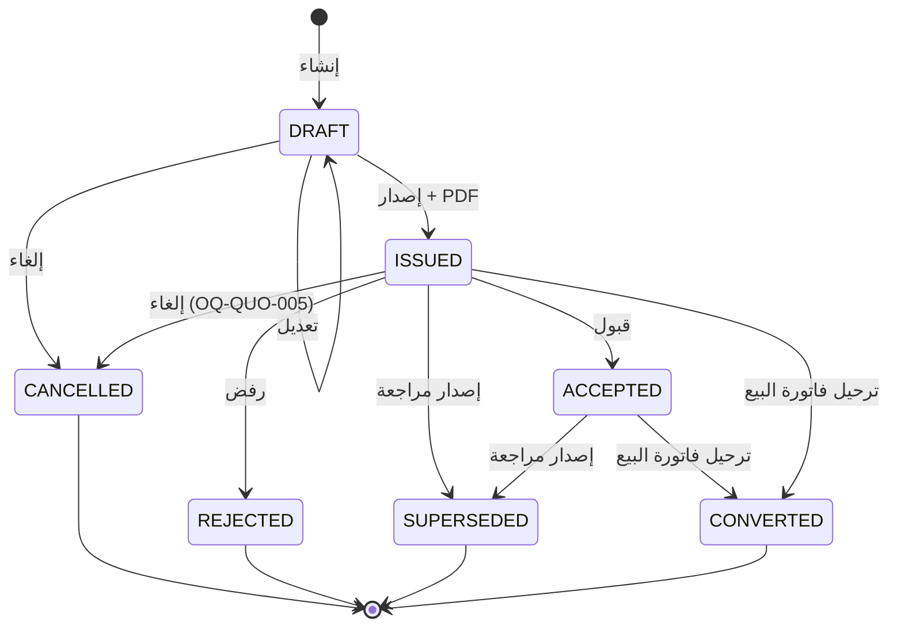

# عروض الأسعار ومستندات A4 — Mizan V1

| البند | القيمة |
|---|---|
| الوثيقة | `05_QUOTATIONS_AND_A4_DOCUMENTS.md` |
| الإصدار | 0.2.0 — Batch 1 |
| الحالة | **PARTIAL — quotation-core decisions approved; A4/PDF engine still NEEDS APPROVAL** |
| يعتمد عليه | المبيعات، PDF، الطباعة، التدقيق |
| الطباعة | A4 فقط — CONFIRMED |

> هذه الوثيقة تجمع قواعد عروض الأسعار والمستندات. لا تُنشئ كودًا أو ملفات PDF. أسماء الحالات/الجداول الدقيقة **PROPOSED** حيث لم تُعتمد.
>
> **حالة التنفيذ 2026-11-17:** نُفِّذت النواة غير المعتمدة على المُصيّر (دورة الحياة/سجل الحالات، المراجعات/الجذر، التحويل إلى مسودة بيع مع قيد التكرار، الإلغاء/الاستعادة، الترقيم، ولقطات المستند ونموذج التصدير). لم يُختر محرك A4/PDF (ADR-0004)، ولم يُنتج/يُختبر PDF أو A4 أو طابعة حقيقية بعد؛ لذلك المرحلة 7 **غير مكتملة**، ومعايير الخروج المتعلقة بالمُصيّر تبقى مفتوحة.

## 1. المبدأ: عرض السعر ليس معاملة

| المعرّف | القاعدة | الحالة |
|---|---|---|
| QUO-P-001 | عرض السعر مستند تجاري، لا يترتب عليه أثر مخزني أو محاسبي. | CONFIRMED |
| QUO-P-002 | لا يحجز مخزونًا، ولا يخصم كمية، ولا يختار بكرة، ولا ينشئ FIFO. | CONFIRMED |
| QUO-P-003 | لا ينشئ إيرادًا، ولا يغيّر رصيد عميل، ولا قبضًا/دفعة. | CONFIRMED |
| QUO-P-004 | لا ينشئ قيد يومية، ولا يؤثر على وردية الكاشير. | CONFIRMED |
| QUO-P-005 | عرض السعر يُصدر على A4؛ لا طباعة حرارية. | CONFIRMED |
| QUO-P-006 | المشاركة يدوية من المستخدم؛ لا تكامل WhatsApp/Email API في V1. | CONFIRMED |

## 2. بيانات العرض

### 2.1 الرأس

- `document_no` فريد (وفق `OQ-DOC-001`: `Q-2026-000001`، والمراجعة `Q-2026-000001-R2`).
- `series_id` / `root_quotation_id` / `version_no`.
- العميل أو المقاول؛ `customer_id` إلزامي.
- `project_id` اختياري (حسب `OQ-CON-001`).
- `price_list_id`.
- `issue_date`، `valid_until`.
- `status` المخزّنة (DRAFT/ISSUED/ACCEPTED/REJECTED/CANCELLED/SUPERSEDED/CONVERTED).
- `subtotal_piastres`، `item_discount_piastres`، `invoice_discount_piastres`، `total_piastres`.
- ملاحظات وشروط.
- `official_export_id` (PDF رسمي).
- `converted_sale_id` **غير موجود**؛ المرجع من `sales.source_quotation_id`.

### 2.2 البنود

| الحقل | إلزامي | ملاحظات |
|---|---|---|
| `line_no` | نعم | ترتيب ثابت |
| `product_id` | نعم | |
| `unit_id` | نعم | وحدة بيع صالحة |
| `quantity_micros` | نعم | > 0 |
| `conversion_factor_num/den` | نعم | لقطة |
| `base_qty_micros` | نعم | محسوبة |
| `original_unit_price_micros` | نعم | قبل التعديل |
| `final_unit_price_micros` | نعم | السعر المستخدم |
| `price_source` | نعم | CUSTOMER_SPECIFIC / PRICE_LIST / PRODUCT_DEFAULT / MANUAL؛ والتنفيذ الحالي يستخدم رموز خدمة البيع `CUSTOMER`/`PRICE_LIST`/`DEFAULT`/`MANUAL` للاتساق |
| `price_adjustment_reason` | عند التعديل | نص/سبب |
| `item_discount_piastres` | نعم | 0 مسموح |
| `invoice_discount_alloc_piastres` | بعد التوزيع | 0 مسموح |
| `net_line_piastres` | نعم | بعد الخصومات |
| `description_snapshot` | نعم | اسم/كود/وصف |
| `quotation_snapshot` | نعم | لقطة عند الإصدار |

- لا يُسمح بكمية صفر/سالبة.
- لا يُسمح بخصم يتجاوز الصافي.
- لا يُسمح بسعر سالب.
- تُطبع القيم النهائية كما حُفظت، لا تُحسب من أسعار اليوم.

## 3. الحالات والانتقالات

### 3.1 الحالات المخزّنة

`DRAFT`, `ISSUED`, `ACCEPTED`, `REJECTED`, `CANCELLED`, `SUPERSEDED`, `CONVERTED`.

- `EXPIRED` **ليست حالة مخزّنة**؛ تُحسب من `valid_until` والتاريخ المحلي. **CONFIRMED**
- الحالات المخزّنة الدقيقة **PROPOSED** في الوثيقة، لكن سياسة الإلغاء حُسمت في `OQ-QUO-005` (2026-11-17): `DRAFT`/`ISSUED` قابلان للإلغاء بصلاحية وسبب، و`ACCEPTED` لا يُلغى.

### 3.2 مخطط الحالات



> `EXPIRED` شرط زمني يظهر فوق الحالة، وليس انتقالًا. قد يكون العرض `ISSUED` لكنه منتهٍ فعليًا.
>
> الانتقال إلى `CONVERTED` يحدث عند **ترحيل** فاتورة البيع، لا عند إنشاء مسودة التحويل. التحويل نفسه ينشئ `DRAFT` ويُبقي العرض على حالته حتى الترحيل.

### 3.3 جدول الانتقالات

| من | إلى | الشرط/الصلاحية | من ينفّذ | الحالة |
|---|---|---|---|---|
| — | DRAFT | `create_quotation` | مستخدم | CONFIRMED |
| DRAFT | DRAFT | تعديل بيانات مسموحة | منشئ/مصرّح | CONFIRMED |
| DRAFT | ISSUED | `issue_quotation` + بيانات مكتملة + PDF رسمي ناجح | مستخدم | CONFIRMED (المبدأ) |
| DRAFT | CANCELLED | `cancel_quotation` + سبب | مستخدم مصرّح | CONFIRMED (`OQ-QUO-005`, 2026-11-17) |
| ISSUED | ACCEPTED | `accept_quotation` | مستخدم | CONFIRMED (القدرة) |
| ISSUED | REJECTED | `reject_quotation` | مستخدم | CONFIRMED (القدرة) |
| ISSUED | CANCELLED | `cancel_quotation` + سبب | مستخدم مصرّح | CONFIRMED (`OQ-QUO-005`, 2026-11-17) |
| ISSUED/ACCEPTED | SUPERSEDED | إصدار مراجعة | النظام | CONFIRMED |
| ISSUED/ACCEPTED | CONVERTED | ترحيل فاتورة البيع | النظام | CONFIRMED |
| أي حالة | EXPIRED | `valid_until` انتهى | محسوب | CONFIRMED |
| ACCEPTED | CANCELLED | — | — | غير مسموح مبدئيًا |
| REJECTED/CANCELLED/SUPERSEDED/CONVERTED | أي | — | — | نهائية |

- **التحويل** لا يبدأ من DRAFT أو REJECTED أو CANCELLED أو SUPERSEDED أو CONVERTED.
- إذا كان العرض منتهيًا، التحويل يتطلب `override_expired_quotation` وسببًا (`OQ-QUO-001`).

## 4. المراجعات وهوية الجذر

### 4.1 الترقيم

- `Q-2026-000001` النسخة الأولى (وفق `OQ-DOC-001`).
- `Q-2026-000001-R2` المراجعة الثانية.
- `Q-2026-000001-R3` المراجعة الثالثة.
- كل النسخ تشترك في `root_quotation_id`، و`(series_id, version_no)` فريد.

### 4.2 `root_quotation_id` — التصميم المقترح

لتفادي مشكلة «الجذر الذي يشير إلى نفسه قبل الإنشاء»، يُقترح:

1. جدول `quotation_series` (`id`, `base_no`, `created_at`).
2. عند إنشاء أول عرض:
   - يُنشأ `quotation_series` بقيمة `Q-2026-000001` من تسلسل `QUOTATION_SERIES`.
   - تُنشأ `quotations` بالنسخة 1 مع `series_id` و`version_no=1`، و`root_quotation_id` مؤقتًا `NULL`.
   - في نفس المعاملة: `root_quotation_id = id` للنسخة الأولى.
3. المراجعات تشير إلى `root_quotation_id` الخاص بالنسخة الأولى.
4. قيود:
   - `UNIQUE(series_id, version_no)`.
   - `root_quotation_id` لا يكون NULL بعد اكتمال الإنشاء، ويُمنع الإصدار/التحويل بدونه.
   - `version_no >= 1`.
   - لا تُحذف السلسلة/الجذر؛ الإلغاء لا يحذف.

> هذا التصميم **PROPOSED** في الوثيقة، ونُفِّذ في المرحلة 7 الجزئية (2026-11-17) مع `quotation_series` و`root_quotation_id`. البديل: `root_quotation_id` يشير إلى `series_id` (وليس إلى صف عرض)؛ مرفوض لأنه يخلط مفاهيم. البديل الآخر: اعتبار `NULL` جذرًا ضمنيًا؛ مرفوض لأنه يضعف القيود.

### 4.3 إنشاء مراجعة

- لا تُنشأ مراجعة إذا وُجدت **مسودة بيع غير ملغاة** مرتبطة بالعرض.
- إنشاء مسودة المراجعة **لا** يجعل السابقة `SUPERSEDED`.
- عند إصدار المراجعة: السابقة تصبح `SUPERSEDED` في نفس معاملة الإصدار.
- يمكن أن توجد مراجعة DRAFT فقط، مع بقاء السابقة ISSUED/ACCEPTED.
- `SUPERSEDED` لا تُحوَّل.
- المراجعة تحتفظ بلقطة/تاريخ النسخة السابقة.

## 5. الانتهاء (EXPIRY)

| المعرّف | القاعدة | الحالة |
|---|---|---|
| QUO-EXP-001 | `EXPIRED` تُحسب من `valid_until` والتاريخ المحلي؛ لا تُخزَّن كحالة. | CONFIRMED |
| QUO-EXP-002 | اليوم الأخير صالح حتى نهاية اليوم بالتوقيت المحلي. | CONFIRMED |
| QUO-EXP-003 | إلغاء مسودة بيع لا يجعل عرضًا منتهيًا صالحًا. | CONFIRMED |
| QUO-EXP-004 | تحويل منتهٍ يتطلب `override_expired_quotation` وسببًا. | CONFIRMED (الاسم مقترح) |
| QUO-EXP-005 | تاريخ `valid_until` قبل `issue_date` مرفوض. | CONFIRMED (منطقيًا) |
| QUO-EXP-006 | صلاحية افتراضية 14 يومًا إن لم يحدد المستخدم — **PROPOSED**. | PROPOSED (`OQ-QUO-002`) |

- لا تُعدّل `valid_until` بعد الإصدار دون مراجعة/صلاحية؛ السياسة OPEN.

## 6. التحويل إلى فاتورة بيع

### 6.1 القواعد

| المعرّف | القاعدة | الحالة |
|---|---|---|
| QUO-CONV-001 | تحويل كامل فقط؛ لا تحويل جزئي. | CONFIRMED |
| QUO-CONV-002 | القبول الجزئي يُعالج بعرض مراجعة يحتوي البنود المقبولة. | CONFIRMED |
| QUO-CONV-003 | التحويل ينشئ `sales` بحالة `DRAFT`، لا `POSTED`. | CONFIRMED |
| QUO-CONV-004 | يستخدم كميات/أسعار/خصومات العرض المحفوظة، دون تحديث صامت. | CONFIRMED |
| QUO-CONV-005 | فحص توافر استرشادي عند التحويل، بلا حجز/بكرة. | CONFIRMED |
| QUO-CONV-006 | الفحص القاطع وتخصيص FIFO/البكرة عند ترحيل البيع فقط. | CONFIRMED |
| QUO-CONV-007 | `sales.source_quotation_id` هو المرجع الوحيد؛ لا `converted_sale_id` على العرض. | CONFIRMED |
| QUO-CONV-008 | لا أكثر من فاتورة بيع غير ملغاة لنفس العرض. | CONFIRMED |
| QUO-CONV-009 | عند ترحيل البيع: `quotation.status=CONVERTED` في نفس المعاملة. | CONFIRMED |
| QUO-CONV-010 | عند فشل الترحيل: لا تتغير حالة العرض. | CONFIRMED |

### 6.2 الحقول المقفلة في مسودة البيع

- العميل.
- المشروع.
- البنود.
- الكميات.
- الأسعار.
- الخصومات.
- التوزيعات/المشتقات التجارية.

**يجوز تعديل:** شروط السداد، بيانات الدفع، الملاحظات، تاريخ الفاتورة حيث يُسمح. أي تغيير في البنود/الأسعار يتطلب عرض مراجعة، لا تعديل المسودة.

### 6.3 منع التكرار — قيد SQLite جزئي

```sql
CREATE UNIQUE INDEX ux_sales_source_quotation_active
ON sales(source_quotation_id)
WHERE source_quotation_id IS NOT NULL
  AND status <> 'CANCELLED';
```

- القيد يمنع أكثر من فاتورة نشطة (DRAFT/POSTED) لنفس العرض.
- إلغاء المسودة يحرّر القيد (تصبح `CANCELLED`).
- يجب اختبار القيد على مستوى قاعدة البيانات نفسها (SQLite مرشحة)، لا عبر الواجهة فقط.
- إذا كان `status` نصًا، يجب توحيد القيم؛ لا تُستخدم قيم مختلفة (`cancelled`/`CANCELED`).
- **التنفيذ (2026-11-17):** القيد موجود في الترحيل 7 (`ux_sales_source_quotation_active`) ومُختبر على مستوى قاعدة البيانات، مع رفض الخدمة للتحويل المكرر قبل الوصول للقيد.

### 6.4 إلغاء مسودة التحويل

| المعرّف | القاعدة | الحالة |
|---|---|---|
| QUO-CANCEL-001 | تُلغى المسودة، لا تُحذف. | CONFIRMED |
| QUO-CANCEL-002 | يُسجَّل تدقيق: المستخدم/الوقت/السبب/الحالة. | CONFIRMED |
| QUO-CANCEL-003 | تُستعاد حالة العرض السابقة (`status_before_conversion`). | CONFIRMED (المبدأ) |
| QUO-CANCEL-004 | إذا كان العرض منتهيًا، يبقى منتهيًا بعد الاستعادة. | CONFIRMED |
| QUO-CANCEL-005 | تحويل جديد بعد الإلغاء يمر بفحص جديد، ولا يُفترض صحة سابقة. | CONFIRMED |
| QUO-CANCEL-006 | لا يمكن إلغاء فاتورة بيع `POSTED`؛ تُصحَّح بمرتجع/عكس. | CONFIRMED |

- `status_before_conversion` يُحفظ في `quotation_status_history` أو حقل مخصص؛ كانت التفاصيل **PROPOSED** (`OQ-QUO-001`) وحُسمت 2026-11-17 بالاعتماد.
- **القرار (2026-11-17، `OQ-QUO-001`):** تُحفظ الحالة السابقة في `quotation_status_history` عند إنشاء مسودة التحويل. إلغاء المسودة يستعيد الحالة المحفوظة فقط إذا لم يكن العرض منتهيًا؛ العرض المنتهي يبقى منتهيًا، وأي تحويل لاحق يتطلب `override_expired_quotation` وسببًا. لا يغيّر إنشاء مسودة التحويل حالة العرض (يبقى `ISSUED`/`ACCEPTED` حتى ترحيل البيع).

## 7. التسعير والخصومات داخل العرض

### 7.1 أولوية السعر

1. **سعر خاص للعميل/المنتج** (`CUSTOMER_SPECIFIC`).
2. **سعر قائمة الأسعار المختارة** (`PRICE_LIST`).
3. **السعر الافتراضي للمنتج** (`PRODUCT_DEFAULT`).
4. تعديل يدوي مصرّح (`MANUAL`).

- **خصم العميل** ميزة منفصلة **PROPOSED** وغير مفعّلة؛ ليس بديلًا عن السعر الخاص. ترتيبه **OPEN** (`OQ-PRC-001`).
- خصم البند يلي السعر المحدد.
- خصم العرض يوزَّع على صافي البنود المؤهلة.

### 7.2 توزيع خصم العرض

- يُحسب إجمالي الخصم بالقرش (ثابت أو نسبة مقرّبة).
- تُحسب حصة كل بند:

```text
exact_share_i = total_discount × net_line_i / Σ net_eligible
floor_i = floor(exact_share_i)
residual = total_discount − Σ floor_i
```

- يُوزَّع `residual` قرشًا واحدًا لكل بند حسب أكبر كسر، ثم `line_no` تصاعديًا.
- `final_line = net_line − allocated_discount`.
- مجموع البنود النهائية = إجمالي العرض بالقرش.
- نفس الخدمة تُستخدم في فواتير البيع حيث ينطبق (ADR-0003).

### 7.3 اعتماد السعر

- تعديل السعر اليدوي يحتاج `edit_sale_price`/صلاحية معتمدة وسببًا.
- انتقال اعتماد العرض إلى فاتورة البيع **غير محسوم**؛ لا يُفترض تلقائيًا (`OQ-PRC-002`).
- عند ترحيل البيع يُعاد فحص تكلفة FIFO/البكرة، حتى لو اعتُمد العرض.
- البيع تحت التكلفة يخضع لضابط `OQ-PRC-002`.

## 8. دورة PDF الرسمي

### 8.1 عند الإصدار

1. التحقق من اكتمال العرض والصلاحيات.
2. عرض A4 إلى ملف مؤقت.
3. حساب SHA-256.
4. إنشاء `document_exports` (نوع `QUOTATION`، `export_type='PDF'`، مسار، hash، قالب/محرك، مستخدم، وقت).
5. نقل الملف إلى مسار نهائي ثابت (Content-addressed أو مجلد مستندات).
6. تحويل الحالة إلى `ISSUED` + تسجيل الحالة.
7. إذا فشل أي جزء: لا يُعتبر العرض صادرًا؛ يُنظَّف الملف المؤقت/الجزئي.

> ملف PDF لا يُخزَّن كـBLOB في SQLite. يُحفظ في مجلد مُدار. المعاملة المالية غير معنية هنا؛ لكن اتساق الحالة/الملف مطلوب.
>
> **حالة 2026-11-17:** نموذج `document_exports` و`document_snapshots` منفذ، لكن توليد PDF والتحقق من وجود الملف/الـhash واختبار A4/الطابعة **غير منفذة** (ADR-0004). `issue_quotation` يتطلب تصديرًا رسميًا مسجلًا مسبقًا؛ لا يُنشئ PDF ولا يدّعي إصدارًا رسميًا بدونه. اختبارات المرحلة 7 الجزئية تستخدم تصديرًا وهميًا (test double) فقط لاختبار انتقالات الحالة، ولا تُعد دليلًا على PDF.

### 8.2 بيانات التصدير

| الحقل | إلزامي |
|---|---|
| `document_type` | نعم |
| `document_id` | نعم |
| `export_type` | `PDF` / `PRINT` |
| `relative_path` | نعم |
| `sha256` | نعم |
| `template_version` | نعم |
| `renderer_version` | نعم |
| `generated_by` | نعم |
| `generated_at` | نعم |
| `is_official` | نعم (واحد لكل مستند) |
| `file_size` | نعم |

- إعادة الطباعة/المشاركة تستخدم الملف الرسمي نفسه.
- إذا كان الملف مفقودًا، يُعرض خطأ/استعادة من نسخة احتياطية، لا يُعاد إنشاء نسخة مختلفة بصمت.
- يمكن إنشاء نسخة معاينة غير رسمية، لكنها لا تستبدل الرسمية.

### 8.3 اللقطات (Snapshots)

عند الإصدار تُحفظ لقطة تشمل:

- هوية المتجر: الاسم/العنوان/الهاتف/الشعار (`logo_asset_id`).
- العميل: الاسم/الهاتف/العنوان/الرقم الضريبي إن وُجد.
- المشروع.
- كل بند: الاسم/الكود/الوصف/الوحدة/الكمية/السعر الأصلي/النهائي/مصدر السعر/سبب التعديل/معامل التحويل/الخصم/الصافي.
- الإجماليات والعملة EGP.
- الشروط/الملاحظات.
- `template_version`/`renderer_version`.

> **حالة 2026-11-17:** اللقطة الكاملة (متجر/عميل/مشروع/بنود/إجماليات + بيانات التصدير) منفذة في `document_snapshots` وتُلتقط عند الإصدار، وهي غير قابلة للتعديل بعد الإصدار. هوية الشعار/الخط ما زالت مؤجلة (`OQ-DOC-002`): لا يُضمَّن شعار أو خط الآن.

### 8.4 الشعار والخطوط

- الشعار يُخزَّن كأصل Content-addressed (`logo_assets`), ولا يُستبدل في المستندات التاريخية.
- تغيير شعار المتجر لا يغيّر المستندات القديمة.
- الخط العربي يجب أن يكون مرخّصًا للتضمين/إعادة التوزيع (`OQ-DOC-002`).
- لا يُضمَّن خط قبل التحقق القانوني.

## 9. A4 — متطلبات العرض والطباعة

### 9.1 النطاق

| المستند | A4 | ملاحظة |
|---|---|---|
| فاتورة بيع | نعم | |
| مستند شراء/استلام حيث ينطبق | نعم | |
| عرض سعر | نعم | |
| كشف عميل/مورد | نعم | |
| تقارير محددة | نعم | |
| حراري 58/80mm | **لا** | خارج V1 |
| ESC/POS | **لا** | خارج V1 |

### 9.2 المتطلبات الإلزامية

| المعرّف | المتطلب | الحالة |
|---|---|---|
| A4-001 | مقاس A4 (210×297mm)، هوامش ثابتة. | CONFIRMED |
| A4-002 | عربي RTL وتشكيل صحيح. | CONFIRMED |
| A4-003 | تطبيع Unicode مناسب دون تخزين أشكال عرض يدوية. | CONFIRMED |
| A4-004 | خط عربي مرخّص ومضمّن حيث يلزم. | CONFIRMED |
| A4-005 | تنسيق EGP موحّد بقرشين. | CONFIRMED |
| A4-006 | رأس جدول متكرر في الصفحات المتعددة. | CONFIRMED |
| A4-007 | ترقيم صفحات ثابت لنفس المدخلات. | CONFIRMED |
| A4-008 | تجنّب قطع صف الجدول بين صفحتين. | CONFIRMED |
| A4-009 | اختبار استخراج نص PDF. | CONFIRMED |
| A4-010 | اختبار صور ذهبية (Golden images). | CONFIRMED |
| A4-011 | اختبار أبعاد A4. | CONFIRMED |
| A4-012 | اختبار Headless حيث يدعم. | CONFIRMED |
| A4-013 | اختبار طابعة A4 حقيقية قبل الإصدار. | CONFIRMED |
| A4-014 | Microsoft Print to PDF لا يُغني عن الطابعة الحقيقية. | CONFIRMED |

### 9.3 اعتبارات عربية

- استخدم محرك تشكيل عربي (HarfBuzz/Qt) ولا تعتمد على وصل الحروف يدويًا.
- طبّع النص إلى NFC عند التخزين/البحث؛ لا تُخزَّن Presentation Forms (FEXX) كبديل.
- اختبر الأرقام/الفواصل/الاتجاه المختلط (عربي + أرقام + EGP).
- اختبر الجداول RTL: عمود الوصف على اليمين، والأرقام بمحاذاة مناسبة.
- لا تفترض أن كل خط يدعم Arabic ligatures؛ اختبر الخط فعليًا.
- عرض النصوص الطويلة/الالتفاف/الاقتطاع يحتاج قواعد.

### 9.4 محرك العرض

- مطلوب محرك واحد للطباعة وPDF.
- مقارنة `QPrinter`/`QPainter`/`QTextDocument`/`QTextTable` في `ADR-0004`.
- لا يُعتمد المحرك قبل اختبار Arabic shaping، تكرار رأس الجدول، الترقيم، والخط.
- إذا اعتُمد .NET/WPF (ADR-0001)، يُعاد تقييم المحرك في ADR-0004 بدلًا من Qt.

## 10. حالات اختبار المستندات

| المعرّف | المدخل/الإجراء | المتوقع | المتطلبات |
|---|---|---|---|
| AC-QUO-001 | إصدار عرض صالح | حالة ISSUED + PDF رسمي + hash | FR-QUO-013/014/038 |
| AC-QUO-002 | إعادة طباعة عرض صادر | نفس الملف/hash، لا إعادة إنشاء | FR-QUO-038 |
| AC-QUO-003 | تغيير شعار المتجر بعد الإصدار | المستند القديم لا يتغير | FR-QUO-041 |
| AC-QUO-004 | تحويل عرض ISSUED | مسودة بيع، لا ترحيل تلقائي | FR-QUO-018 |
| AC-QUO-005 | تحويل عرض ACCEPTED | مسموح بصلاحية | FR-QUO-031 |
| AC-QUO-006 | تحويل عرض DRAFT | مرفوض | FR-QUO-031 |
| AC-QUO-007 | تحويل عرض SUPERSEDED | مرفوض | FR-QUO-030 |
| AC-QUO-008 | تحويل عرض منتهٍ بلا صلاحية | مرفوض | FR-QUO-028 |
| AC-QUO-009 | تحويل عرض منتهٍ مع override + سبب | مسموح + تدقيق | FR-QUO-028 |
| AC-QUO-010 | تحويل مرتين | المسودة الثانية مرفوضة بقيد SQLite | FR-QUO-024/025 |
| AC-QUO-011 | إلغاء مسودة التحويل | لا حذف، تدقيق، استعادة الحالة | FR-QUO-026/027 |
| AC-QUO-012 | إلغاء مسودة بعد انتهاء العرض | يبقى منتهيًا | FR-QUO-027 |
| AC-QUO-013 | تعديل سعر في مسودة مولّدة | مرفوض/يتطلب مراجعة | FR-QUO-019 |
| AC-QUO-014 | تعديل شروط السداد في المسودة | مسموح | FR-QUO-019 |
| AC-QUO-015 | قبول جزئي | يتطلب عرض مراجعة | FR-QUO-017 |
| AC-QUO-016 | مراجعة جديدة والسابق ISSUED | السابق يبقى ISSUED حتى إصدار المراجعة | FR-QUO-029 |
| AC-QUO-017 | مراجعة أثناء مسودة بيع | مرفوض | FR-QUO-034 |
| AC-QUO-018 | إصدار مراجعة | السابق SUPERSEDED + PDF جديد | FR-QUO-029 |
| AC-QUO-019 | خصم 10 على 100 موزع 33.33/33.33/33.34 | 3.33/3.33/3.34، الإجمالي 90 | FR-QUO-036 |
| AC-QUO-020 | PDF بخط عربي | نص عربي صحيح/قابل للاستخراج | A4-002/009 |
| AC-QUO-021 | مستند متعدد الصفحات | رأس متكرر، لا قطع صف | A4-006/008 |
| AC-QUO-022 | طباعة A4 حقيقية | لا قطع/انعكاس | A4-013 |
| AC-QUO-023 | ملف PDF مفقود | لا إعادة إنشاء صامتة؛ خطأ/استعادة | FR-QUO-038 |
| AC-QUO-024 | ترحيل البيع بعد التحويل | العرض CONVERTED في نفس المعاملة | FR-QUO-037 |

> **تغطية 2026-11-17:** اختبارات headless تغطي أجزاء الحالة/قاعدة البيانات/التحويل من `AC-QUO-004..014` و`AC-QUO-016/017/019/024`. `AC-QUO-015` (القبول الجزئي) يبقى سلوكًا تصميميًا (تحويل كامل فقط + مراجعة) غير مغطى باختبار مخصص. `AC-QUO-001/002/003/018/020/021/022/023` ما زالت مفتوحة لأنها تتطلب PDF/A4/طابعة/شعارًا فعليًا (ADR-0004/OQ-DOC-002). اختبارات الإصدار تستخدم تصديرًا وهميًا (test double)، وليست اختبار PDF.

## 11. القرارات المفتوحة

| المعرّف | الموضوع |
|---|---|
| `OQ-QUO-001` | استعادة الحالة بعد إلغاء مسودة التحويل — **محسوم 2026-11-17: اعتماد التوصية** |
| `OQ-QUO-002` | الصلاحية الافتراضية |
| `OQ-QUO-003` | إثبات القبول |
| `OQ-QUO-004` | قالب PDF/الشروط |
| `OQ-QUO-005` | إلغاء عرض ISSUED/ACCEPTED — **محسوم 2026-11-17: DRAFT/ISSUED قابلان للإلغاء، ACCEPTED لا يُلغى** |
| `OQ-PRC-002` | انتقال اعتماد السعر/البيع تحت التكلفة |
| `OQ-PRC-001` | خصم العميل |
| `OQ-DOC-001` | ترقيم المستندات — **محسوم 2026-11-17: اعتماد التوصية** |
| `OQ-DOC-002` | الشعار/الخط — **مفتوح/مؤجل؛ يحجب إصدار المستندات لا نواة العروض** |

## 12. ما لا تعتمده هذه الوثيقة

- لا تعتمد الحالات/الانتقالات كنهائية.
- لا تعتمد محرك A4 (ADR-0004)؛ ما زال **PROPOSED / NEEDS APPROVAL**.
- لا تعتمد الخط/الشعار (`OQ-DOC-002` مفتوح/مؤجل).
- لا تعتمد سياسة الخصم/الاعتماد.
- لا تدّعي إنشاء PDF أو اختبار طباعة أو A4؛ أجزاء دورة الحياة/التحويل/اللقطات فقط نُفِّذت واختُبرت headlessly.

---

**مرتبط بـ:** [المتطلبات](01_PRODUCT_REQUIREMENTS_V1.md) · [قواعد العمل](02_BUSINESS_RULES.md) · [ADR-0004](adr/ADR-0004-A4-DOCUMENT-RENDERING.md) · [الأسئلة المفتوحة](10_OPEN_QUESTIONS.md)
