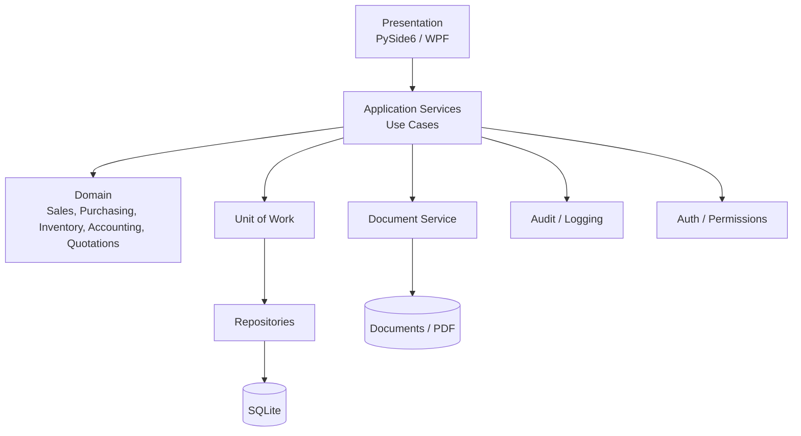
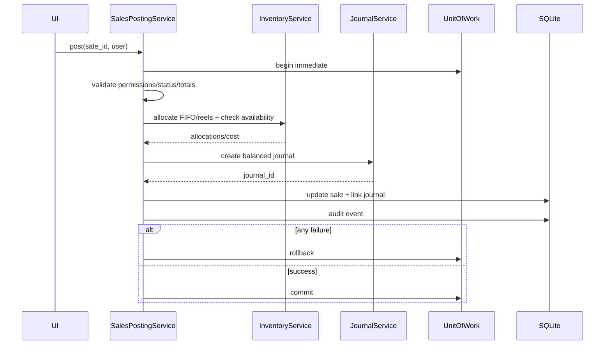

# معمارية التطبيق — Mizan V1

| البند | القيمة |
|---|---|
| الوثيقة | `06_ARCHITECTURE_PROPOSAL.md` |
| الإصدار | 0.2.0 — Batch 1 |
| الحالة | **PROPOSED / NEEDS APPROVAL** |
| التقنية | غير معتمدة (`ADR-0001`) |
| النمط | Modular Monolith — تطبيق سطح مكتب offline |

> هذه وثيقة معمارية، وليست كودًا. أي تقنية/مكتبة مذكورة هي مرشح، وليست قرارًا معتمدًا.

## 1. السياق والقيود

- Windows Desktop، جهاز واحد، متجر واحد، مخزن واحد في V1.
- عمل أساسي **دون اتصال**.
- واجهة عربية RTL، طباعة A4 فقط.
- EGP فقط.
- محاسبة قيد مزدوج ومخزون FIFO/بكرات.
- SQLite المحلية مرشحة؛ قد تُستبدل بتقنية محلية أخرى إذا اعتُمد ADR-0001/0002.
- المنتج لمتجر صغير، لكنه يحتاج سلامة بيانات أعلى من تطبيق «فواتير».
- فريق صغير/مطور واحد **افتراض تخطيطي غير مؤكد**؛ البساطة التشغيلية مهمة.

## 2. الأسلوب المعماري

**Modular Monolith** داخل عملية سطح مكتب واحدة:

- وحدة تنفيذ واحدة (Single Process).
- قاعدة بيانات محلية واحدة.
- حدود واضحة بين النطاقات (Bounded Contexts) عبر خدمات/عقود، لا ميكروسيرفسات.
- واجهة المستخدم لا تتعامل مع قاعدة البيانات مباشرة.
- كل عملية كتابة تمر عبر **Application Service** يملك حدود المعاملة.
- المستودعات (Repositories) للوصول للبيانات، دون قواعد عمل.
- المحاسبة والمخزون نواة مشتركة، وليست ملحقات لواجهة المبيعات.

## 3. الطبقات والمسؤوليات

| الطبقة | المسؤولية | لا تفعل |
|---|---|---|
| Presentation | الشاشات، RTL، المدخلات، عرض الأخطاء، الاختصارات | لا تحسب قيودًا/تكلفة/مخزونًا |
| Application | تنسيق Use Case، التحقق من الصلاحية، فتح المعاملة، استدعاء الخدمات | لا تحتوي SQL/رسم PDF |
| Domain | القواعد، الكيانات، Value Objects، سياسات التسعير/FIFO/الترحيل | لا تعرف قاعدة البيانات/الواجهة |
| Infrastructure | SQLite/Repositories/UnitOfWork، الملفات، PDF، الوقت، التشفير | لا تقرر قواعد العمل |
| Accounting | القيود، دليل الحسابات، التحقق من التوازن، قواعد الترحيل | لا تخصّص مخزونًا بنفسها |
| Inventory | الدفعات، البكرات، FIFO، التكلفة، حركات المخزون | لا تنشئ قيودًا بلا تنسيق مع Accounting |
| Documents | القوالب، PDF، الطباعة، اللقطات، metadata | لا تغيّر حالة المستند المالي |

## 4. حدود النطاقات

| النطاق | المسؤولية | يعتمد على |
|---|---|---|
| Identity & Access | المستخدمون، الأدوار، الصلاحيات، الجلسات | — |
| Master Data | المنتجات، الوحدات، العملاء، الموردون، المشاريع، القوائم | Identity |
| Purchasing | فواتير الشراء، المصروفات المباشرة، دفعات الموردين | Master Data, Inventory, Accounting |
| Inventory | الدفعات، البكرات، الحركات، FIFO، التسويات | Master Data, Accounting |
| Sales | عروض/فواتير البيع، التسعير، المرتجعات، التحصيل | Master Data, Inventory, Accounting |
| Quotations | دورة العرض، المراجعات، التحويل | Sales (Draft), Documents |
| Accounting | COA، القيود، الترحيل، الفترات، المطابقة | Master Data |
| Financial Accounts | النقدية/البنك/المحافظ، القبض/الدفع/التحويل | Accounting |
| Reporting | التقارير والكشوف | كل ما سبق (قراءة) |
| Documents | A4/PDF/الطباعة/اللقطات | Sales, Purchasing, Quotations |
| Backup & Audit | النسخ، الاستعادة، التدقيق | DB, Documents, Identity |

**قاعدة الاتجاه:** النطاقات الأعلى تعتمد على الأدنى في القراءة/الكتابة عبر العقود. لا تعتمد المحاسبة على واجهة المبيعات، ولا المخزون على PDF.

## 5. حدود المعاملات

### 5.1 القاعدة

- كل Command كتابي له **Unit of Work** واحد.
- `Application Service` يفتح المعاملة، يستدعي Domain/Repositories، ثم `commit` أو `rollback`.
- لا `commit` داخل Repository.
- الترحيل المالي/المخزني يستخدم `BEGIN IMMEDIATE` (أو ما يعادله) لتقليل تعارض الكتابة.
- القراءات تستخدم معاملة قراءة/اتساق مناسب، ولا تفتح كتابة.

### 5.2 الترحيل الذري

- لا يُحفظ `sale.status=POSTED` قبل نجاح القيد/المخزون.
- لا يُحفظ القيد قبل نجاح التخصيصات.
- أي فشل يعيد كل شيء.

### 5.3 Idempotency

- `journal_entries.idempotency_key` فريد.
- `sales/posted` يتحقق من الحالة + القيد.
- إعادة إرسال أمر الترحيل (نقر مزدوج/إعادة محاولة) لا تُنشئ قيدًا/حركة ثانية.

## 6. الوصول للبيانات

### 6.1 المستودعات

- واجهة لكل Aggregate/جذر: `SalesRepository`, `PurchaseRepository`, `LotRepository`, `ReelRepository`, `JournalRepository`, `QuotationRepository`.
- المستودع يعيد كيانات/ملخصات، ولا يفتح معاملات.
- استعلامات التقارير يمكن أن تكون Read Models/Views منفصلة.
- لا SQL في الواجهة.

### 6.2 Unit of Work

- يملك `session`/`transaction`.
- يوفر `commit`/`rollback`.
- يضمن استخدام اتصال واحد.
- يفرض `PRAGMA foreign_keys=ON` و`busy_timeout`.
- لا يسمح بمعاملات متداخلة غير محكومة.

### 6.3 قاعدة البيانات

- SQLite (مرشحة) مع WAL/foreign keys/إعدادات متانة (ADR-0002).
- لا `REAL` للمال/الكمية.
- قيود/FKs/فهارس جزء من التصميم، لا إضافة لاحقة.
- الهجرات (migrations) تُدار بأداة معتمدة؛ لا تعديل يدوي لمخطط الإنتاج.

## 7. تدفق الترحيل

| الخطوة | المسؤول | مخرجات |
|---:|---|---|
| 1 | Application | تحقق صلاحية/حالة/فترة |
| 2 | Domain | تحقق الإجماليات/الكميات/الأسعار |
| 3 | Inventory | فحص نهائي + تخصيص FIFO/بكرة |
| 4 | Accounting | إنشاء قيد متوازن |
| 5 | Application | ربط المستند بالقيد/الحركات |
| 6 | Audit | حدث تدقيق |
| 7 | UnitOfWork | commit/rollback |
| 8 | Documents | PDF/طباعة بعد commit حيث ينطبق |

**قاعدة غير قابلة للتفاوض:** لا خطوة 4 مؤجلة، ولا خطوة 4 منفصلة عن 3/5.

## 8. حدود المستندات والطباعة

- `DocumentService` يستقبل `DocumentRequest` (نوع، بيانات، قالب).
- `Renderer` (Qt معتمد في ADR-0004 Option B) يُنتج PDF/صفحات.
- `DocumentStore` يحفظ الملفات خارج DB، ويسجل `document_exports`.
- `TemplateRegistry` يحمل إصدار القالب.
- لا تُبنى قوالب الطباعة داخل شاشات المبيعات.
- PDF لمستند مرحّل يُنشأ بعد الترحيل؛ فشل PDF لا يلغي القيد، لكنه يمنع اعتبار المستند «مطبوعًا رسميًا» ويُعاد المحاولة.
- لعرض السعر: PDF الرسمي شرط للإصدار؛ يُستخدم staging/تعويض (القسم 9).

## 9. الاتساق بين الملفات وقاعدة البيانات

- ملف PDF لا يُخزَّن كـBLOB.
- الكتابة إلى ملف مؤقت، ثم نقل ذري (rename) إلى مسار نهائي.
- تسجيل `sha256`/`relative_path` في DB.
- عند بدء التشغيل: فحص سجلات `document_exports` مقابل الملفات؛ المفقود يُعلَّم ويُستعاد من نسخة احتياطية.
- لا يُعاد إنشاء مستند رسمي بصمت.
- الشعارات Content-addressed، ولا تُستبدل في المستندات التاريخية.

## 10. العمل دون اتصال

| الجانب | القرار المقترح |
|---|---|
| المصادقة | محلية؛ لا خادم |
| البيانات | SQLite/ملفات محلية |
| الوقت | ساعة الجهاز المحلي + UTC للتخزين |
| الترخيص | غير محدد (`OQ-SYS-001`) |
| المزامنة | غير موجودة في V1 |
| النسخ | محلي + خارج الجهاز (`ADR-0005`) |
| التحديث | لا تحديث تلقائي معتمد |
| الفشل الشبكي | لا يمنع البيع/الشراء/الترحيل |

- لا يُفترض اتصال دائم بأي خدمة سحابية.
- إذا أُضيف تكامل لاحقًا، يكون عبر Outbox/واجهة صريحة، لا داخل المعاملة الأساسية.

## 11. معالجة الأخطاء

- **Domain errors** (قابل للعرض): نقص مخزون، صلاحية، حالة مستند، خصم زائد، قيد غير متوازن.
- **Technical errors**: فشل DB/ملف/PDF؛ تُسجَّل، وتُعرض رسالة عربية عامة + رمز مرجعي.
- كل خطأ له `code`, `message_ar`, `details`, `correlation_id`.
- لا تُعرض تفاصيل SQL/Stack للمستخدم.
- لا يُستخدم `except: pass`/تجاهل صامت.
- عند فشل الترحيل: رسالة تحدد السبب والأصناف/الكميات عند النقص.

## 12. السجلات والتدقيق

| النوع | المكان | المحتوى |
|---|---|---|
| Application log | ملف محلي/مجلد logs | وقت، مستوى، رمز، correlation_id، لا بيانات حساسة |
| Audit events | جدول `audit_events` | من/ماذا/متى/قبل/بعد/سبب |
| Document exports | جدول `document_exports` | مسار/hash/إصدار |
| DB integrity | تقرير/فحص | نتائج الفحص |

- التدقيق ليس سجل أخطاء تقنيًا؛ هو سجل أعمال حساسة.
- لا يُعدَّل/يُحذف من واجهة عادية.
- الاحتفاظ/التشفير **PROPOSED/OPEN**.

## 13. التغليف والنشر

- تطبيق Windows قابل للتثبيت/الإزالة.
- يفضَّل `onedir` (لا `onefile` لـQt) لتشخيص/تحميل أسرع.
- توقيع الكود قبل التوزيع.
- مجلد بيانات المستخدم:
  - `%LOCALAPPDATA%\Mizan\` أو `%PROGRAMDATA%\Mizan\` — القرار النهائي لاحقًا.
  - قاعدة البيانات، المستندات، السجلات، النسخ.
- لا يتطلب صلاحيات مدير للاستخدام العادي إن أمكن.
- نسخة احتياطية قبل أي ترقية.
- خطة تحديث/ترخيص **OPEN**.

## 14. مرجع التقنيات (PROPOSED)

| الطبقة | المرجع A (Python) | المرجع B (.NET) |
|---|---|---|
| UI | PySide6/Qt 6 | WPF/.NET |
| DB | SQLite | SQLite |
| ORM/Data | SQLAlchemy 2 | EF Core/Dapper |
| Migrations | Alembic | EF Core Migrations |
| Validation | Pydantic v2 | DataAnnotations/FluentValidation |
| Tests | pytest | xUnit/NUnit |
| Packaging | PyInstaller onedir | MSIX/Installer |
| PDF/Print | Qt renderer (ADR-0004) | WPF FlowDocument/PDF library |

- **لا تقنية معتمدة.** ADR-0001 يجب أن يحسم المسار قبل التنفيذ.
- ADR-0002 (SQLite) مستقل نسبيًا عن اختيار UI.
- ADR-0003 (الدقة) يجب أن يظل صحيحًا في أي لغة.

## 15. التوسّع المستقبلي

- `warehouse_id`/`branch_id` موجودان كأبعاد اختيارية من البداية (V1 قيمة افتراضية واحدة)، دون تنفيذ multi-warehouse.
- IDs مستقرة، timestamps، و`idempotency_key` تساعد على المزامنة لاحقًا.
- لا يُنفَّذ Outbox/Sync/Cloud في V1.
- لا تُضاف تكاملات أو وحدات أعمال غير مطلوبة.
- إضافة مخزن/فرع لاحقًا يجب ألا تكسر قواعد FIFO/القيود.

## 16. المخاطر المعمارية

| الخطر | الأثر | التخفيف |
|---|---|---|
| اختيار تقنية غير مناسب | إعادة بناء | ADR-0001 + spike + اعتماد |
| ترحيل غير ذري | فاتورة بلا قيد/مخزون | UnitOfWork + اختبارات فشل |
| PDF/ملفات خارج المعاملة | حالة/ملف غير متسق | staging + فحص بدء التشغيل |
| SQLite قفل/تزامن | بطء/فشل كتابة | WAL/busy_timeout/معاملة قصيرة |
| تشتت قواعد العمل في الواجهة | تناقض | خدمات/نطاق مركزي |
| تكرار الأرصدة | انحراف | مصدر واحد + تقارير مطابقة |
| ازدواج الدفعة/البكرة | كمية/تكلفة مزدوجة | نموذج 04 + قيود/Triggers |
| طباعة عربية غير مستقرة | مستندات مرفوضة | ADR-0004 + اختبارات |
| فقدان النسخ | فقدان بيانات | ADR-0005 + اختبار استعادة |

## 17. معايير القبول المعمارية

| المعرّف | المعيار |
|---|---|
| AC-ARCH-001 | لا استدعاء SQL من الواجهة. |
| AC-ARCH-002 | كل Command كتابي له UnitOfWork ومعاملة. |
| AC-ARCH-003 | فشل القيد/المخزون يعيد كل الترحيل. |
| AC-ARCH-004 | لا تعديل/حذف لمستند مرحّل. |
| AC-ARCH-005 | PDF/الملفات لا تُخزَّن في DB. |
| AC-ARCH-006 | تشغيل بلا إنترنت. |
| AC-ARCH-007 | فحص اتساق الملفات عند البدء. |
| AC-ARCH-008 | لا مزامنة/سحابة/تعدد أجهزة في V1. |

## 18. ما لا تعتمده هذه الوثيقة

- لا تعتمد Python/PySide6 أو .NET/WPF.
- لا تعتمد SQLite نهائيًا.
- لا تعتمد بنية المجلدات/التغليف.
- لا تعتمد أي تنفيذ.

---

**مرتبط بـ:** [متطلبات المنصة](01_PRODUCT_REQUIREMENTS_V1.md) · [ADR-0001](adr/ADR-0001-DESKTOP-PLATFORM.md) · [ADR-0002](adr/ADR-0002-DATABASE-AND-DATA-INTEGRITY.md) · [نموذج البيانات](07_DATA_MODEL_PROPOSAL.md)
