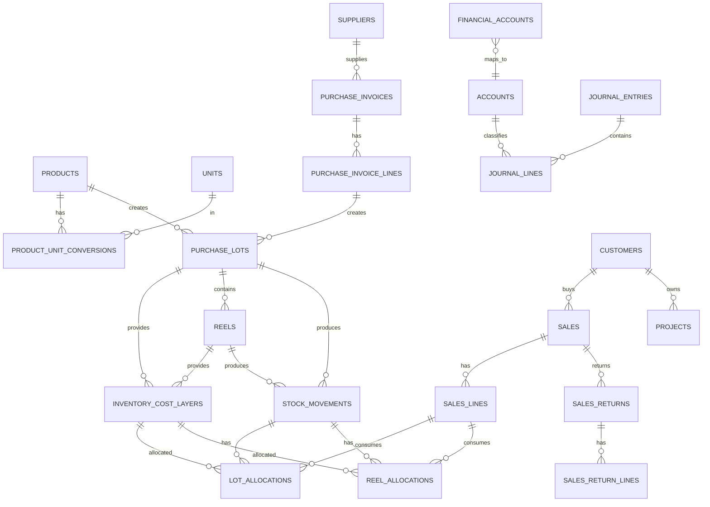
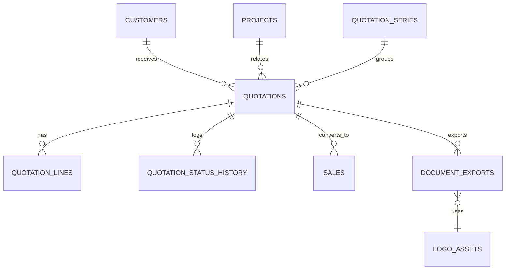

# نموذج البيانات المقترح — Mizan V1

| البند | القيمة |
|---|---|
| الوثيقة | `07_DATA_MODEL_PROPOSAL.md` |
| الإصدار | 0.2.0 — Batch 1 |
| الحالة | **PROPOSED / NEEDS APPROVAL** |
| قاعدة البيانات | SQLite — مرشحة، غير معتمدة |
| جاهزية التنفيذ | **ليست جاهزة** حتى حسم الأسئلة المفتوحة |

> هذا نموذج علائقي مقترح، وليس مخططًا نهائيًا أو كودًا. أسماء الجداول/الحقول قابلة للتغيير. لا تُنشأ قاعدة بيانات في Batch 1.

## 1. الاصطلاحات

- PK: `INTEGER PRIMARY KEY`.
- المبالغ: `INTEGER` بالقرش (`*_piastres`).
- الكميات: `INTEGER` بوحدة الأساس × 10^6 (`*_micros`).
- أسعار الوحدة: `INTEGER` micro-EGP (`*_price_micros`).
- التواريخ: `TEXT` ISO `YYYY-MM-DD`.
- الأوقات: `TEXT` UTC ISO-8601.
- النصوص العربية: `TEXT` مع تطبيع NFC.
- `status`/`type`: قيم ثابتة `CHECK`.
- لا `REAL`/`FLOAT` للمال/الكمية.
- كل الجداول لها `created_at`/`updated_at` حيث ينطبق.

## 2. مخطط ER — النواة المالية والمخزنية



## 3. مخطط ER — العروض والمستندات



## 4. الجداول الأساسية

### 4.1 الهوية والصلاحيات

| الجدول | الحقول المفتاحية | القيود/الفهارس |
|---|---|---|
| `users` | `id`, `username`, `display_name`, `password_hash`, `is_active`, `created_at`, `last_login_at` | `username` UNIQUE |
| `roles` | `id`, `code`, `name_ar` | `code` UNIQUE |
| `permissions` | `id`, `code`, `name_ar`, `category` | `code` UNIQUE |
| `role_permissions` | `role_id`, `permission_id` | PK مركب |
| `user_roles` | `user_id`, `role_id` | PK مركب |
| `audit_events` | `id`, `event_type`, `entity_type`, `entity_id`, `actor_user_id`, `occurred_at`, `before_json`, `after_json`, `reason`, `correlation_id` | فهرس `(entity_type, entity_id, occurred_at)` |
| `sequences` | `id`, `name`, `year`, `next_value`, `prefix` | UNIQUE `(name, year)` |

- `audit_events` append-only على مستوى الخدمة؛ منع التعديل/الحذف على مستوى DB **PROPOSED**.
- كلمات المرور لا تُخزَّن كنص؛ `password_hash` يشمل salt/params.

### 4.2 البيانات الأساسية

| الجدول | الحقول المفتاحية | القيود |
|---|---|---|
| `store_profile` | `id`, `name_ar`, `legal_name`, `address`, `phone`, `logo_asset_id` | صف واحد فعّال |
| `logo_assets` | `id`, `content_hash`, `relative_path`, `mime`, `width`, `height`, `created_at` | `content_hash` UNIQUE |

> **حالة 2026-11-17:** التنفيذ الحالي يستخدم `store_profile.logo_path` وينسخ الشعار إلى `assets/logos/<sha256>.<suffix>` في مجلد المستندات المُدار، ويسجّل `logo_asset` في لقطة العرض. جدول `logo_assets` لم يُنفَّذ بعد؛ التفاصيل أعلاه تبقى مقترحًا.| `warehouses` | `id`, `code`, `name_ar`, `is_default` | `code` UNIQUE |
| `units` | `id`, `code`, `name_ar`, `allows_fraction`, `is_active` | `code` UNIQUE |
| `products` | `id`, `sku`, `name_ar`, `description`, `base_unit_id`, `tracking_mode`, `default_sale_price_micros`, `low_stock_threshold_micros`, `is_active` | `sku` UNIQUE؛ `tracking_mode IN ('LOT','REEL')` |
| `product_barcodes` | `id`, `product_id`, `barcode` | `barcode` UNIQUE |
| `product_unit_conversions` | `id`, `product_id`, `unit_id`, `factor_num`, `factor_den`, `can_purchase`, `can_sell`, `is_default_purchase`, `is_default_sale` | UNIQUE `(product_id, unit_id)`؛ `factor_num>0`, `factor_den>0` |
| `customers` | `id`, `code`, `name_ar`, `customer_type`, `phone`, `address`, `tax_id`, `credit_limit_piastres`, `is_active` | `code` UNIQUE؛ `customer_type IN ('RETAIL','WHOLESALE','CONTRACTOR')` |
| `suppliers` | `id`, `code`, `name_ar`, `phone`, `address`, `tax_id`, `is_active` | `code` UNIQUE |
| `projects` | `id`, `customer_id`, `code`, `name_ar`, `status`, `start_date` | UNIQUE `(customer_id, code)`؛ العميل يجب أن يكون مقاولًا |
| `price_lists` | `id`, `code`, `name_ar`, `list_type`, `is_active` | `code` UNIQUE |
| `price_list_items` | `id`, `price_list_id`, `product_id`, `unit_id`, `price_micros` | UNIQUE `(price_list_id, product_id, unit_id)` |
| `customer_prices` | `id`, `customer_id`, `product_id`, `unit_id`, `price_micros` | UNIQUE `(customer_id, product_id, unit_id)` |
| `product_default_prices` | `id`, `product_id`, `unit_id`, `price_micros` | UNIQUE `(product_id, unit_id)` |

- `credit_limit_piastres` اختياري؛ تطبيق الحد **OPEN** (`OQ-SAL-002`).
- `customer_discount_rules` **غير منشأة/غير مفعّلة** حتى `OQ-PRC-001`.

### 4.3 الشراء والمخزون

#### `purchase_invoices`

`id`, `document_no` UNIQUE, `supplier_id`, `supplier_invoice_no`, `invoice_date`, `due_date`, `payment_type` (`CASH`,`CREDIT`), `financial_account_id` NULL, `status` (`DRAFT`,`POSTED`,`CANCELLED`), `subtotal_piastres`, `discount_piastres`, `total_piastres`, `posted_at`, `journal_entry_id` NULL UNIQUE, `created_by`, `created_at`.

#### `purchase_invoice_lines`

`id`, `purchase_invoice_id`, `line_no`, `product_id`, `unit_id`, `quantity_micros`, `base_qty_micros`, `unit_price_micros`, `supplier_line_total_piastres`, `discount_piastres`, `net_piastres`, `tracking_mode`, `lot_id` NULL (بعد الترحيل).

- UNIQUE `(purchase_invoice_id, line_no)`.
- `tracking_mode` يطابق المنتج.

#### `purchase_expenses`

`id`, `document_no` UNIQUE, `purchase_invoice_id` NULL, `supplier_id` NULL, `payee_type` (`SUPPLIER`,`THIRD_PARTY`,`CASH`), `expense_type`, `amount_piastres`, `payment_type`, `financial_account_id` NULL, `status`, `journal_entry_id` NULL UNIQUE, `allocation_method`, `posted_at`.

#### `purchase_expense_allocations`

`id`, `expense_id`, `purchase_invoice_line_id`, `amount_piastres`.

- مجموع التوزيعات = مبلغ المصروف.
- التوزيع على البكرات يتم عبر حقول البكرة (`supplier_cost`, `allocated_expense`, `original_cost`) عند إنشاء البكرات.

#### `purchase_lots`

`id`, `lot_no` UNIQUE, `purchase_invoice_line_id` NULL, `source_type` (`PURCHASE`,`OPENING`,`RETURN`,`ADJUSTMENT`), `product_id`, `warehouse_id`, `supplier_id` NULL, `tracking_mode`, `received_at`, `original_qty_micros`, `original_supplier_cost_piastres`, `original_landed_cost_piastres`, `status` (`OPEN`,`EXHAUSTED`,`RETURNED_TO_SUPPLIER`), `created_at`.

- للـ`REEL`: `original_qty_micros` = مجموع أطوال البكرات؛ `original_landed_cost` = مجموع تكاليفها.
- للـ`LOT`: لا بكرات.
- لدفعة `RETURN` (بكرة مرتجعة): `original_supplier_cost = 0`، و`original_landed_cost` = تكلفة المرتجع الفعلية، وتُسند البكرة بالكامل إلى `allocated_expense`؛ لا تُفسَّر كسعر مورد. كل مرتجع بكرة يُنشئ بكرة/طبقة جديدة، وتُربط البكرة الجديدة بالأصل عبر `source_reel_id` و`source_issue_allocation_id`؛ لا تُضاف الكمية إلى البكرة الأصلية (`OQ-INV-012`).
- `status` (`OPEN`/`EXHAUSTED`/`RETURNED_TO_SUPPLIER`) وصف مشتق/مُتحقَّق؛ `EXHAUSTED` ليس نهائيًا إذا سمحت سياسة مرتجع/تسوية معتمدة بإنشاء طبقة متاحة (`OQ-INV-005`/`OQ-INV-012`).

#### `inventory_cost_layers` — LCP

`id`, `lot_id`, `reel_id` NULL, `layer_type` (`BASE`,`CUSTOMER_RETURN`,`ADJUSTMENT_IN` — الأخير PROPOSED), `parent_issue_allocation_id` NULL, `original_qty_micros`, `original_cost_piastres`, `position_micros`, `remaining_qty_micros`, `remaining_cost_piastres`, `fifo_anchor_at`, `fifo_suborder`, `status` (`OPEN`,`EXHAUSTED`,`DAMAGED`), `created_at`.

- `original_qty_micros > 0`، `original_cost_piastres >= 0` (CHECK).
- `remaining_qty = original_qty − position` (CHECK/Trigger).
- `remaining_cost = original_cost − T_L(position)`، حيث `T_L(x)=ROUND_HALF_UP(original_cost×x/original_qty)`.
- `T_L` غير تنازلية؛ `outflow_cost = T_L(pos+q)−T_L(pos) >= 0`.
- `remaining_cost >= 0`, `position >= 0`, `position <= original_qty`.
- `parent_issue_allocation_id` إلزامي لـ`CUSTOMER_RETURN`، وNULL لـ`BASE`/`ADJUSTMENT_IN`.
- `reel_id` إلزامي لمنتج `REEL`، وNULL لمنتج `LOT`.
- لا صف `LOT` بدون `lot_id`؛ لا صف `REEL` بدون `reel_id`.
- `fifo_anchor_at`/`fifo_suborder`: ترتيب FIFO (`OQ-INV-013` للطبقات المرتجعة).
- `status` وصف مشتق/مُتحقَّق من `position` والحركات، وليس علمًا نهائيًا يمنع إنشاء طبقة مرتجع/تسوية معتمدة.

#### `lot_inventory_balances` / `reel_inventory_balances` — Views/Read Models

ليست جداول سلطة؛ تُشتق من الطبقات والتخصيصات:

`original_qty`, `original_cost`, `gross_sale_issue_qty`, `gross_sale_issue_cost`, `sellable_return_qty`, `sellable_return_cost`, `net_sold_qty`, `net_sold_cost`, `damaged_qty`, `damaged_cost`, `supplier_returned_qty`, `supplier_returned_cost`, `adjustment_in_qty/cost`, `adjustment_out_qty/cost`, `remaining_qty`, `remaining_cost`, `conservation_diff_qty`, `conservation_diff_cost`.

- `net_sold_* = gross_sale_issue_* − sellable_return_*`.
- `sellable_return_*` = مجموع طبقات `CUSTOMER_RETURN` فقط؛ `ADJUSTMENT_IN` لا يُحتسب مرتجعًا.
- `remaining_*` = مجموع الطبقات المتبقية، وليس `original − net_issued`.
- `conservation_diff_*` يجب أن يساوي 0.
- `lot_balances` القديم **يُستبدل** بهذا العرض/النموذج.
- `damaged_*` و`supplier_returned_*` **مشتقة** من تخصيصات `DAMAGE`/`PURCHASE_RETURN`، لا حقول مستقلة قابلة للتعديل. إذا استُخدمت Projections للأداء، يجب أن تكون قابلة لإعادة البناء ومطابقة.

#### `reels`

`id`, `reel_no` UNIQUE, `lot_id`, `product_id`, `original_length_micros`, `supplier_cost_piastres`, `allocated_expense_piastres`, `original_cost_piastres`, `status`, `received_at`, `version`, `source_reel_id` NULL, `source_issue_allocation_id` NULL.

- الطول/التكلفة **الأصليان فقط** هنا؛ `remaining_length/cost` مشتقان من `inventory_cost_layers`.
- `reels` هي سجل الهوية الفيزيائية والأصل التاريخي، وليست رصيدًا متاحًا ثانيًا.
- `lot.product_id = product_id` (Trigger/Service).
- الحالة `SEALED/OPENED/EMPTY/RETURNED/DAMAGED` مشتقة/مُتحقَّقة (PROPOSED `OQ-INV-005`)، ولا تُعامل `EMPTY` كحالة نهائية إذا سمحت تسوية معتمدة بإنشاء طبقة متاحة على البكرة نفسها. مرتجع العميل يُنشئ بكرة/طبقة جديدة ولا يعيد فتح الأصلية (`OQ-INV-012`).

#### `stock_movements`

`id`, `movement_no` UNIQUE, `movement_type` (`RECEIPT`,`SALE_ISSUE`,`SALE_RETURN_IN`,`PURCHASE_RETURN`,`DAMAGE`,`ADJUSTMENT`), `product_id`, `warehouse_id`, `lot_id` NULL, `reel_id` NULL, `quantity_micros`, `cost_piastres`, `direction` (`IN`,`OUT`), `source_type`, `source_id`, `source_line_id`, `occurred_at`, `posted_at`, `created_by`.

- `stock_movements` رأس حدث؛ `lot_allocations`/`reel_allocations` هي تفاصيل الربط بالطبقات.
- مجموع كميات/تكاليف التخصيصات يجب أن يساوي إجمالي الحركة **لكل نوع** (يُتحقق في الخدمة/Trigger).
- `RECEIPT` ينشئ طبقة BASE عبر تخصيص `RECEIPT` مرتبط بـ`created_layer_id`، بكمية/تكلفة الطبقة المنشأة؛ بذلك تبقى القاعدة عامة بلا استثناء خفي.
- المرتجع التالف: `SALE_RETURN_IN` (إنشاء طبقة) + `DAMAGE` (استهلاكها) في نفس المعاملة. لا تبقى كمية قابلة للبيع، لكن الكمية/التكلفة تظهران في `sellable_return` و`damaged` معًا.
- `DAMAGE` مخصص لتلف مخزون/طبقة قائمة، ويشمل تلف المرتجع بعد إنشاء طبقته.

- CHECK: `quantity_micros > 0`, `cost_piastres >= 0`.
- للـ`LOT`: `lot_id` مطلوب، `reel_id` NULL.
- للـ`REEL`: `lot_id` و`reel_id` مطلوبان.
- فهارس `(product_id, occurred_at)`، `(lot_id)`، `(reel_id)`.

#### `lot_allocations`

`id`, `stock_movement_id`, `cost_layer_id`, `lot_id`, `sales_line_id` NULL, `sales_return_line_id` NULL, `purchase_return_line_id` NULL, `allocation_role` (`RECEIPT`,`SALE_ISSUE`,`SALE_RETURN`,`DAMAGE`,`PURCHASE_RETURN`,`ADJUSTMENT_IN`,`ADJUSTMENT_OUT`), `quantity_micros`, `cost_piastres`, `direction` (`IN`,`OUT`), `layer_position_start_micros`, `layer_position_end_micros`, `source_issue_allocation_id` NULL, `created_layer_id` NULL, `created_at`.

- UNIQUE `(stock_movement_id, cost_layer_id, allocation_role)`؛ يمكن أن تمتد الحركة على أكثر من طبقة، بما فيها عدة طبقات لنفس الدفعة.
- CHECK: `quantity > 0`, `cost >= 0`.
- للـ`RECEIPT`/`SALE_RETURN`/`ADJUSTMENT_IN` (إنشاء طبقة): `position_start/end` **NULL**، `quantity = created_layer.original_qty`، `created_layer_id` مطلوب.
- للـ`SALE_ISSUE`/`DAMAGE`/`PURCHASE_RETURN`/`ADJUSTMENT_OUT`: `position_start/end` مطلوبان، `position_start < position_end`، والفرق = `quantity`.
- `SALE_RETURN`: `source_issue_allocation_id` مطلوب، `cost_layer_id` = الطبقة الجديدة.
- `ADJUSTMENT_IN`: ينشئ طبقة (`created_layer_id`)؛ سياسته/أساس تكلفته **OPEN** (`OQ-INV-007`).
- لا تُستخدم مع منتج `REEL`.
- لا تُحدَّث حقول `returned_qty/returned_cost` على تخصيص البيع الأصلي؛ تُشتق من تخصيصات/طبقات المرتجع المرتبطة به (view/projection قابلة لإعادة البناء).

#### `reel_allocations`

`id`, `stock_movement_id`, `cost_layer_id`, `reel_id`, `sales_line_id` NULL, `sales_return_line_id` NULL, `purchase_return_line_id` NULL, `allocation_role` (`RECEIPT`,`SALE_ISSUE`,`SALE_RETURN`,`DAMAGE`,`PURCHASE_RETURN`,`ADJUSTMENT_IN`,`ADJUSTMENT_OUT`), `quantity_micros`, `cost_piastres`, `direction`, `layer_position_start_micros`, `layer_position_end_micros`, `source_issue_allocation_id` NULL, `created_layer_id` NULL, `created_at`.

- UNIQUE `(stock_movement_id, cost_layer_id, allocation_role)`.
- لا تُستخدم مع منتج `LOT`.
- نفس قواعد `lot_allocations` بالطول.

#### `purchase_returns` / `purchase_return_lines`

`purchase_returns`: `id`, `document_no` UNIQUE, `purchase_invoice_id`, `supplier_id`, `return_date`, `status`, `total_piastres`, `journal_entry_id` UNIQUE, `reason`, `posted_at`.
`purchase_return_lines`: `id`, `purchase_return_id`, `purchase_invoice_line_id`, `lot_id`, `reel_id` NULL, `quantity_micros`, `cost_piastres`.

#### `purchase_landed_cost_adjustments` — PROPOSED

`id`, `document_no`, `purchase_invoice_id`, `expense_id` NULL, `amount_piastres`, `status`, `journal_entry_id`, `allocation_method`, `posted_at`.

`purchase_landed_cost_adjustment_lines`: `id`, `adjustment_id`, `lot_id`, `reel_id` NULL, `remaining_share_piastres`, `sold_share_piastres`, `reason`.

- لا تُنفَّذ قبل `OQ-INV-011`.

### 4.4 البيع والمرتجعات

#### `sales`

`id`, `document_no` UNIQUE, `customer_id`, `project_id` NULL, `price_list_id`, `sale_type`, `payment_type` (`CASH`,`CREDIT`,`MIXED`), `status` (`DRAFT`,`POSTED`,`CANCELLED`), `source_quotation_id` NULL, `invoice_date`, `due_date`, `subtotal_piastres`, `item_discount_piastres`, `invoice_discount_piastres`, `total_piastres`, `paid_piastres`, `balance_piastres`, `posted_at`, `journal_entry_id` NULL UNIQUE, `created_by`, `created_at`.

- **Partial unique index:**

```sql
CREATE UNIQUE INDEX ux_sales_source_quotation_active
ON sales(source_quotation_id)
WHERE source_quotation_id IS NOT NULL
  AND status <> 'CANCELLED';
```

- `source_quotation_id` FK → `quotations.id`؛ لا `converted_sale_id` على العرض.
- `status` القيم الدقيقة **PROPOSED** (`OQ-SAL-001`).

#### `sales_lines`

`id`, `sales_id`, `line_no`, `product_id`, `unit_id`, `quantity_micros`, `base_qty_micros`, `unit_price_micros`, `gross_piastres`, `item_discount_piastres`, `invoice_discount_alloc_piastres`, `net_piastres`, `cost_piastres`, `price_source`, `price_adjustment_reason`, `conversion_num`, `conversion_den`, `tracking_mode` (`LOT`,`REEL`), `quotation_line_id` NULL, `project_id` NULL.

- UNIQUE `(sales_id, line_no)`.
- `tracking_mode` يحدد مصدر التخصيص.
- `cost_piastres` يُملأ عند الترحيل، لا عند المسودة.

#### `sales_returns`

`id`, `document_no` UNIQUE, `sales_id`, `customer_id`, `return_date`, `status`, `settlement_method` (`REDUCE_RECEIVABLE`,`CUSTOMER_CREDIT`,`CASH_REFUND`,`BANK_REFUND`,`MIXED`), `commercial_total_piastres`, `inventory_cost_piastres`, `journal_entry_id` UNIQUE, `reason`, `posted_at`.

#### `sales_return_lines`

`id`, `sales_return_id`, `line_no`, `sales_line_id`, `quantity_micros`, `commercial_value_piastres`, `cost_piastres`, `condition` (`SELLABLE`,`DAMAGED`), `lot_id` NULL, `reel_id` NULL.

- UNIQUE `(sales_return_id, line_no)`؛ يسمح بتقسيم نفس بند البيع إلى سطر قابل للبيع وآخر تالف.
- مجموع الكميات ≤ المتبقي القابل للإرجاع.
- **تدفق التالف المعتمد:** `SALE_RETURN_IN` ينشئ طبقة مرتجع ثم `DAMAGE` يستهلكها في نفس المعاملة؛ لا تبقى كمية قابلة للبيع، وتظل الكمية/التكلفة قابلتين للتتبع. تُقيَّد تكلفة التالف كخسارة مباشرة: مدين `5020` / دائن `5010`؛ لا `1210` ولا إعدام (`OQ-INV-004` محسوم 2026-11-17).
- لا يُعتمد «قيد تكلفة فقط بلا حركة كمية» بديلًا؛ لم يُثبت اكتمال الكمية/التالف/حفظ التكلفة/تسوية الحركات.

#### `sales_return_settlements` — PROPOSED

`id`, `sales_return_id`, `method` (`AR_CREDIT`,`CASH_REFUND`,`BANK_REFUND`,`CUSTOMER_CREDIT`), `amount_piastres`, `financial_account_id` NULL, `reference`, `approved_by`.

- يدعم الدفع الجزئي/المختلط. `OQ-SAL-007`.

#### `customer_receipts` / `customer_receipt_allocations`

`customer_receipts`: `id`, `document_no` UNIQUE, `customer_id`, `financial_account_id`, `amount_piastres`, `receipt_date`, `status`, `journal_entry_id` UNIQUE, `notes`.
`customer_receipt_allocations`: `id`, `receipt_id`, `sales_id`, `amount_piastres`.

- مجموع التخصيصات ≤ مبلغ القبض.
- الفائض → `customer_credits`.

#### `customer_credits` / `customer_credit_applications`

`customer_credits`: `id`, `customer_id`, `source_type` (`SALES_RETURN`,`OVERPAYMENT`,`MANUAL_APPROVED`), `source_id`, `amount_piastres`, `remaining_piastres`, `status`.
`customer_credit_applications`: `id`, `credit_id`, `sales_id`, `amount_piastres`.

- لا رصيد سالب للعميل؛ الفائض التزام 2020.
- `OQ-SAL-007`/`OQ-FIN-005`.

#### `supplier_payments` / `supplier_payment_allocations`

`supplier_payments`: `id`, `document_no` UNIQUE, `supplier_id` NULL, `payee_type`, `financial_account_id`, `amount_piastres`, `payment_date`, `status`, `journal_entry_id` UNIQUE, `notes`.
`supplier_payment_allocations`: `id`, `payment_id`, `purchase_invoice_id`, `amount_piastres`.

### 4.5 العروض

> **حالة 2026-11-17:** جداول `quotation_series`/`quotations`/`quotation_lines`/`quotation_status_history` ونموذج `document_exports`/`document_snapshots` نُفِّذت في الترحيل 7 كجزء من المرحلة 7 الجزئية (النواة غير المعتمدة على المُصيّر). تبقى التفاصيل أدناه مرجعًا تصميميًا؛ محرك A4/PDF لم يُعتمد (ADR-0004).

#### `quotation_series`

`id`, `base_no` UNIQUE, `created_at`.

#### `quotations`

`id`, `document_no` UNIQUE, `series_id`, `root_quotation_id` NULL, `version_no`, `customer_id`, `project_id` NULL, `price_list_id`, `status`, `issue_date`, `valid_until`, `subtotal_piastres`, `item_discount_piastres`, `invoice_discount_piastres`, `total_piastres`, `notes`, `terms`, `official_export_id` NULL, `cancellation_reason` NULL, `created_by`, `created_at`, `issued_at`, `converted_at`.

- UNIQUE `(series_id, version_no)`.
- `root_quotation_id` FK self؛ يشير للنسخة الأولى بعد إنشائها.
- `status` CHECK القيم المخزّنة.
- `EXPIRED` غير مخزّنة.
- `official_export_id` FK `document_exports` (أو UNIQUE partial).

#### `quotation_lines`

`id`, `quotation_id`, `line_no`, `product_id`, `unit_id`, `quantity_micros`, `base_qty_micros`, `original_unit_price_micros`, `final_unit_price_micros`, `price_source`, `price_adjustment_reason`, `conversion_num`, `conversion_den`, `item_discount_piastres`, `invoice_discount_alloc_piastres`, `net_piastres`, `description_snapshot`, `product_code_snapshot`, `product_name_snapshot`, `unit_name_snapshot`, `project_id` NULL.

- UNIQUE `(quotation_id, line_no)`.
- لا كميات/أسعار سالبة.

#### `quotation_status_history`

`id`, `quotation_id`, `from_status` NULL, `to_status`, `reason`, `actor_user_id`, `occurred_at`, `metadata_json`.

- `metadata_json` يمكن أن يحمل `status_before_conversion`/`expired_override`/`pdf_hash`.

### 4.6 المحاسبة

#### `accounts`

`id`, `code` UNIQUE, `name_ar`, `account_type` (`ASSET`,`LIABILITY`,`EQUITY`,`REVENUE`,`EXPENSE`), `parent_id` NULL, `is_control`, `is_postable`, `is_active`, `normal_balance` (`DEBIT`,`CREDIT`).

#### `account_mappings`

`id`, `mapping_key` UNIQUE, `account_id`.

#### `journal_entries`

`id`, `entry_no` UNIQUE, `entry_date`, `source_type`, `source_id`, `entry_kind` (`POSTING`,`REVERSAL`,`ADJUSTMENT`), `description`, `status` (`POSTED`,`REVERSED`), `posted_at`, `posted_by`, `reversal_of_id` NULL, `reversed_by_id` NULL, `idempotency_key` UNIQUE, `created_at`.

- UNIQUE `(source_type, source_id, entry_kind)` لضمان قيد واحد لكل مستند/نوع (مع `entry_kind` POSTING/REVERSAL/ADJUSTMENT).
- لا تعديل/حذف بعد `POSTED` (Trigger/Service).

#### `journal_lines`

`id`, `journal_entry_id`, `line_no`, `account_id`, `debit_piastres`, `credit_piastres`, `party_type` NULL, `party_id` NULL, `project_id` NULL, `description`, `source_line_id` NULL.

- CHECK: `debit >= 0`, `credit >= 0`, `(debit > 0) <> (credit > 0)`.
- UNIQUE `(journal_entry_id, line_no)`.
- فهرس `(account_id, journal_entry_id)`، `(party_type, party_id)`.

#### `financial_accounts`

`id`, `code` UNIQUE, `name_ar`, `account_type` (`CASH`,`BANK`,`WALLET`,`OTHER`), `gl_account_id`, `is_active`, `opening_date`.

#### `expense_categories` / `expenses`

`expenses`: `id`, `document_no` UNIQUE, `category_id`, `financial_account_id`, `amount_piastres`, `expense_date`, `status`, `journal_entry_id` UNIQUE, `description`, `payee`.

#### `transfers`

`id`, `document_no` UNIQUE, `from_account_id`, `to_account_id`, `amount_piastres`, `transfer_date`, `status`, `journal_entry_id` UNIQUE, `notes`.

- `from != to`، مبلغ > 0.

#### `financial_reconciliations` — PROPOSED

`id`, `account_id`, `statement_date`, `opening_balance_piastres`, `closing_balance_piastres`, `status`, `created_by`, `approved_by`.
`reconciliation_lines`: `id`, `reconciliation_id`, `journal_line_id`, `cleared`, `note`.

### 4.7 المستندات والتدقيق

#### `document_exports`

`id`, `document_type` (`QUOTATION`,`SALES_INVOICE`,`PURCHASE_DOC`,`STATEMENT`,`REPORT`), `document_id`, `export_type` (`PDF`,`PRINT`), `relative_path`, `sha256`, `file_size`, `template_version`, `renderer_version`, `generated_by`, `generated_at`, `is_official`.

- Partial unique:

```sql
CREATE UNIQUE INDEX ux_document_exports_official
ON document_exports(document_type, document_id)
WHERE is_official = 1;
```

> **حالة 2026-11-17:** الجدول والقيد الجزئي منفذان في الترحيل 7. للعروض الرسمية، يُسجَّل التصدير في نفس معاملة `ISSUED`/اللقطة، ويشير `relative_path` إلى ملف PDF مُدار فعليًا في `DocumentStore`؛ إعادة الطباعة تتحقق من وجود الملف/الـhash. خط Noto Naskh Arabic المعتمد مضمّن في الحزمة/الـPDF (T-DOC-005 مغطى)؛ Golden (T-DOC-007) مغطى بمرجعية حتمية؛ اختبار الطابعة (T-DOC-009) ما زال خارج النطاق المكتمل.

#### `document_snapshots`

`id`, `document_type`, `document_id`, `snapshot_json`, `created_at`.

- snapshot يحتوي كل البيانات المطلوبة تاريخيًا.
- لا تُعدَّل اللقطة بعد الإصدار.
- `UNIQUE(document_type, document_id)` في التنفيذ الحالي (الترحيل 7)، مع trigger يمنع التعديل/الحذف.
- الـPDF الرسمي والطباعة يُبنيان من هذه اللقطة/نفس مسار التخطيط (لا من بيانات حيّة).

## 5. الفهارس المهمة

| الجدول | الفهرس | السبب |
|---|---|---|
| `sales` | `(customer_id, invoice_date)`, `(status)`, `(project_id)` | كشوف/تقارير |
| `sales` | unique partial `(source_quotation_id)` | منع تحويل مكرر |
| `sales_lines` | `(product_id)`, `(sales_id)` | تقارير/تخصيص |
| `purchase_invoices` | `(supplier_id, invoice_date)`, `(status)` | كشوف |
| `purchase_lots` | `(product_id, received_at, status)` | FIFO |
| `inventory_cost_layers` | `(lot_id, status, fifo_anchor_at, fifo_suborder)` | توافر/FIFO |
| `reels` | `(product_id, status)`, `(lot_id)` | بكرة |
| `stock_movements` | `(product_id, occurred_at)`, `(lot_id)`, `(reel_id)` | تتبع |
| `lot_allocations` | `(sales_line_id)`, `(lot_id)`, unique `(stock_movement_id, cost_layer_id, allocation_role)` | تخصيص؛ يسمح بعدة طبقات لنفس الدفعة |
| `reel_allocations` | `(sales_line_id)`, `(reel_id)`, unique `(stock_movement_id, cost_layer_id, allocation_role)` | تخصيص؛ يسمح بعدة طبقات لنفس البكرة |
| `journal_entries` | `(entry_date, status)`, `(source_type, source_id)` | تقارير |
| `journal_lines` | `(account_id, journal_entry_id)`, `(party_type, party_id)` | ميزان/كشوف |
| `quotations` | `(series_id, version_no)` UNIQUE, `(customer_id, status)` | عروض |
| `quotation_lines` | `(quotation_id)`, `(product_id)` | عروض |
| `document_exports` | unique partial official | PDF |
| `audit_events` | `(entity_type, entity_id, occurred_at)`, `(actor_user_id, occurred_at)` | تدقيق |

## 6. القيود والحمايات

### 6.1 قيود قاعدة البيانات

| المعرّف | القيد | المستوى |
|---|---|---|
| DB-C-001 | `products.tracking_mode IN ('LOT','REEL')` | CHECK |
| DB-C-002 | `product_unit_conversions.factor_den > 0` | CHECK |
| DB-C-003 | طبقة تكلفة واحدة على الأقل لكل LOT/REEL عند وجود رصيد | Trigger/Service |
| DB-C-004 | `reels.lot_id` إلزامي | FK NOT NULL |
| DB-C-005 | `layer.original_qty > 0`، `layer.original_cost >= 0`، `layer.position <= layer.original_qty`، و`remaining_* >= 0` | CHECK/Trigger |
| DB-C-006 | `journal_lines` أحد الطرفين فقط > 0 | CHECK |
| DB-C-007 | `sales` partial unique للعرض | Partial UNIQUE |
| DB-C-008 | `quotations (series_id, version_no)` | UNIQUE |
| DB-C-009 | `document_exports` official واحد | Partial UNIQUE |
| DB-C-010 | `stock_movements.quantity > 0` | CHECK |
| DB-C-011 | `lot/reel allocations` كمية/تكلفة >= 0 | CHECK |
| DB-C-012 | منع تعديل/حذف المستندات/القيود المرحّلة | Triggers (PROPOSED) |
| DB-C-013 | منع `lot_allocations` لمنتج REEL و`reel_allocations` لمنتج LOT | Triggers |
| DB-C-014 | منع اجتماع lot/reel لنفس `sales_line_id` | Triggers/Service |
| DB-C-015 | `allocation.position_end − position_start = quantity` للأدوار المستهلكة؛ NULL لأدوار إنشاء الطبقة (`RECEIPT`/`SALE_RETURN`/`ADJUSTMENT_IN`) | CHECK/Trigger |
| DB-C-016 | `allocation_role` من المجموعة المحددة، ولا `DAMAGE` بلا طبقة | CHECK |
| DB-C-017 | مجموع تخصيصات الحركة = كمية/تكلفة الحركة | Trigger/Service |
| DB-C-018 | `SALE_RETURN` له `source_issue_allocation_id` و`created_layer_id` | CHECK/Trigger |
| DB-C-019 | `CUSTOMER_RETURN` طبقة لها `parent_issue_allocation_id` | CHECK/Trigger |

> SQLite لا تدعم FK متعددة الأشكال (polymorphic) بسهولة؛ لذلك `source_type/source_id` في الحركات/التدقيق تُحقق في الخدمة، مع فهارس واختبارات. أي FK حقيقي يُضاف حيث أمكن.

### 6.2 الثوابت (Invariants)

| المعرّف | الثابت |
|---|---|
| INV-01 | كل كمية/قيمة مخزون لها مصدر واحد: طبقة LOT أو طبقة بكرة. |
| INV-02 | `Σ reels.original_length = lot.original_qty` لمنتج REEL. |
| INV-03 | `Σ reels.original_cost = lot.original_landed_cost`. |
| INV-03a | `Σ reels.supplier_cost = lot.original_supplier_cost` و`Σ reels.allocated_expense = lot.original_landed_cost − lot.original_supplier_cost`. |
| INV-04 | `Σ layers.remaining_qty = reel/lot remaining` (مشتق). |
| INV-05 | `layer.position = original_qty − remaining_qty`، `layer.position <= original_qty`. |
| INV-06 | `C0 = remaining_cost + net_cogs_cost + damage_cost + supplier_return_cost + adjustments_out_cost − adjustments_in_cost`. |
| INV-07 | `Q0 = remaining_qty + net_sold_qty + damaged_qty + supplier_returned_qty + adjustments_out_qty − adjustments_in_qty`. |
| INV-08 | مجموع المدين = الدائن في كل قيد. |
| INV-09 | كل قيد مرتبط بمستند مصدر. |
| INV-10 | كل فاتورة/مرتجع/دفعة مرحّلة مرتبطة بقيد. |
| INV-11 | لا تعديل/حذف بعد الترحيل. |
| INV-12 | `sales.source_quotation_id` لا يتكرر لفاتورة غير ملغاة. |
| INV-13 | `quotation.root_quotation_id`/`series_id`/`version_no` متسقة. |
| INV-14 | `document_exports` الرسمي واحد لكل مستند. |
| INV-15 | `AR/AP` control = مجموع subledger. |
| INV-16 | كل `SALE_RETURN` ينشئ طبقة؛ `returned_qty/cost` على التخصيص الأصلي **مشتقة/Projection** من تخصيصات المرتجع، وليست حقولًا تُحدَّث على صف مرحّل. |
| INV-17 | كل `DAMAGE`/`PURCHASE_RETURN` يستهلك طبقة ولا يغيّر COGS تاريخية. |
| INV-18 | `outflow_cost = T_layer(pos+q) − T_layer(pos) >= 0`. |
| INV-19 | مجموع تخصيصات الحركة = كمية/تكلفة الحركة. |

## 7. العلاقة بين الدفعة والبكرة — القرار

**النموذج المقترح:**

- `purchase_lots` و`reels` تحملان **الأصل التاريخي** (Q0/C0 أو L0/C0) وهوية البكرة الفيزيائية.
- `inventory_cost_layers` هي **مصدر الكمية/القيمة المتاحة** لكل LOT/REEL في LCP المقترح.
  - `BASE` للاستلام.
  - `CUSTOMER_RETURN` للمرتجع القابل للبيع.
  - `ADJUSTMENT_IN` للتسوية بالزيادة (PROPOSED؛ التكلفة OPEN `OQ-INV-007`).
- `stock_movements`/`lot_allocations`/`reel_allocations` سجل الأدلة والأحداث، وليست رصيدًا ثانيًا.
- `lot_inventory_balances`/`reel_inventory_balances` عروض مشتقة، وليست جداول سلطة.
- كل بكرة مرتبطة بـ`lot` واحد، وكل طبقة مرتبطة بدفعة/بكرة.
- كل تخصيص بيع/مرتجع/تالف/مرتجع مورد يشير إلى طبقة واحدة على الأقل، ولا يشير إلى lot/reel مباشرة للتكلفة.
- المرتجع ينشئ طبقة جديدة؛ لا يعيد الكمية إلى موضع الطبقة الأصلية.
- التالف/مرتجع المورد يستهلكان الطبقات المتاحة.

**لماذا؟** يمنع أن يظهر الطول مرة كرصيد دفعة ومرة كرصيد بكرة، ويمنع سالبية تكلفة الإصدار بعد مرتجعات تعسفية. البكرة/الدفعة هي الأصل التاريخي، والطبقات هي المتاح الحالي.

## 8. التسلسلات والأرقام

- `sequences` لكل نوع/سنة: `SALES_INVOICE`, `PURCHASE_INVOICE`, `SALES_RETURN`, `PURCHASE_RETURN`, `QUOTATION_SERIES`, `JOURNAL_ENTRY`, `RECEIPT`, `PAYMENT`, `EXPENSE`, `TRANSFER`.
- التوليد داخل معاملة الترحيل/الإنشاء.
- شكل الأرقام محسوم 2026-11-17 (`OQ-DOC-001`): `{TYPE}-{YYYY}-{NNNNNN}` لكل نوع/سنة، والفجوات فقط عند فشل معاملة.
- لا يُعاد استخدام رقم.

## 9. جاهزية التنفيذ

**جاهزية جزئية.** نُفِّذت الترحيلات 1–7 للنواة الحالية (بما فيها جداول العروض والمستندات)، لكن المخطط الكامل يبقى مرجعًا، وبعض القرارات ما زالت مفتوحة.

| السؤال | الأثر |
|---|---|
| `OQ-ACC-001` | حقول/حسابات الضريبة |
| `OQ-ACC-002` | الفترات/السنة المالية |
| `OQ-ACC-003` | طريقة التخصيص/التقريب |
| `OQ-INV-001` | توزيع المصروفات |
| `OQ-INV-003` | اختيار تخصيص المرتجع |
| `OQ-INV-004` | التالف |
| `OQ-INV-005` | حالات البكرة |
| `OQ-INV-011` | المصروفات اللاحقة |
| `OQ-INV-012` | هوية البكرة المرتجعة |
| `OQ-INV-013` | ترتيب طبقات المرتجع FIFO |
| `OQ-SAL-001` | حالات البيع |
| `OQ-SAL-007` | تسوية المرتجع |
| `OQ-PRC-001/002` | الأسعار/الخصومات |
| `OQ-SEC-001` | الصلاحيات |
| `OQ-DOC-001` | الترقيم — **محسوم 2026-11-17** |
| `OQ-QUO-001/005` | حالات/استعادة العرض — **محسوم 2026-11-17** |
| `OQ-DOC-002` | الشعار/الخط — **محسوم 2026-11-17: V1 بلا شعار، والخط Noto Naskh Arabic معتمد** |

- لا تُنشأ migrations قبل اعتماد المخطط والحقول الحرجة. (الترحيلات 1–7 منفذة للنواة الحالية بالفعل.)
- أي جدول/حقل جديد يجب أن يمر بمراجعة تناسق مع 03/04/05/08.

## 10. ما لا تعتمده هذه الوثيقة

- لا تعتمد المخطط أو أسماء الجداول.
- لا تعتمد SQLite نهائيًا.
- لا تعتمد Triggers/Partial indexes كنهج نهائي قبل اختبارها.
- لا تدّعي إنشاء قاعدة بيانات أو تنفيذ أي جدول.

---

**مرتبط بـ:** [التصميم المحاسبي](03_ACCOUNTING_DESIGN.md) · [المخزون](04_INVENTORY_FIFO_AND_REELS.md) · [العروض](05_QUOTATIONS_AND_A4_DOCUMENTS.md) · [ADR-0002](adr/ADR-0002-DATABASE-AND-DATA-INTEGRITY.md)
