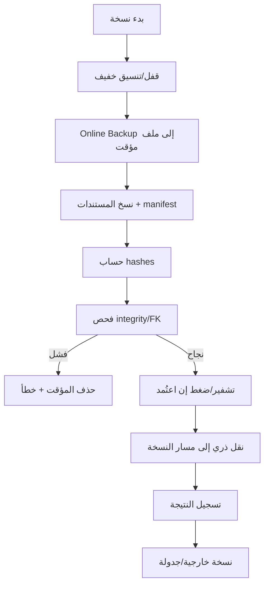

# ADR-0005 — العمل دون اتصال واستراتيجية النسخ الاحتياطي

| البند | القيمة |
|---|---|
| المعرّف | `ADR-0005` |
| العنوان | offline، النسخ الاحتياطي، الاستعادة، والاستمرارية |
| الحالة | **PROPOSED / NEEDS APPROVAL** |
| التاريخ | نوفمبر 2026 |
| يؤثر على | التشغيل، النسخ، الاستعادة، التغليف، الدعم |
| لا يغطيه | مزوّد مزامنة محدد (غير معتمد) |

> لا مزوّد سحابي/مزامنة معتمد. لا يُفترض Google Drive أو أي خدمة. V1 يعمل محليًا، والنسخة الخارجية قرار مالك.

## 1. السياق

- متجر واحد/جهاز واحد.
- الوظائف الأساسية يجب أن تعمل بلا إنترنت.
- البيانات محلية (SQLite مرشحة).
- فقدان الجهاز/الملف يعني فقدان العمل.
- المستخدم قد لا يكون تقنيًا؛ النسخ يجب أن يكون بسيطًا/مؤتمتًا.
- لا multi-device sync في V1.
- النسخ يجب أن يشمل قاعدة البيانات والمستندات.
- لا يكفي نسخ ملف قاعدة حيّة كافتراضي.

## 2. الخيارات

### A — محلي فقط + نسخ يدوي

**المزايا:** أبسط، لا اعتماد خارجي.
**العيوب:** نسيان النسخ، فقدان الجهاز = فقدان كل شيء. غير كافٍ.

### B — محلي + نسخ مجدول محلي

**المزايا:** تقليل النسيان، استعادة سريعة.
**العيوب:** نفس القرص/الجهاز قد يُفقد/يتلف/يُصاب برansomware.

### C — محلي + مجدول + نسخة خارج الجهاز (موصى به)

**المزايا:** حماية من فشل القرص/الجهاز، استعادة.
**العيوب:** يحتاج وجهة (قرص خارجي/مشاركة/سحابة) وسياسة ومسؤولية.

### D — مزامنة سحابية/متعددة الأجهزة

**المزايا:** وصول/نسخ تلقائي.
**العيوب:** خارج V1، مزوّد غير معتمد، تعارضات/أمان/تكلفة. لا يُنفَّذ.

### E — النسخ إلى مجلد شبكة/NAS

**المزايا:** خارج الجهاز محليًا.
**العيوب:** يحتاج شبكة/تكوين؛ يجب أن يكون متاحًا وقت النسخ؛ لا يُفترض.

## 3. التوصية

**الخيار C:** قاعدة بيانات محلية + نسخ احتياطي مشفّر/متحقَّق، محليًا وخارج الجهاز، مع استعادة مختبرة. **المزوّد/التكرار/الاحتفاظ النهائي OPEN.**

### 3.1 النموذج المقترح

| المكوّن | الاقتراح | الحالة |
|---|---|---|
| قاعدة البيانات | SQLite/WAL (ADR-0002) | PROPOSED |
| طريقة النسخ | Online Backup API/آلية متسقة | PROPOSED |
| المستندات | نسخ مجلد PDF/الشعارات + manifest | CONFIRMED (تضمين) |
| التحقق | `integrity_check`/`foreign_key_check` + hash | PROPOSED |
| التشفير | نسخة مشفرة، مفتاح منفصل | PROPOSED |
| النسخة المحلية | يومية/عند الإغلاق | PROPOSED |
| النسخة الخارجية | يدوية/مجدولة إلى قرص/مشاركة/سحابة | OPEN |
| الاحتفاظ | 30 يومية / 12 شهرية / قبل التحديث | PROPOSED |
| RPO | يومي | PROPOSED (`OQ-BKP-003`) |
| RTO | أقل من ساعة | PROPOSED (`OQ-BKP-003`) |
| واجهة النسخ | خلفية/تقدم/خطأ واضح | PROPOSED |
| الاستعادة | اختبار دوري + توثيق | CONFIRMED (المبدأ) |

### 3.2 لماذا لا نسخ ملف حيّ؟

نسخ ملف SQLite أثناء الكتابة قد ينتج نسخة غير متسقة/تالفة. يُستخدم Online Backup API أو آلية تنسخ صفحات متسقة. إذا استُخدم نسخ ملف، يجب إغلاق التطبيق/ضمان عدم الكتابة، وهذا ليس الافتراضي.

### 3.3 التشفير والمفتاح

- تشفير النسخة (AES-GCM/ChaCha20-Poly1305 أو ما يعتمده المالك) **PROPOSED**.
- المفتاح **لا** يُخزَّن بجانب النسخة.
- خطة حفظ/استرجاع المفتاح موثقة (`OQ-BKP-002`).
- فقدان المفتاح = فقدان النسخة؛ يجب اختبار ذلك.
- لا تُشفَّر النسخة بكلمة مرور ضعيفة/مشتركة.

### 3.4 الاحتفاظ

- 30 نسخة يومية.
- 12 نسخة شهرية.
- نسخة قبل أي ترقية كبرى/تغيير مخطط.
- لا تُحذف نسخة قديمة قبل التحقق من الجديدة.
- المدة النهائية OPEN (`OQ-BKP-003`).

## 4. دورة النسخ

- لا تُجمَّد الواجهة أثناء النسخ.
- إذا فشلت النسخة، تُسجَّل وتحتفظ بالنسخة السابقة.
- لا يُحذف الأصل.

## 5. الاستعادة

1. اختيار نسخة + التحقق من manifest/hash.
2. فك التشفير (إن وجد).
3. فحص DB.
4. استعادة إلى مجلد مؤقت.
5. فحص التكامل + فتح.
6. اختبار دخان (فاتورة/تقرير/PDF).
7. استبدال/فتح النسخة.
8. توثيق العملية.

- لا تُستعاد نسخة تالفة.
- لا تُستعاد فوق قاعدة مفتوحة/قيد الاستخدام.
- إذا كانت النسخة أحدث من إصدار التطبيق، قد يلزم ترقية.
- الاستعادة تحتاج صلاحية `restore_database`.

## 6. خارج الجهاز

| الخيار | ملاحظات |
|---|---|
| قرص خارجي | بسيط، يحتاج توصيل/فصل |
| مشاركة شبكة/NAS | يحتاج شبكة/صلاحية |
| مجلد سحابي متزامن | لا يُفترض مزوّد؛ خطر تعارض/تشفير |
| خدمة نسخ احتياطي | مزوّد/تكلفة/امتثال OPEN |

- لا يُعتمد أي مزوّد. `OQ-BKP-001`.
- لا تُستخدم مزامنة ثنائية الاتجاه على قاعدة SQLite حيّة (خطر تلف).
- النسخة الخارجية نسخة **ملفات**، لا مزامنة قاعدة حيّة.

## 7. المزامنة المستقبلية

- غير موجودة في V1.
- لا multi-device/فروع/سحابة.
- أي مزامنة لاحقة تحتاج ADR جديد، تضارب/حل، سجل تغييرات/Outbox، هوية جهاز، وأمان.
- لا يُدخل Outbox/Cloud الآن.

## 8. Consequences

### إيجابيات

- عمل مستقل عن الإنترنت.
- استعادة ممكنة عند فشل الجهاز.
- لا تعقيد خادم.
- تحكم محلي بالبيانات.

### تكاليف/قيود

- النسخ/الاستعادة مسؤولية المالك/التطبيق.
- التشفير/المفتاح يحتاج إدارة.
- النسخة الخارجية تحتاج وسيطًا/توصيلًا.
- RPO/RTO يعتمد على التكرار.
- لا حماية كاملة من ransomware إذا كانت النسخة متصلة دائمًا.

## 9. ما يجب التحقق منه قبل التنفيذ

| # | التحقق | معيار النجاح |
|---:|---|---|
| 1 | نسخة أثناء التشغيل | متسقة، تفتح بعد الاستعادة |
| 2 | مستندات | كل الملفات + hash |
| 3 | استعادة | DB + مستندات + تقرير |
| 4 | تشفير | لا فتح دون مفتاح |
| 5 | تلف | كشف/رفض |
| 6 | احتفاظ | لا حذف قبل نجاح جديد |
| 7 | واجهة | لا تجميد |
| 8 | خارج الجهاز | نسخة قابلة للاستخدام |
| 9 | RPO/RTO | ضمن السياسة المعتمدة |
| 10 | اختبار دوري | موثق |

## 10. القرار

**الحالة: NEEDS APPROVAL.** التوصية: local SQLite + encrypted, verified backups local/off-device + tested restore. المزوّد/التكرار/الاحتفاظ/المفتاح تحتاج قرار المالك. لا تُنفَّذ مزامنة سحابية في V1.

---

**مرتبط بـ:** [ADR-0002](ADR-0002-DATABASE-AND-DATA-INTEGRITY.md) · [المعمارية](../06_ARCHITECTURE_PROPOSAL.md) · [الاختبارات](../09_TEST_AND_ACCEPTANCE_STRATEGY.md) · [الأسئلة المفتوحة](../10_OPEN_QUESTIONS.md)
